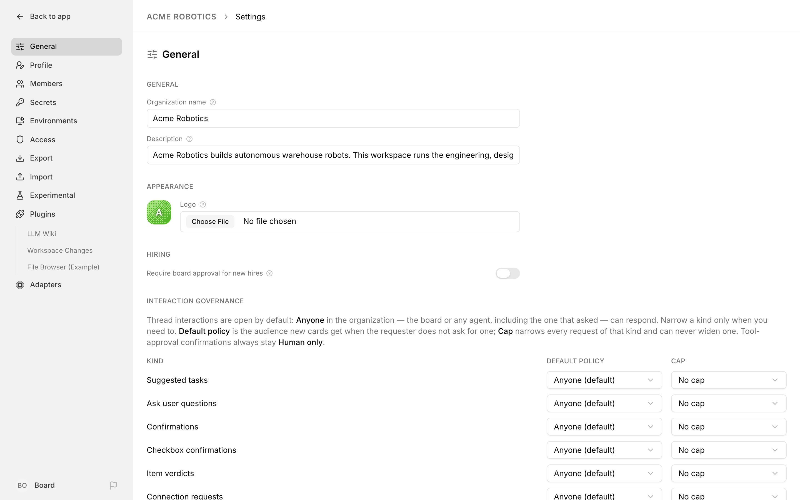
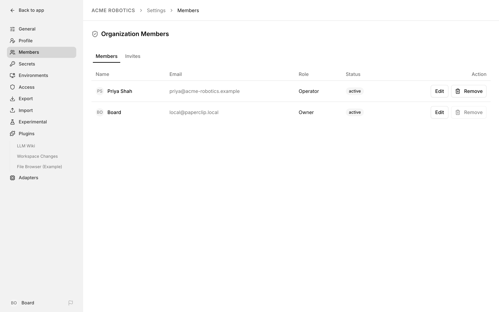
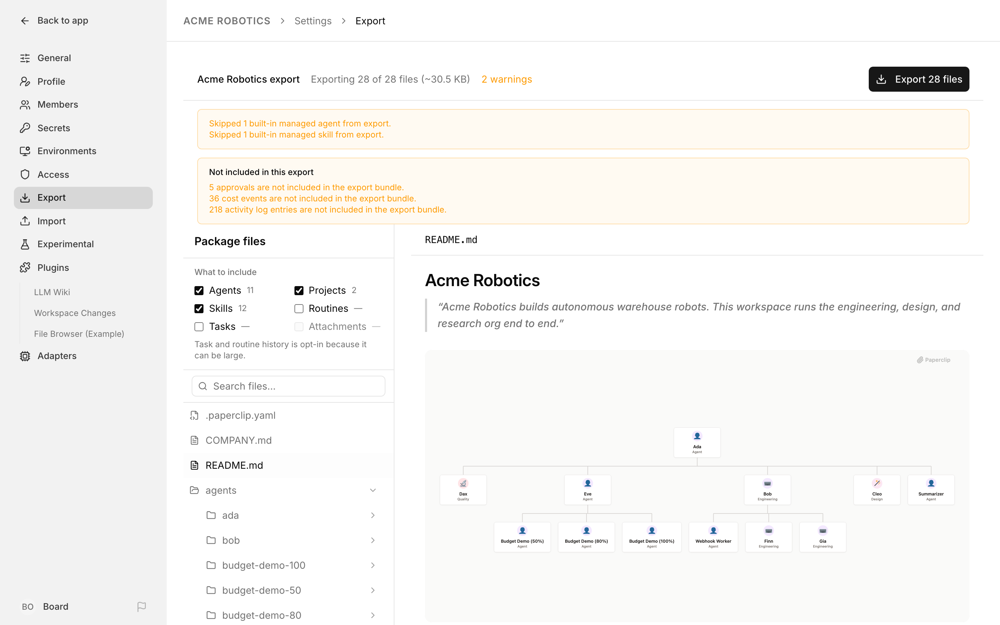
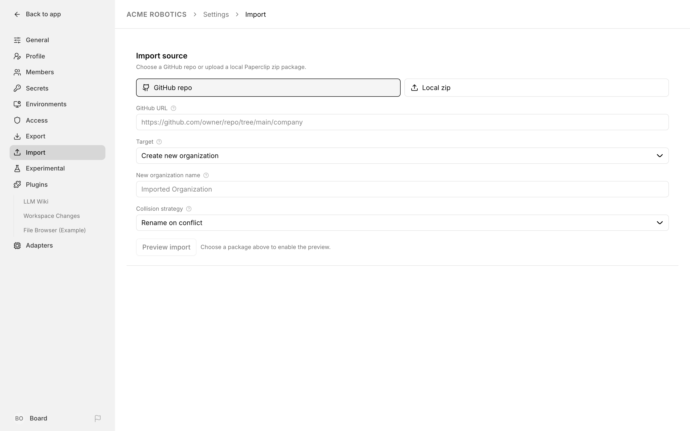

# Company Administration

Every Paperclip company has a small cluster of surfaces that control its identity, its membership, and its portability. These pages are where you, as a board user (or a member with the right grants), set the company's name and logo, decide who else can sign in, hand out invite links, review join requests, and move the whole company in and out of a portable package. The CEO agent never touches most of this — it is deliberately human territory.

This guide walks through each of those surfaces in the order you typically meet them: **General Settings**, **Connections**, **Members** (whose **Invites** tab now lives alongside the member list), **Join Requests**, **Export**, and **Import**. If you are looking for how hiring approvals themselves work, see the [Approvals guide](../guides/day-to-day/approvals.md). If you want to understand the reporting tree that sits underneath the membership model, see [Org Structure](../guides/org/org-structure.md).

---

## General Settings

The **General** page groups the settings that apply to the whole organization rather than to any one agent or project. Open **Settings**, and **General** is the first item in the settings sidebar — it's where you land.

Company and instance settings now share one navigation, so this is also where the instance-wide general controls appear. Below the organization sections you'll find the deployment and auth readiness summary, log censoring, backup retention, AI feedback sharing, and a **Sign out** button (unless an operator has hidden it) — see [Settings](./settings.md#instance-general) for what each one does. Keyboard shortcuts are no longer a setting at all — they're [always on](./settings.md#keyboard-shortcuts) for every signed-in user. The sections below cover the organization-specific settings.

### Name and description

The **General** section has two fields:

- **Organization name** — the display name shown in the organization switcher and across the UI.
- **Description** — an optional one-line description shown on the organization profile. Leave it empty if you do not want one.

Changes are not persisted until you click **Save changes**. The save button only appears when one of the fields is dirty, and it is disabled if the name is empty.

### Logo

The **Appearance** section controls the small square tile that represents your organization in the sidebar and switcher:

- **Logo** — upload a PNG, JPEG, WEBP, GIF, or SVG file. After upload, a **Remove logo** button appears next to the file input so you can clear it again. If an upload fails, the error message is shown inline.

When no logo is set, Paperclip draws an auto-generated pattern icon whose hue is derived from the organization name — there is no separate brand-color setting to pick. A live preview of the tile is rendered to the left of the field so you can see the result before saving.

### Hiring

The **Hiring** section contains one switch:

- **Require board approval for new hires** — when on, every agent the CEO or a manager tries to hire stays pending until a board member approves it from the approvals queue. When off, hires go through immediately. This ties directly into the flow described in the [Approvals guide](../guides/day-to-day/approvals.md).

The toggle saves immediately; there is no separate save button for this setting.

### Interaction governance

The **Interaction governance** section sets, for each kind of interaction card (suggested tasks, questions, confirmations, and so on), who may respond by default and the strictest audience allowed. Each kind has a **Default policy** and a **Cap**. See [Setting company-wide interaction governance](../guides/day-to-day/issues.md#setting-company-wide-interaction-governance) for how the two work together.

### Decision model

Unless an instance admin has turned on **Experimental fast responses**, the **Decision model** section also sits on **General**, below **Interaction governance**. It's where you choose the shared OpenAI or OpenRouter API connection Paperclip uses for optional small-model decisions. When fast responses are on, the section moves to the **Connections** page instead. See [Costs and Budgets → Decisions](../guides/day-to-day/costs.md#decisions) for setup, testing, and where the usage shows up.

### Feedback sharing, Export, and Import

There's no organization-level feedback toggle on this page anymore. Whether thumbs-up / thumbs-down votes can send AI output to Paperclip Labs is now the instance-wide **AI feedback sharing** setting, further down the same page — see [Settings](./settings.md#ai-feedback-sharing).

The old **Company Packages** shortcuts are gone too. **Export** and **Import** are now their own items in the settings sidebar, and they open the pages covered in the last two sections of this guide.

### Danger Zone

At the bottom of the page is a **Danger Zone** with an **Archive organization** button. Archiving hides the organization from the sidebar and persists the change in the database. A confirmation dialog appears before the archive takes effect, and the UI automatically switches you to the next non-archived organization if one is available.

Archiving also quiets the company so it stops doing work in the background: every active agent is paused (with the pause reason `company_archived`), and any queued or in-flight wake-up requests are cancelled. Archiving is not destructive — unlike deletion, your agents, projects, and issues are all preserved — but the company will not wake its agents again until you bring it back.

---

## Connections

The **Connections** page only appears in the settings navigation when an instance admin has turned on **Experimental fast responses**. It holds two sections:

- **Decision model** — the shared connection Paperclip uses for optional small-model decisions. See [Costs and Budgets → Decisions](../guides/day-to-day/costs.md#decisions).
- **Fast responses** — the connection that posts short acknowledgements. See [Costs and Budgets → Fast responses](../guides/day-to-day/costs.md#fast-responses).

---

## Members

The **Members** page is where you manage human memberships: who belongs to the organization, what role they hold, and which permissions they have on top of that role. Open it from **Settings → Members**, or directly from the sidebar. The page carries two tabs — **Members** (covered here) and **Invites** (covered in the next section) — which used to be separate pages and now sit side by side.

### Roles

Paperclip uses four human membership roles. The role determines a set of implicit permission grants:

- **Owner** — full company access. Includes creating agents and skills, managing execution environments, inviting humans and agents, managing members and grants, assigning tasks, approving join requests, and managing the tool and MCP setup — connections, runtime slots, gateways, and test calls.
- **Admin** — an operator with invite and approval powers. Can create agents and skills, manage execution environments, invite users, assign tasks, approve join requests, and manage the tool and MCP setup (connections, runtime, gateways, and test calls) just like an Owner. The one thing an Admin cannot do that an Owner can is manage other members' permissions.
- **Operator** — a hands-on member who helps run work. Can edit the company's work — create agents and skills, manage execution environments, invite people, assign tasks, write pipelines, use and manage tool connections, and view the agent-action audit feed — but cannot approve join requests or manage member permissions.
- **Viewer** — read-only access. No built-in grants.

The role drop-down in the edit dialog also accepts **Unset**, which leaves the member without any implicit grants.

For the exact list of what each role grants by default, and what every permission key controls, see [Roles & Permissions](./roles-and-permissions.md).

> **Note:** Paperclip's agent chain of command (CEO, managers, reports) is separate from these human roles. Human roles gate access to the Paperclip UI and company-level actions; agent roles describe the reporting tree inside the company. See [Org Structure](../guides/org/org-structure.md) for the agent side.

### The members list

The members section shows one row per human member with:

- **User account** — display name and email (or principal id if neither is set).
- **Role** — the human membership role, or "Unset".
- **Status** — `active`, `pending`, or `suspended`, rendered as a coloured badge.
- **Grants** — a comma-separated summary of any explicit permission grants attached to the member. Shows "No explicit grants" when the member only relies on implicit role grants.
- **Action** — an **Edit** button that opens the member editor.

If you do not have permission to manage members, Paperclip replaces the page body with a message explaining why. An instance admin who is viewing the page without an active company membership sees a banner noting that the current account has admin-level access but is not a member of this company.

### Editing a member

Clicking **Edit** opens a dialog with three controls:

1. **Company role** — the same role list as above, plus "Unset".
2. **Membership status** — `Active`, `Pending`, or `Suspended`.
3. **Grants** — a two-column grid of explicit permission grants. A read-only panel above the grid lists the grants the selected role provides implicitly. Checking a box here stores the grant explicitly on the member, so it persists even if the role later changes.

The keys you will reach for most often are `agents:create`, `skills:create`, `environments:manage`, `users:invite`, `users:manage_permissions`, `tasks:assign`, `tasks:assign_scope`, `tasks:manage_active_checkouts`, `pipelines:write`, `audit:view_agent_actions`, and `joins:approve`. Each box is labelled with a human name and its underlying key for reference. Two of these — `tasks:assign_scope` and `tasks:manage_active_checkouts` — are never part of a role's implicit grants, so the only way a member gets them is by checking the box here. `pipelines:write` and `audit:view_agent_actions` come with the Operator role only, so check them here to give them to anyone else. For the complete list of keys, what each one gates, and which roles include it by default, see [Roles & Permissions](./roles-and-permissions.md).

Click **Save access** to persist the changes, or **Cancel** to close the dialog without saving.

### Adding and removing members

The Members page does not have an "Add member" button. New humans enter the organization through the invite flow described in the next section, which makes them a member as soon as they accept. To remove a human, set their **Status** to `suspended` through the Edit dialog; the row stays visible so the audit trail is preserved.

### Pending human joins

If you hold the `joins:approve` grant and there are pending human join requests, a **Pending human joins** card appears above the members list. Each entry shows the requester's name, email, and the invite context, with **Approve human** and **Reject human** buttons. This card duplicates the subset of the join request queue that applies to humans — full coverage (including agent joins) lives on the queue page.

---

## Invites

The **Invites** tab of the Members page creates invite links for new humans. Each link is single-use — the first successful use consumes the link. A person who accepts gets the selected role as soon as they sign in; only agent invites still create a join request that someone has to approve.

### Creating an invite

The **Invite a person** card has one required choice, under **Choose a role**: which role the invite should grant. The options are the four roles described above — **Viewer**, **Operator** (the default), **Admin**, and **Owner** — each rendered with a short description and a one-line summary of what the role gets.

Clicking **Create invite** does three things:

1. Generates a new invite link against the current Paperclip domain.
2. Copies the URL to your clipboard if the browser allows it.
3. Shows the invite in a **Latest invite link** panel below the form.

If the clipboard is unavailable, Paperclip shows a warning toast. Use the **Copy link** button next to the URL, or copy it manually from the field.

### Invite expiry and state

Invite links have four possible states, shown as a badge in the history table: **Active**, **Accepted**, **Expired**, and **Revoked**. Only `Active` invites can be consumed — the link becomes `Accepted` on first use and can be `Revoked` manually from the same page.

### Invite history

Below the creator is a paginated **Invite history** table with one row per invite:

- **State** — the badge above.
- **For** — who the invite is for: the role it grants for a human invite, or **Agent** for an agent invite.
- **Invited by** — the name and email of the human who created the invite.
- **Created** — the creation timestamp.
- **Join request** — a **Review request** link to the join request queue if the invite has produced one.
- **Action** — a **Revoke** button for invites still in the `Active` state.

The table shows five invites at a time and includes a **View more** button when there are more pages. An **Open join request queue** link in the header jumps to the full queue.

### What the invited person sees

When a human opens the invite URL, they land on a Paperclip join page. Once they sign in and accept, they join the organization right away with the role the invite carries (for example **Operator**) — no separate approval step. Agent invites work differently: they create a join request, and the agent doesn't join until someone with `joins:approve` approves it.

---

## Join Requests

The **Join Request Queue** consolidates every join request — human and agent — that has come in against the organization. Open it from `/inbox/requests`, or from the **Open join request queue** link in the **Invite history** on the Invites tab. Because human invites now grant access as soon as they're accepted, most of what lands here is agent requests.

### Filters

Two drop-downs sit above the list:

- **Status** — `Pending approval` (the default), `Approved`, or `Rejected`.
- **Request type** — `All`, `Human`, or `Agent`.

Changing either filter refreshes the list. "Approved" and "Rejected" are useful when you want to audit past decisions.

### What's on each card

Each request card shows:

- A **status** badge (`pending approval`, `approved`, or `rejected`), a **request type** badge (`human` or `agent`), and, for agent requests, an **adapter type** badge.
- The requester's name and a secondary identifier — email for humans, capabilities or source IP for agents.
- An **Invite context** panel with the invite's `allowedJoinTypes` and default role, plus the invite message if one was attached.
- A **Request details** panel with the submission timestamp, source IP, and agent capabilities (when applicable).

For requests in `pending approval`, the card also shows **Approve** and **Reject** buttons. Once acted on, the card stays in the list under the new status filter for audit purposes but no longer exposes action buttons.

### Permissions

The queue requires the `joins:approve` grant. Accounts without it see a "You do not have permission to review join requests for this organization." message instead of the list.

---

## Export

The **Export** page turns the current organization — its agents, projects, tasks, skills, and settings — into a portable markdown package you can download as a zip. It's a full page, not a dialog: open it from **Export** in the settings sidebar, or from the **Export organization** button above the Org Chart.

### What gets included

When the page loads, Paperclip builds a preview of everything that would be exported. The preview is rendered as a left-hand **Package files** tree, with a selected-file preview on the right.

At the top of the tree, **What to include** has a checkbox per category: **Agents**, **Projects**, **Skills**, **Routines**, **Tasks**, and **Attachments**. Agents, projects, and skills start checked. Tasks, routines, and attachments start unchecked — task and routine history is opt-in because it can be large — so tick them if you want that history in the package. **Attachments** travel with tasks and routines, so it stays greyed out until one of those is checked.

The bar at the top of the page shows:

- The organization name and a running count of the files you're exporting, with the estimated zip size.
- An amber warnings count (for example, `2 warnings`) when the preview flagged anything you should look at before downloading.
- A **Not included in this export** notice listing anything that never goes into a package (approvals, cost events, and activity log entries, for example).
- A single **Export N files** button that downloads the zip.

### Selecting what to export

Every entry in the file tree has a checkbox. Unchecking a file or a directory removes it from the download. A couple of details worth knowing:

- The tree is searchable with the input above it. Search expands matching directories automatically and restores the previous expansion state when you clear the query.
- `README.md` and `.paperclip.yaml` are regenerated on the fly so they always reflect the current selection.
- The `tasks/` directory is paginated — ten entries visible by default, with a **Show more tasks** button. Checked and search-matched tasks are always pinned above the fold.
- Clicking a file opens its content in the preview pane. The URL updates as you navigate so you can deep-link to a specific file in the export.

### Downloading

Click **Export N files** to build the final package. Paperclip assembles the zip with the filtered files (including the regenerated README and `.paperclip.yaml`) and triggers a browser download. A success toast confirms the file count and the zip's root path.

For a deeper description of what lives in each file, see [Export & Import](../guides/power/export-import.md).

---

## Import

The **Import** page is the reverse direction: it takes an exported package and loads it into Paperclip, either as a new organization or on top of an existing one. Open it from **Import** in the settings sidebar, or from the **Import organization** button above the Org Chart.

### Choosing a source

The **Import source** section supports two source types:

- **GitHub repo** — paste a tree or blob URL pointing at a folder that contains a `COMPANY.md`.
- **Local zip** — upload a `.zip` package exported from Paperclip. Paperclip warns against re-zipping archives in Finder or Explorer; use the download from the Export page.

### Choosing a target

The **Target** drop-down has two options:

- **Create new organization** — the default. An optional **New organization name** field lets you override the name from the package.
- **Existing company: *name*** — apply the package on top of the currently selected organization.

### Collision strategy

The **Collision strategy** drop-down controls what happens when an incoming item clashes with something that already exists in the target company:

- **Rename on conflict** — the default. Paperclip proposes a new name (prefixed with the package name, for example `gstack-CEO`) for each conflicting entity.
- **Skip on conflict** — existing items are kept and the incoming copy is dropped.
- **Replace existing** — overwrites the current entity with the incoming version.

### Preview

Click **Preview import** to run the preview without applying anything. The preview populates three things:

1. A **Renames** list showing every agent and project that collided and what it will be renamed to. Each row has a free-form input for the target name, a **skip** button, and a **confirm rename** button that locks the chosen name in.
2. An **Adapters** list for every agent in the package, with a drop-down of available adapters. New agents default to the same adapter as the target company's CEO. A **configure adapter** button expands an inline config form so you can set per-agent values (environment, working directory, etc.) before the import runs.
3. A file tree identical in layout to the export tree, but with an **action badge** on each row (`create`, `update`, `skip`, or `replace`) so you can see what Paperclip plans to do to every file. Directories that will be renamed show an arrow and the target name.

The sticky bar at the top counts selected files and surfaces the number of conflicts and errors.

### Applying the import

When you are happy with the preview, click **Import N files**. The button is disabled if there are errors in the preview or no files selected. On success, Paperclip refreshes the companies list, navigates you to the dashboard of the imported (or updated) company, and restores the imported sidebar order if the package included one.

Existing-company imports are non-destructive in the safe import path: incoming issues are always created as new issues, and `replace` is blocked by the server for safe imports. If you need a full replace, use the dedicated instance-admin flow instead.

See [Export & Import](../guides/power/export-import.md) for the structural reference — the field-by-field description of the package format complements the walkthrough above.

---

Company administration covers the pieces of Paperclip that sit around the agents rather than inside them: identity, membership, and portability. Once you have the company set up and people invited in, day-to-day work happens in the approvals queue, the dashboard, and the task surfaces that the rest of this guide set covers.
