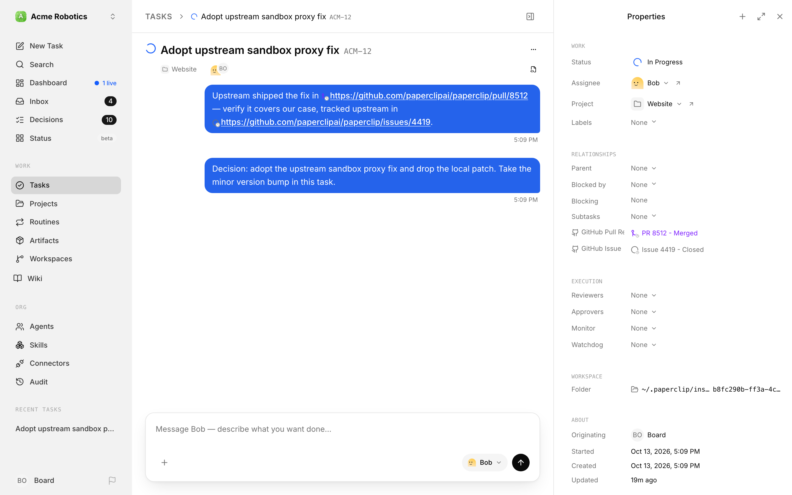

# External Objects

Issues constantly reference work that lives somewhere else — a GitHub pull request, a ticket in another tracker, a deployment. Normally those are dead links: to know whether that PR merged, you leave Paperclip and go look.

With **External Objects** on, Paperclip detects external URLs anywhere in an issue — title, description, comments, documents — and shows their live status instead of leaving them as plain links. A referenced GitHub pull request gets a small status icon right where it's mentioned, and a row in the issue's **Properties** panel that reads like *PR 8512 - Merged*.

## Turn it on

1. Go to **Settings → Experimental**.
2. Turn on **Enable External Objects** — *"Detect external URLs in issues and show resolved status for pull requests, tickets, and other referenced work objects."*

## Using it

There's nothing to configure per issue — just paste URLs where you'd naturally write them:

- **Detection.** Whenever an issue, comment, or document is created or updated, Paperclip extracts its URLs. GitHub pull-request and issue URLs (`github.com/{owner}/{repo}/pull/{n}` or `/issues/{n}`) are recognized as first-class work objects out of the box; anything else becomes a generic link object. Plugins can register additional detectors for other systems.
- **Inline status icons.** In descriptions and comments, a recognized link keeps its original text, with a small status icon in front of it. Hover the link to see the object and its state (for example *Open*, *Merged*, or *Closed*). A newly detected object starts as *"Not yet refreshed"* until it's resolved.
- **Properties rows.** The issue's **Properties** panel (under **Relationships**) gets one row per object, labelled with the provider and type — for example *GitHub Pull Request* or *GitHub Issue* — with a value like *PR 8512 - Merged* or *Issue 4419 - Closed*. Merged PRs get their own color. The most urgent statuses sort first; if there are more than five, a **References** row lets you expand the rest.
- **The External objects panel.** The issue's Related Work area gains an **External objects** section — *"Remote work referenced from this issue — pull requests, deployments, tickets in other systems, and more."* — listing every detected object as a status pill, with an `×N` counter when it's mentioned several times and a dashed border when the status is stale, unreachable, or needs authentication.
- **Lists and sidebar.** Issue list rows get a compact status badge and the list toolbar gains an external-object status filter; project rows in the sidebar roll up the dominant status.

## GitHub access

Public repositories resolve without setup. For private repos (and friendlier rate limits), add a company **secret** named `GITHUB_TOKEN`, `GH_TOKEN`, or `PAPERCLIP_GITHUB_TOKEN`. Without access, private objects show *"Requires auth"*.

## When it's off

Hidden and inert: detection stops, links go back to plain links, and the Properties rows, panel, and filters disappear. Already-detected objects are kept and reappear if you re-enable.

## Caveats

- **GitHub is the only built-in resolver** at this release, and only `github.com` URLs in the exact PR/issue path shape — GitHub Enterprise hosts and other trackers need a plugin that provides object detection.
- Resolved statuses have a short TTL (about five minutes) and there's no background poller yet at this release — statuses refresh lazily, and agents can force a refresh through the API. Expect statuses to read *stale* or *"Not yet refreshed"* between resolutions.

## Where to go next

- [Secrets & scopes](../administration/secret-scopes.md) — where the GitHub token lives.
- [Plugins](../administration/plugins.md) — extending detection to other providers.
- [Experimental features overview](overview.md)
