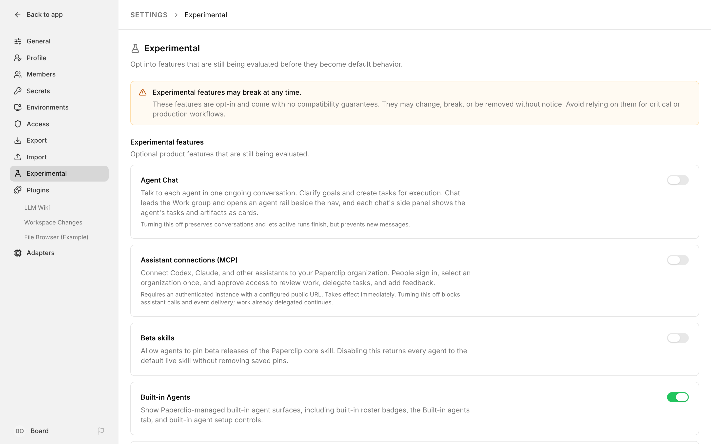

# Experimental features

Paperclip ships some features behind opt-in flags before they become default behavior. They're real, working features — you can turn them on today — but they're still being evaluated against real usage, so they live on a dedicated **Experimental** settings page instead of being on for everyone.

This section has one page per experimental feature: why it exists, how to turn it on, and how to use it.

## What "experimental" means

An experimental feature in Paperclip:

- **Has shipped and works.** These aren't stubs — each flag gates a complete surface.
- **Has a feature gate.** Most flags are off by default. Paperclip Runner is experimental even though its gate defaults to on for self-hosted instances; Cloud can manage a different value.
- **Comes with no compatibility guarantees.** The app puts it plainly when you open the page: *"Experimental features may break at any time. These features are opt-in and come with no compatibility guarantees. They may change, break, or be removed without notice. Avoid relying on them for critical or production workflows."*

Check the feature's own page before changing its flag: hiding a surface and disabling execution can have different effects. Avoid relying on experimental behavior for a workflow that must stay stable, and read the release notes after an upgrade. Features may be renamed, reworked, promoted to core settings, or retired between releases.

## Turning a feature on

All experimental flags live in one place, and they're instance-wide (they apply to every company on your Paperclip instance):

1. Open **Settings → Experimental**.
2. Find the feature's card and flip its toggle.

**Experimental** sits near the bottom of the settings sidebar.

Changes take effect immediately — no restart, no migration. Each feature page in this section repeats the exact toggle name to look for.

The page groups its toggles into up to three sections — **Experimental features**, **Paperclip Developer Mode**, and **Legacy** — and lists the cards alphabetically within each one, so you can scan for a name. If every toggle in the developer or legacy section is hidden, that section heading disappears too.

## If a toggle is missing

If you're on a hosted Paperclip — a managed cloud or a shared server someone else runs — the operator may have hidden some toggles, or all of them, because they manage those features for you. A hidden toggle simply doesn't appear on the page. It still has a value, though: hiding a control keeps whatever it was set to, so a feature can be on even when you can't see its card. If you need one changed, ask whoever runs your instance. Operators can read how this works in [Operator controls for hosted deployments](../administration/settings.md#operator-controls-for-hosted-deployments).

## If a toggle is locked

On an instance managed by Paperclip Cloud, some of these features are decided for you. Open the Experimental page there and you'll see a small lock badge reading **Managed by Paperclip Cloud** next to the feature's name, and its toggle greyed out — the switch still shows you whether the feature is on or off, you just can't move it. Clicking it does nothing.

That's not a permission problem with your account. Paperclip Cloud sets those values for the fleet your instance runs in, and the app re-applies them every time it reads the settings, so the answer can't drift — nothing you or anyone else does inside the instance changes a managed value. If you need one of these features turned on or off, that's a change on the Paperclip Cloud side rather than something you flip on this page.

Only some features are managed this way. Anything without the badge is still yours to turn on and off exactly as described above, and the two kinds sit side by side in the same list — so the badge is what tells you which is which, on any given release.

**Who can change toggles on Cloud.** On a Paperclip Cloud instance, a person with the Admin role on the Cloud stack can change the editable experimental toggles, even without full instance-admin rights. Members, Support users, and agents can't. Toggles the operator has hidden and values with the lock badge stay protected either way.

On a Cloud staging instance (an address ending in `.staging.paperclip.app`), you can change the experiments that Cloud leaves off, and any change you save sticks across reloads. A feature that Cloud turns on stays on everywhere Cloud manages, staging included: its toggle is locked, an older saved "off" value no longer wins, and trying to switch it off through the settings API is refused with `403`. Cloud's access and execution policies stay managed on staging too, and production Cloud keeps its locked values as described above.

**Self-hosted instances are unaffected.** If you run Paperclip yourself, there is no managed configuration, no lock badge, and every card on the page stays editable. What makes the difference is a single environment variable, [`PAPERCLIP_MANAGED_CONFIG`](../reference/deploy/environment-variables.md#cloud-managed-instances), which only the Paperclip Cloud harness sets.

## The features

The tables follow the page's own sections and order. Where a feature has a page in these docs, its name links there.

### Experimental features

| Feature | What it adds |
| --- | --- |
| [Agent Chat](agent-chat.md) | One ongoing conversation per agent. **Chat** leads the **Work** group; agents clarify your goal, hand real work off to tasks, and report back when those tasks are done. |
| [Assistant connections (MCP)](assistant-connections.md) | Connect an external assistant as your user through OAuth, with separate read, write, and configuration scopes. |
| Beta skills | Lets agents pin beta releases of the Paperclip core skill. Turning it off returns every agent to the default live skill without removing saved pins. |
| [Built-in Agents](../reference/api/built-in-agents.md) | Paperclip-managed built-in agent surfaces: roster badges, the **Built-in agents** tab, and setup controls. |
| [Cases](cases.md) | Durable work products that tasks create and iterate on, with one primary task that agents hand off phase by phase. Adds the **Cases** tab and the agent case API ([API reference](../reference/api/cases.md)). |
| [Chat connectors](../connectors.md#chat-channels-experimental) | Connect agents to Slack, GitHub, Discord, Microsoft Teams, and Telegram conversations. Existing chat connections keep running when it's off. |
| [Combined Inbox + Task List](task-chat.md#an-optional-combined-task-list) | Reach inbox and task views from one **Tasks** navigation entry. |
| [Decisions](../guides/day-to-day/decisions.md) | Shows the **Decisions** item in the main sidebar, where the tasks awaiting your input collect. |
| [Enable Environments](environments.md) | Environment management in settings, plus project and agent environment assignment — including custom sandbox images. |
| [Enable External Objects](external-objects.md) | Detects external URLs in issues and shows live status for referenced pull requests, tickets, and other work objects. |
| [Enable Isolated Workspaces](isolated-workspaces.md) | Execution-workspace controls: per-run isolated copies of a project so agents don't step on each other. Turning it on reveals a **Use Isolated Workspaces By Default** card. |
| Experimental fast responses | Lets agents post a short acknowledgement while they begin work. You configure it in **Settings → Connections**, which is always visible now. Its cost history is under **Audit → Costs → Fast responses** ([details](../guides/day-to-day/costs.md#fast-responses)). |
| [Experimental File Viewer](file-viewer.md) | Task-detail controls for browsing and previewing workspace files relative to a task. |
| First task: propose with a plan document | For a single-task first request, the chief of staff writes a short plan document and a checkbox card. Applies to organizations created after you flip it. |
| [GitHub review bots](../connectors/understanding-github-review-bots.md) | Connect agents to GitHub with their own App identity to review pull requests and respond to issues. Separate from Chat connectors; turning it off hides setup, but existing bots keep running. |
| [Grok Bot](external-agents.md) | Connect an existing Grok Bot as an agent. Needs Assistant connections (MCP), Paperclip Runner, and authenticated public HTTPS. |
| [Memory connectors](../connectors/memory-connectors.md) | Set up Mem0, Zep, Supermemory, Cognee, or Honcho for agents. Existing connections keep running when setup is hidden. |
| [Muse — Personal agent](external-agents.md) | Connect your personal Meta Muse and verify a background reply before assigning tasks. Needs Paperclip Runner and an authenticated instance with a public HTTPS URL. |
| [OpenAI Dot](external-agents.md) | Adds OpenAI Dot as a standalone agent choice. Needs Assistant connections (MCP) and an authenticated instance with a public HTTPS URL. |
| [Paperclip Runner](../reference/adapters/paperclip-runner.md) | Native agent execution, on by default for self-hosted instances and off by default on Cloud. The switch controls the Runner's other providers (Muse and Grok Bot need it, for example). New Codex and Claude Code agents resolve to the Runner on supported macOS and Linux hosts even when it's off, unless you pick **Legacy runner** as the runner override. First-run setup offers qualified GitHub Copilot, and Copilot agents keep running when the switch is off; turning it off only hides the **Paperclip Runner** choice. See [GitHub Copilot](../connectors/github-copilot.md) and [Experimental external providers](../reference/adapters/paperclip-runner.md#experimental-external-providers). |
| [Simplified English Interactions](../reference/skills/optional/content/simplified-english.md) | Agents write confirmations, questions, and suggested tasks in ASD-STE100 Simplified Technical English. |
| [Status Cards](status-cards.md) | A shared board of living summaries, kept current by the Summarizer. Enabling it also enables Summaries. |
| Streamlined UI | **On by default.** The simplified sidebar, focused task detail layout, and contextual navigation. Turning it off restores the legacy shell and navigation. |
| [Summaries](../reference/api/summary-slots.md) | Summarizer-generated status slots on project and workspace pages. Status Cards needs it. |

### Paperclip Developer Mode

Internal tools for developing, testing, and debugging Paperclip itself.

| Feature | What it adds |
| --- | --- |
| [Auto-Restart Dev Server When Idle](auto-restart-dev-server.md) | Restarts a stale `pnpm dev:once` boot once all local runs finish. |
| Managed Environment Only | Hides the local environment and runs all agents in the platform-managed environment. |
| Paperclip Developer Mode | Internal maintainer tools and observability links, such as Honeycomb trace queries on run pages. |
| Run tasks in this worktree | Only shown when the server runs inside a git worktree. |
| [Server Info Debug View](server-info-debug-view.md) | A "Server" section in the account drawer with the server restart time and running commit. |
| Smoke Lab | A **Smoke Lab** tab under **Apps → Developer** and an **Integration smoke** dashboard card. Private deployments only. |
| [Task Plan Decomposition](plan-decomposition-panel.md) | Shows accepted-plan decomposition history on task detail pages. |

### Legacy

*"These features are going to be removed."*

| Feature | What it adds |
| --- | --- |
| [Classic Task Interface](task-chat.md) | Restores the previous task detail page. The chat-style task page is now the default. |
| [Goals Sidebar Link](../guides/projects-workflow/goals.md) | Restores the **Goals** item in the main sidebar. |

### Not on the page

These have pages in this section but no toggle in this release:

| Feature | Status |
| --- | --- |
| [Task-pinned AI routing](task-pinned-ai-routing.md) | Experimental and off by default, but the `enableAiConnectionRouters` flag has no card on the Experimental page. Needs a router plugin. |
| [Task Watchdogs](task-watchdogs.md) | **No flag any more.** Watchdog controls are always available on tasks. |
| [Auto-Create Recovery Tasks](auto-create-recovery-tasks.md) | **Retired**, along with its toggle and its preview and run actions. |
| [Cloud Sync](cloud-sync.md) | **Retired**, toggle included. Use [company Import/Export](../how-to/back-up-and-restore-a-company.md) to move a company between instances. |

## Where to go next

- [Instance settings](../administration/settings.md) — the rest of the instance-level settings pages, including where the Experimental page sits.
