# Costs and Budgets

> **Warning:** AI agents make real API calls that cost real money. Every time an agent works — every heartbeat, every task, every comment it reads and writes — it sends and receives text through a provider like Anthropic or OpenAI, which charges you per token (roughly per word). This isn't a Paperclip fee; it's a cost you pay directly to the AI provider. Read this guide before your agents start running in earnest.

Paperclip's budget system exists to make sure you're never surprised. You set limits, and the platform enforces them automatically — an agent won't spend a cent beyond what you allow.

All of this lives under **Audit** in the sidebar. The Audit page has five tabs — **Activity**, **Runs**, **Costs**, **Budgets**, and **Timeline** — and two of them are the subject of this guide:

- **Costs** — where your money went. It has its own row of views — **Overview**, **Providers**, **Billers**, **Finance**, **Decisions**, and **Fast responses** — plus a shared date-range selector and five headline metrics at the top.
- **Budgets** — the limits that stop spend, and the incidents raised when a limit is hit.

This guide walks through each view, then folds in the core concepts around how costs work, how budgets protect you, and how to tune spend over time. (Older `/costs` and `/budgets` links still work — they redirect into Audit.)

---

## How Costs Work

Every time an agent runs a heartbeat, it generates an API call. That call sends the agent's context (its identity, its tasks, the instructions it's working from) to the AI provider, and receives a response (the agent's reasoning and next actions). The provider charges based on the number of tokens — input tokens (what's sent) and output tokens (what comes back).

Paperclip records every one of these calls: which agent made it, which model it used, how many tokens were used, and the exact dollar cost. These records are aggregated per agent per calendar month (resetting on the 1st of each UTC month).

> **Note:** A token is roughly equivalent to one word, though technically it's a fragment of text slightly smaller than that. A busy agent doing coding or writing work might process 100,000–500,000 tokens per month. At typical Anthropic pricing, that's roughly $3–$15 per month for a moderately active worker agent — but this varies significantly based on the model used and how much context each task requires.

### Why the dollars are lower than the token count suggests

If you multiply an agent's token count by the provider's list price, you'll usually land somewhere above what Paperclip reports. That gap is normally prompt caching doing its job, not an error in the arithmetic.

Agents re-send a lot of the same text on every heartbeat — their identity, their standing instructions, the task they're working on. Providers cache that repeated context and charge much less for a cached token than for a fresh one. You can see the split yourself in the per-model rows on the **Providers** view, where cached-input tokens are counted separately from input tokens.

Paperclip records the **cache-adjusted** cost: what the provider actually billed after the cache discount, rather than an estimate derived from raw token counts. When an adapter reports a discounted amount separately, that discounted amount is the one that lands in the cost ledger, counts against your budgets, and rolls up into every total on the Costs tab. When an adapter reports only a single cost figure, Paperclip treats that figure as the billed amount.

The practical rule: the dollars you see are billed dollars. A run with a large cached-input count and a small dollar figure is healthy — it means the agent's context is being reused instead of re-billed. If you want to reason about a run in detail, read the token columns and the dollar figure together rather than trying to derive one from the other.

### Estimated, unpriced, and still-being-counted costs

Not every run arrives with a clean price tag. Paperclip tells you when a number is less than certain instead of quietly rounding it to a guess or to zero:

- **Estimated** — the provider didn't report a price, but Paperclip knows the model's published rates and calculated one from the token counts. Rows built from these show an **Estimated** or **Partially estimated** badge; hover it to see how many charges were estimated. Your provider's bill may differ slightly.
- **Unpriced** — the run used tokens but there's no reliable price at all. This happens, for example, when an agent's CLI points at an OpenAI-compatible endpoint other than OpenAI or OpenRouter: Paperclip won't assume OpenAI's prices for someone else's service. The tokens are kept, but the cost counts as unknown — never as `$0`.
- **Awaiting accounting** — the run has finished, but its cost hasn't been recorded yet. Local CLI agents save their usage as they go, so even a run that crashes or times out part-way still gets its cost recorded once Paperclip catches up.

When any of these affect the range you're looking at, a short, neutral line appears on the **Overview** just below the metric tiles — for example *3 run costs unavailable*. Treat the totals on the tab as **known** spend until that line goes away. It's information, not an error: most entries need nothing from you.

Click the line to see the affected entries, grouped by agent. Each agent's name links to its configuration, and each entry shows when it happened, a **View run** link, and a label that tells you what's going on:

| Label | What it means | What you can do |
|---|---|---|
| **Cost unavailable** | The provider didn't supply a reliable price for this usage. | Nothing — no action is needed for a past entry. |
| **Model not reported** | Tokens were recorded without a model, so there's nothing to price them against. | Pick an explicit model in the agent's configuration for future runs. Past runs aren't repriced. |
| **Billing category unknown** | The run didn't say whether it was API or subscription billing. Any charges it recorded are still counted. | Select an AI connection in the agent's configuration so future runs can be identified. |
| **Receiving usage** | The run has stopped and Paperclip is waiting for its final usage data. | Nothing — it's recorded automatically. You don't need to rerun the agent. |
| **Final usage unavailable** | The run stopped without final usage data, so its cost stays unresolved for budget checks. | Nothing to retry. Paperclip still records a late receipt if one arrives; rerunning the agent won't recover it. |
| **Ready to record** | Saved usage data is ready to be recorded. Paperclip retries on its own. | Click **Retry cost recording** to do it now. This only records costs — it never reruns the agent. |

If only billing categories are missing, the line reads like *2 billing types unknown* instead. The list shows the 25 most recent entries in each category; pick a shorter date range to see more. Board members with view-only access can read the list but can't retry recording.

Usage that isn't API or subscription billing — credits or fixed-price plans, for example — appears in its own *Other billing usage* line under the tiles. It's still included in the inference totals.

Unpriced and still-being-counted usage also matters for budgets — see [When spend is uncertain](#when-spend-is-uncertain).

Beyond per-request inference costs, there are also **account-level** charges — monthly subscription fees, credit top-ups, invoice adjustments, refunds — that don't map to a single API call. Paperclip tracks those separately in the finance ledger so you can reconcile your actual provider invoices against what Paperclip thinks you spent.

---

## Costs Tab: Header and Date Range

Open **Audit** in the sidebar and click the **Costs** tab. Every view on the Costs tab shares the same header, so it's worth understanding what you're looking at before diving into the individual views.

The header reads **Costs**.

To the right of the title is a **date-range selector** — a row of preset buttons (**Month to Date**, **7 Days**, **30 Days**, **Year to Date**, **All Time**, and **Custom**) that scopes every chart, table, and metric on the Costs tab. Month to Date and Year to Date start at midnight UTC, the same clock your monthly budgets reset on. If you pick **Custom**, two date inputs appear and you enter the start and end date manually. Until both custom dates are filled in, most of the views show a prompt to pick a range before loading data.

Below the header is a strip of five **metric tiles**:

- **API spend** — dollars spent on pay-as-you-go API calls in the selected range, with an **Estimated** or **Partially estimated** badge when some of it came from published rates, and the API token counts underneath. It shows `—` when none of that usage has a reliable price.
- **Subscriptions** — what your connected AI subscriptions cost per month, next to the tokens your agents used through them in the range. See [Subscriptions](#subscriptions) below.
- **Budget** — the count of active incidents if any budget has been breached; otherwise, with **Month to Date** selected, a utilisation percentage (e.g. `62%`) with a `$X of $Y this month` line. With any other range it shows the monthly limit itself, because a percentage of a monthly cap only makes sense for the current month. It reads `Open` if no monthly cap is configured.
- **Recorded charges** — the net of the account-level finance ledger across the range, with debits and credits listed underneath.
- **Finance events** — the number of finance events recorded, plus the total estimated (non-invoice-authoritative) debits still open.

If your finance ledger holds amounts in more than one currency, a note explains that the headline totals are US dollars only — other currencies are listed separately, and Paperclip never converts between them.

These tiles reflect the selected date range, not an all-time total — with one exception: the monthly fee on **Subscriptions** is your *current* monthly commitment, whatever range you pick.

### Subscriptions

If your agents run on a Claude, ChatGPT/Codex, or Grok subscription, those runs usually don't add a per-call charge — but you're still paying a monthly fee. The **Subscriptions** tile puts that fee beside your API spend so you can compare the two.

Paperclip works out which subscription account each run used from the AI connection selected for it. Several agents or connections sharing one paid seat count **once**, so a $200 plan used by five agents shows as $200, not $1,000. Distinct seats stay separate, even inside the same workspace.

The tile shows:

- The monthly total, per currency (Paperclip never converts between currencies).
- An **Estimated** or **Partially estimated** badge when the price came from a published list price rather than from you.
- How many subscriptions are active, and how many prices are unknown. When some are unknown, the figure is labelled *Known monthly subtotal*.
- A count of unconfirmed account identities, if any.
- Input and output tokens your agents used through subscriptions in the selected range.

Click **View details** to see each account: its owner (or **Shared**), provider, and plan; its monthly price; the tokens it used in the range; and which agents used it. A price marked *Estimated · before tax* comes from the provider's published list price. Generic plans — OpenAI Pro, Claude Max without a tier, team or enterprise seats — don't identify a reliable price, so they show **Price unknown** until someone enters one.

When you open the Costs tab, Paperclip checks your connected accounts in the background to pick up plan details. If that check fails, you'll see *Connected accounts could not be checked. Existing subscription estimates are still shown.* along with a **Retry account check** button.

#### Enter your actual price

List prices are estimates. If you pay something different — a discount, an annual plan, another currency — click **Edit price** on the account and fill in:

- **Plan**
- **Price per billing period** — the full amount for one account or seat. Leave it empty if you don't know.
- **Currency** — `USD`, `EUR`, `GBP`, `CAD`, `AUD`, or `CHF`.
- **Billed** — **Monthly** or **Annually**. Annual prices are divided by 12.
- **Tracking** — **Active**, **Subscription ended**, or **Exclude from this organization**.

Click **Save price**. Changes apply from now on; earlier prices are kept as history. Ending tracking here doesn't cancel anything with the provider — and disconnecting a connection doesn't stop the fee either, so mark it ended when you actually cancel.

You can edit the price of your own personal accounts. Prices for shared accounts need permission to manage AI connections. Board members with view-only access can't edit prices.

#### Link duplicate accounts

Sometimes Paperclip can't confirm an account's identity — for example, some Claude setup tokens can't read profile details. An unconfirmed account doesn't get an automatic list-price estimate, so a credential change can't double-count your fee, and it may show up twice. If two entries are really the same subscription or seat, open one, choose the other under **Same subscription as another account?**, and click **Link accounts**. Paperclip then counts them once, combines their usage, and keeps the price of the account you chose in the list.

#### What the fee doesn't include

A subscription fee covers the whole provider account, including use outside Paperclip. It's kept separate from recorded charges and from agent budgets — it doesn't count against a budget or show up as a finance event. You only see fees for accounts you're allowed to see: your own personal accounts, shared accounts you manage, and shared accounts you're in the audience for. Token totals still cover all of the company's work.

If a subscription account records extra usage charges (overage, for example) in the range, a line under the tiles says so: *Subscription accounts also have $X in recorded usage charges for this period, separate from monthly fees.*

---

## Overview

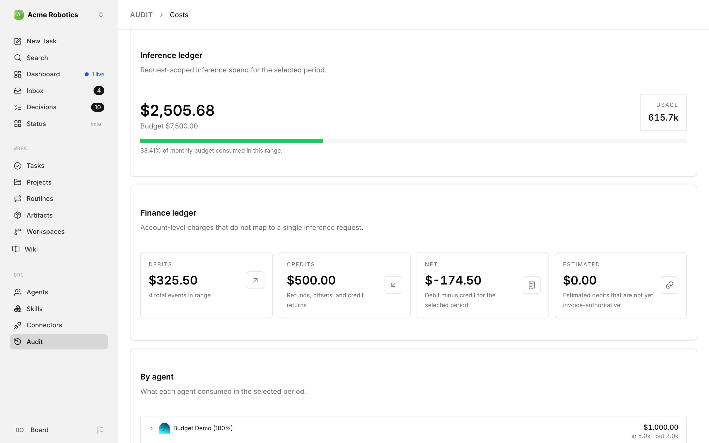

**Overview** is the default view when you open the Costs tab. It gives you a single-screen readout of spend health without forcing you to drill into any one dimension. The headline spend and budget figures live in the metric tiles above the views; Overview breaks them down.

### By agent

On the left is the **By agent** card. Each agent that generated inference events in the range is listed with:

- Agent name and avatar, plus a `terminated` badge if the agent has been retired.
- Total cost for the range, right-aligned, with an **Estimated** or **Partially estimated** badge when some of it was calculated from published rates rather than reported by the provider.
- Token breakdown: `in <input+cached> (<cached> cached) · out <output>`.
- Run-type breakdown: `runs: N api · N sub` — how many runs went through API-priced calls versus subscription-backed calls (see [Billers](#billers) below for the distinction).

Charges that don't belong to any agent — for example, a [decision model](#decisions) request made by a background feature — appear in a **Paperclip services** row.

If an agent has a per-model breakdown available, a caret appears on the left of the row. Clicking the row expands it to show one line per `provider / model / billingType` combination with its share of that agent's spend, the cost, the token count, and which biller handled the call. This is the fastest way to see "why is this particular agent spending so much" — you can immediately tell whether it's one runaway model or a healthy mix.

### By user

Under the agent card is the **By user** table. Every run records the person it was done for, and this table adds spend up by that person — handy when several people share one company and you want to know whose requests are driving the bill.

Each row shows the user, how many **Runs** they account for, **Input** and **Output** tokens, and **Cost**. A few things to know:

- Every active member is listed, even if they haven't spent anything in the range.
- Spend with no recorded person — including anything run under the built-in local board login — lands in an **Unattributed** row, so the table always adds up to the company total.
- When some of a person's usage is unpriced, the row says how many charges (for example `2 unpriced charges`). If all of their usage is unpriced, the cost shows `—` rather than `$0.00`.

### By project

To the right of the agent breakdown is the **By project** card. Paperclip attributes run costs to a project when the run was triggered by an issue that belongs to that project. Each row shows the project name and its total attributed cost. Runs that didn't happen inside a project-linked issue appear as `Unattributed`.

### Active budget incidents (overview)

If any budget has crossed its warning threshold or hit a hard stop, up to two **Budget incident cards** appear below the breakdowns. Each card shows the scope, the breach details, and two resolution buttons — **Keep paused** or **Raise budget & resume** (with a **New budget (USD)** input). See [Active incidents](#active-incidents) for what each one does. If a hard stop happened because spend is uncertain rather than over the limit, the card says *Accounting is incomplete* and points you to the pending or unpriced usage instead. The full incident list lives on the [Budgets tab](#budgets-tab).

### Finance ledger card

At the bottom of the overview is the **Finance ledger** card — the account-level ledger for the range:

- **Debits** — account-level charges in the range, with the total event count.
- **Credits** — refunds, offsets, and credit returns.
- **Net** — debit minus credit for the period.
- **Estimated** — debits that are not yet invoice-authoritative (for example, a Paperclip estimate of a subscription day that hasn't been reconciled with the provider's invoice yet).

The individual finance events are listed in the [Finance](#finance) view.

---

## Providers

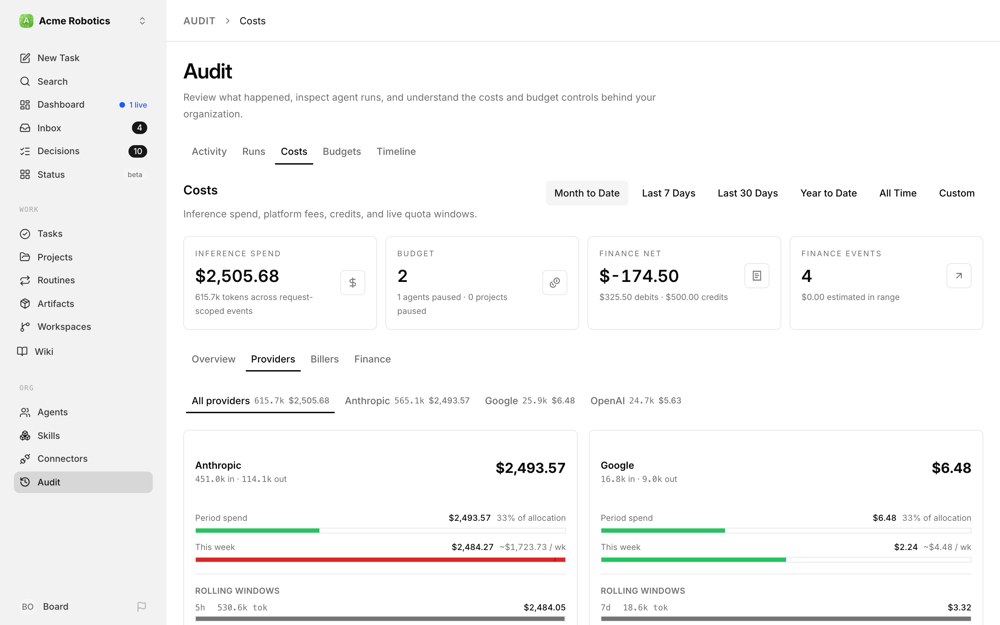

The **Providers** view breaks spend down by who the inference was actually performed by — Anthropic, OpenAI, Google, and any other model provider your agents use. This is the view you want when you're asking "how much am I sending Anthropic this month?" or "is my OpenAI usage growing?".

### Provider sub-tabs

At the top of the view is a sub-tab bar. The first entry is **All providers** — an aggregate showing tokens and cents across everything. After that comes one sub-tab per provider that generated events in the selected range. Each sub-tab label includes the provider's display name, its token count, and its cost, so you can read the split without clicking in.

### Provider card

Selecting **All providers** renders a grid of provider cards (two per row on wider screens). Selecting a single provider shows the same card by itself. Each **ProviderQuotaCard** rolls up, for a given provider:

- **Per-model spend** — one row per model used in the range, with input tokens, cached-input tokens, output tokens, and dollar cost. This is where you confirm, for example, that most of your Anthropic spend is on Claude Sonnet and not a stray Opus call.
- **Current-week spend** — a separate roll-up showing what the provider cost you this calendar week, independent of the main range selector. Useful for catching week-over-week surprises.
- **Share of budget** — the provider's share of the company monthly budget, with a deficit notch that lights up if the provider is projected to overshoot its fair share at the current burn rate (only shown when the date range is set to **Month to Date**).

### Quota windows

When you've connected an Anthropic or OpenAI subscription in [AI connections](../../connectors/ai-usage.md), the Anthropic and OpenAI cards also show a **Subscription quota** section. Paperclip reads each connected subscription account separately, using that account's own stored sign-in — never whatever account happens to be logged in on the machine running Paperclip. You only see the accounts you're allowed to use.

Each account appears under its name. For each usage window the provider reports (e.g. a 5-hour window, or a weekly cap), you see:

- The window label.
- How much of the window you've consumed. If the provider doesn't report a percentage, you get **Usage not reported** instead of a bar.
- When the window resets, when the provider says.

If a read fails for a moment — say the provider is slow — Paperclip keeps showing the last good reading with *Showing the last available quota. Updates will resume automatically.* If there's nothing to fall back on, you'll see *Subscription quota is currently unavailable. Check usage with your provider.* If the account isn't connected, or its sign-in has expired, the section reads *Connect or reconnect a subscription in AI connections to view its quota.* Any old reading is cleared rather than shown as if it were current.

### Provider window spend

Underneath the quota bars, Paperclip also shows **window spend** — what the provider cost you inside each active quota window. This is how you tell the difference between "I'm at 80% of my 5-hour cap because of one burst" and "I'm at 80% and it's evenly distributed".

---

## Billers

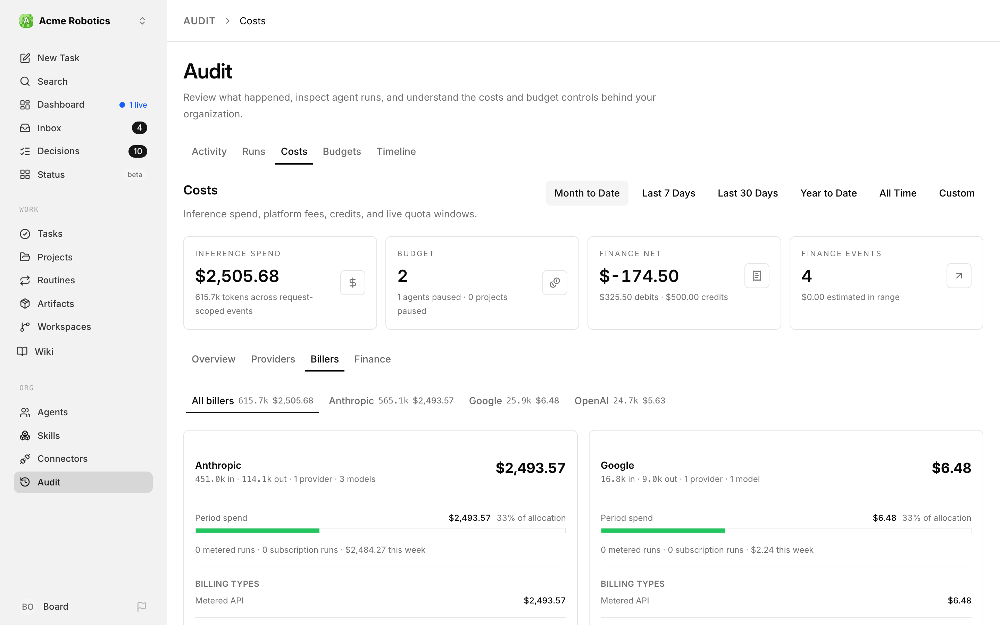

The **Billers** view answers a different question than **Providers**: not "who ran the inference?" but "who charged me for it?". In most companies these are the same entity, but they can diverge — for example, when you run Claude models through a subscription plan (Anthropic is the biller *and* provider) versus through the API (Anthropic is still the biller, but the pricing model is different), or when a gateway or reseller handles the billing relationship on your behalf.

### Biller sub-tabs

Like Providers, the Billers view has a sub-tab bar at the top. **All billers** shows an aggregate grid; each per-biller sub-tab shows the same card standalone. Sub-tab labels include the biller's display name, token count, and cost.

### Biller spend card

Each **BillerSpendCard** shows:

- The biller's total spend in the range, in dollars and tokens.
- The current calendar week's spend with that biller, for a short-horizon sanity check.
- The biller's share of the company monthly budget.
- A per-provider breakdown *within this biller* — i.e. which providers' models were billed through this biller, and how much each contributed. This is where you'd see, for example, that one biller is paying for both Anthropic and OpenAI calls.

### Why this matters

The Biller view is how you reconcile invoices. When the Anthropic invoice lands at the end of the month, the number on it should line up with what the Anthropic biller card has been telling you all along. If it doesn't, you have a starting point for investigation — drill into the biller card, compare per-provider and per-model rows, and compare timestamps against your provider's usage dashboard.

### Attribution

Every cost event in Paperclip is tagged with both a provider (who did the inference) and a biller (who charges you). For simple setups the two are identical, and you can largely ignore the Billers view. For more complex setups — multiple accounts with the same provider, subscription-plus-API combinations, or a centralised gateway — the Billers view is how you keep the accounting clean.

---

## Finance

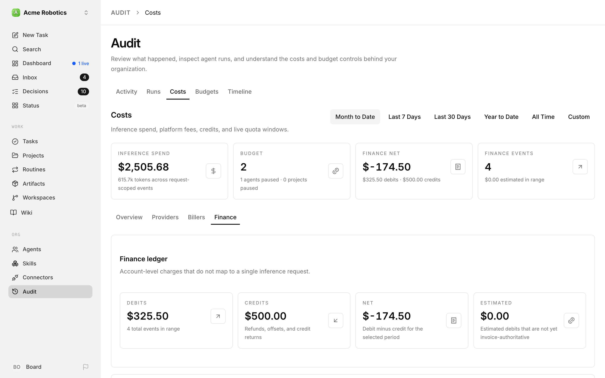

The **Finance** view is the account-level ledger — everything that isn't a per-request inference cost. Subscription fees, invoice reconciliations, credit top-ups, refunds, and adjustments all land here. If the Providers and Billers views show what your agents did, the Finance view shows what actually hit your accounts.

### Finance summary card

At the top of the view is the **Finance ledger** card with four metric tiles:

- **Debits** — total debited dollars in the range, plus the count of events.
- **Credits** — refunds, offsets, and credit returns.
- **Net** — debit minus credit for the selected period.
- **Estimated** — debits that Paperclip has estimated but are not yet invoice-authoritative. These are the events most likely to change as invoices arrive.

### By biller

The **By biller** card groups finance events by who charged or credited you. Each biller row shows the biller, its debit and credit totals for the range, and an event count. This is the usual starting point for reconciling against a specific vendor's invoices.

If no finance events exist yet, the card prompts you to add them once biller invoices or credits land.

### Finance timeline

Below the biller grid is the **Recent financial events** card, listing individual finance events chronologically. Each row shows the event type (e.g. subscription debit, credit top-up, invoice adjustment), amount, biller, timestamp, and whether it's estimated or authoritative. This is where you spot the specific event you're trying to trace.

### Financial event mix

To the right of the timeline is the **Financial event mix** card. Instead of grouping by who charged you, it groups by *what kind of event* — all subscription debits together, all credits together, all adjustments together. Useful when you're answering "how much are we spending on subscriptions versus pay-as-you-go?".

### Estimated versus actual

Paperclip separates estimated debits from authoritative ones because your provider's invoice is the source of truth. Until an invoice is reconciled, Paperclip's number for a subscription day is its best guess — typically derived from the plan price divided by the billing cycle length. Once the real invoice arrives and is imported, the estimated flag flips off and the number becomes authoritative.

The **Estimated** metric at the top tells you, at a glance, how much of your finance ledger is still provisional. A small number means most of your ledger is invoice-backed; a large number means a lot of estimated spend is waiting for reconciliation.

### Other currencies

The headline debit, credit, net, and estimated totals are in US dollars. If you've recorded charges in another currency, they're listed separately with their own currency — Paperclip doesn't apply exchange rates.

### Provider cost reports and invoices

An operator can bring in the provider's own figures through the [accounting API](../../reference/api/costs.md#accounting):

- **Provider cost reports** — daily totals pulled straight from your OpenAI or Anthropic organization. These overlap with invoices and with Paperclip's own run costs, so they're never added to your recorded charges. Instead, the Finance view shows them on their own line: *Provider API cost reports: $X. Report totals overlap invoices and run estimates and are shown separately from recorded charges.* Use that line as a cross-check.
- **Invoices** — an imported invoice adds its lines to the finance ledger and can be compared line by line with the recorded charges, so you can spot and correct any difference.

---

## Decisions

Some optional Paperclip features ask a small, fast model a quick question — "is this about billing?", "which team should take this?" — instead of waking a full agent. These are **decision model** requests, and the **Decisions** view lists them so you can see what they cost. (This is different from the [Decisions queue](./decisions.md), which collects calls a *human* needs to make.)

### Set up a decision model

Each company chooses one shared API connection to pay for these requests. New companies start unconfigured. You need permission to manage AI connections to set it up.

1. Open **Company Settings → General** and find the **Decision model** section. If an instance admin has turned on **Experimental fast responses**, it's at the top of **Company Settings → Connections** instead.
2. Pick an existing shared OpenAI or OpenRouter API connection, or click **Add connection** to create one. Paperclip uses GPT-6 Luna on OpenAI and Jev 1.13 on OpenRouter. Only company-shared API keys work here — not personal accounts, subscriptions, or custom endpoints.
3. Leave **Enable decisions** on, and decide whether to keep **Allow company-sponsored background decisions** on. It starts on when you first set the model up. With it on, background features can charge the connection without a responsible person; those requests show up as **Paperclip services**. If you turn it off, it stays off when you later change connections.
4. Click **Save decision model**.
5. Click **Run test** to send a small, fixed sample question set. It makes a real API charge. The answers appear once and aren't saved; the usage is recorded.

Turning **Enable decisions** off stops new requests. It doesn't cancel or erase requests already sent.

### Read the Decisions view

Open **Audit → Costs → Decisions**, or click **View usage** in the Decision model settings. The view uses the same date range as the rest of the Costs tab and lists the most recent requests — up to 100 — with:

- **When / feature** — when it started, and which feature asked (**Setup test** for the test button).
- **Responsible** — the person it ran for, or **Paperclip services** for a background request.
- **Task** — a link to the task, when there is one you can see.
- **Model**, **Status**, **Duration**, and **Tokens in / out**.
- **Cost** — to a fraction of a cent, labelled **Reported** or **Estimated**, or **Unknown** when no reliable price exists.

Paperclip doesn't keep the questions, inputs, or answers — only the metadata above.

Decision requests count against your budgets like any other spend: the company budget, plus the agent and project budgets of the work they ran for. If a budget blocks a request, the test reports *The company or task budget prevents this request.* A request that times out leaves its cost unresolved, with the budget hold in place, until an operator settles it through the [accounting API](../../reference/api/costs.md#correct-a-charge).

### Fast responses

**Fast responses** is an experimental feature: when someone sends an agent a message, a small model posts a short acknowledgement while the agent starts work. It's off by default; an instance admin turns it on with **Experimental fast responses** in the instance's experimental settings, and you then configure it under **Company Settings → Connections**.

The **Fast responses** view on the Costs tab lists those acknowledgements in the same table as **Decisions**, with an extra **Connection** column showing which connection paid for each one.

---

## Budgets Tab

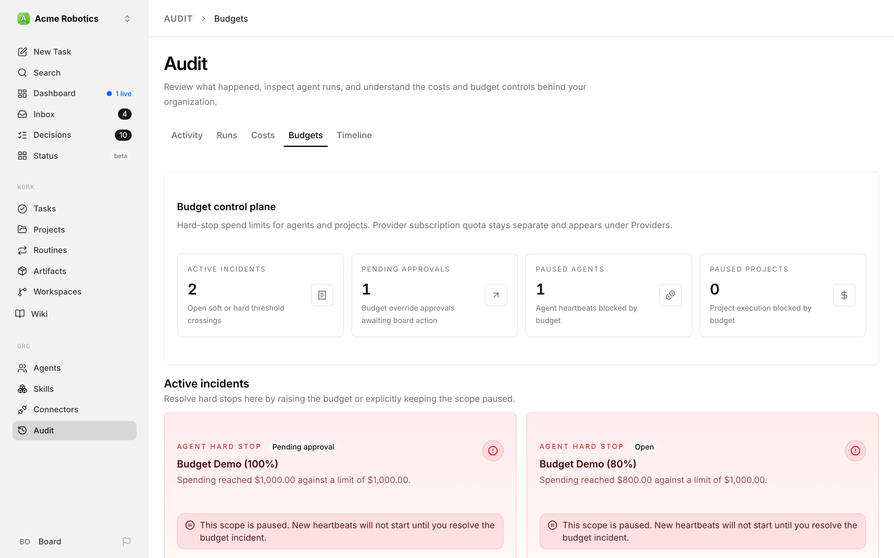

Open **Audit** in the sidebar and click the **Budgets** tab. This is where you configure the spend ceilings that protect your company. It's a peer of the Costs tab rather than part of it, and it doesn't use the date-range selector — budgets always work on their own windows. Think of it as the control plane for hard stops — the place where you decide, in dollars, how much any given scope is allowed to spend before Paperclip pulls the emergency brake.

### Budget Levels

Paperclip operates two levels of budget protection that work together:

**Organization budget** — the total monthly ceiling for your entire company. All agents combined cannot spend more than this. Set it conservatively when starting out.

**Per-agent budget** — an individual monthly ceiling for each agent. This is enforced independently of the company total. An agent at 100% pauses even if the company still has budget remaining. This protects you from any single agent spending disproportionately.

A third scope, **project budget**, acts as a lifetime cap on an execution-bound project — useful for one-off work where you want to say "this project can never cost more than $200" regardless of the month. You set it from the project's own **Budget** tab.

All budgets are displayed in dollars in the Paperclip UI.

### Budget control plane

At the top of the Budgets tab is a **Budget control plane** card with four headline metrics:

- **Active incidents** — open soft or hard threshold crossings.
- **Pending approvals** — budget override approvals awaiting board action.
- **Paused agents** — count of agents currently blocked from running because of a budget breach.
- **Paused projects** — count of projects currently blocked from execution because of a budget breach.

If all four show zero, your budget posture is clean.

### What Happens When Limits Are Hit

Paperclip enforces budgets automatically, in two stages:

```
$0 ─────────────────────── 80% ──────── 100%
   Normal operation         ⚠              🛑
                          Warning        Auto-paused
```

**At 80%:** Paperclip records a warning so you can intervene before the hard stop. The warning doesn't pause the agent. In v2026.1023.0, though, its incident card still uses the hard-stop design: it offers **Keep paused** and **Raise budget & resume**, and says the scope is paused. The screenshots show the corrected amber warning card from [the fix](https://github.com/paperclipai/paperclip/pull/16201), which ships in a later release. Until then, trust the policy card's **Warning** badge: the warning itself doesn't pause the agent.

**At 100%:** The agent is automatically paused. No further heartbeats are triggered. The agent stops all activity until either you increase its budget or the calendar month resets.

An auto-paused agent doesn't lose its work — any tasks it had in progress remain assigned to it and will pick up again once the agent is resumed.

### When spend is uncertain

A hard stop is only as good as the number behind it. So if a scope's spend can't be trusted yet, Paperclip holds new work for that scope even before it reaches 100%:

- **A finished run is still waiting for its cost to be recorded.** New work waits until it's counted. This usually clears on its own within moments.
- **There's unpriced usage in the budget window.** By default the scope stays blocked, because Paperclip can't tell how close to the limit you really are.

The policy card explains which one is happening — for example *"2 completed runs await accounting."* or *"3 usage events are unpriced. Known spend excludes their unknown cost."*

If you're comfortable treating unpriced usage as unknown, open the policy card's **Advanced settings** and clear **Block new work when usage has no reliable price**. Otherwise, the usage needs a price before the scope can resume — an operator can add one through the [accounting API](../../reference/api/costs.md#correct-a-charge).

### Active incidents

If any budget policy has been breached, an **Active incidents** section appears under the control plane. Each incident card shows:

- The scope (company, agent, or project) and its name.
- The policy details — how much was configured and how much was actually spent.
- Two actions:
  - **Keep paused** — acknowledge the breach and leave the scope paused. Useful when you want the agent to stop for the rest of the month and resume naturally at rollover.
  - **Raise budget & resume** — increase the policy's amount (you enter the new cap in **New budget (USD)**; it must be higher than what's already been spent) and immediately un-pause the scope.

Raising the budget won't work while the scope has runs awaiting accounting, or unpriced usage it's set to block on. In that case you'll see *Could not update the budget. Check any pending runs or unpriced usage shown on this page, then try again.* — sort those out first (see [When spend is uncertain](#when-spend-is-uncertain)).

Both actions are logged and become part of the audit trail.

### Budget policies by scope

Below the incidents, the rest of the tab is organised into up to three sections — **Organization Budgets**, **Agent Budgets**, and **Project Budgets** — with one budget policy card per configured policy. A section only appears once it has at least one policy in it.

Each policy card shows:

- The scope type and name (who this applies to) and the window — **Monthly UTC budget** for organization and agent policies, **Lifetime budget** for projects.
- A status badge: **Healthy**, **Warning**, **Hard stop**, or **Paused**.
- **Observed** spend (with the percentage of the limit used) next to the **Budget** cap and the soft-alert threshold.
- A **Remaining** amount with a utilisation bar — green while healthy, amber once the warning threshold is crossed, red at the hard stop.
- Any runs awaiting accounting or unpriced usage in the window.
- A **Budget (USD)** field with a **Set budget** or **Update budget** button. Setting the budget to `0` turns the policy off.
- An **Advanced settings** section with two controls:
  - **Block new work when usage has no reliable price** — on by default. See [When spend is uncertain](#when-spend-is-uncertain).
  - **Reserve per run (USD)** — an estimate Paperclip sets aside from the budget before each run starts, saved with **Update reservation**. It stops a burst of runs from all starting at once and together blowing past the cap. Zero (the default) turns it off. Each unfinished run holds its reservation. If what's held would push the scope over its cap, new runs wait until earlier ones finish. A reservation only controls when work can start — a run's real charge can still come in higher.

If no policies exist yet, a single empty-state card says so: "No budget policies yet. Set agent and project budgets from their detail pages, or use the existing organization monthly budget control." In practice, here's where each kind of policy starts:

- **Agents** — hire the agent through the API with a monthly budget, or give an existing agent a cap with the CLI or API (see [Set a monthly budget](../../how-to/set-monthly-budget.md)).
- **Projects** — open the project and click its **Budget** tab. You can set a lifetime cap there even before any policy exists.
- **Organization** — use the organization monthly budget control.

Once a policy exists, its card here is where you change it.

### Setting a Company Budget

1. **Open Audit → Budgets**

   Click **Audit** in the sidebar, then the **Budgets** tab. The company-wide policy appears under **Organization Budgets**.

   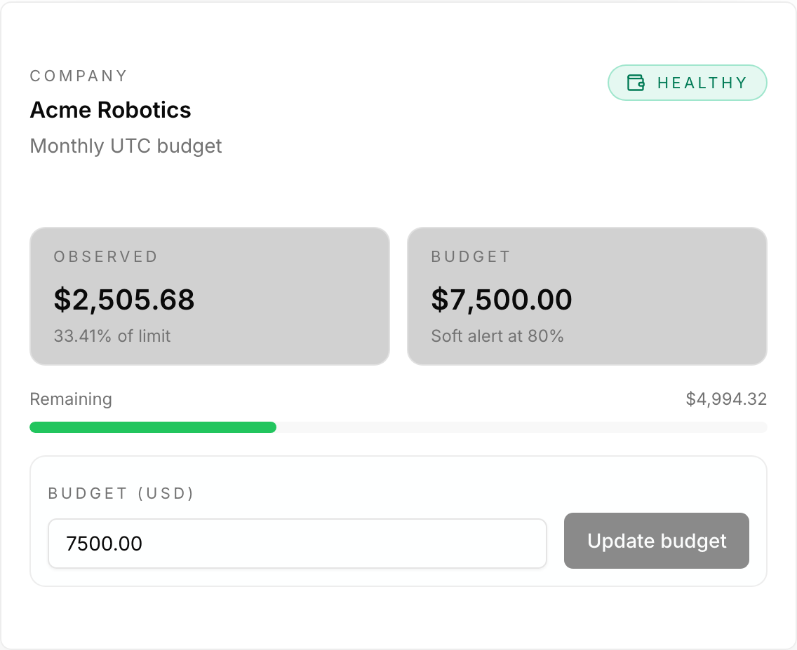

2. **Set the monthly budget**

   Enter a dollar amount in the **Budget (USD)** field. This is the maximum your entire company can spend in a calendar month.

   If there's no Organization Budgets card yet, set the first company budget through the API — [Set a monthly budget](../../how-to/set-monthly-budget.md) shows the one-line call. The card appears as soon as the policy exists.

   > **Tip:** Start conservative — $50–100/month is enough for experimentation with a small team. You can always increase it once you have a feel for how much your agents are spending.

3. **Click Update budget** (or **Set budget** if the cap is currently zero)

### Setting Per-Agent Budgets

Each agent should have its own budget. This limits exposure from any single agent and makes your cost picture easier to read.

1. **Find the agent's budget card**

   Click **Audit** in the sidebar, then the **Budgets** tab, and find the agent under **Agent Budgets**. (From an agent's own page you can get here too: click **Budgets** under **Audit** in the agent's side menu.)

   

   If the agent has no card yet, it doesn't have a budget policy. Agents hired through the API with a monthly budget get one automatically, but the setup flow in the app doesn't set one. To give any other agent a cap, use the CLI's `budget agent:update` command (see [Cost & budget commands](../../reference/cli/cost.md)) or the [Set agent budget](../../reference/api/costs.md#set-agent-budget) API. [Set a monthly budget](../../how-to/set-monthly-budget.md) walks through the API call.

   Projects work differently: open the project and click its **Budget** tab to set a lifetime cap, even if the project has no policy yet.

2. **Set the monthly budget**

   Enter a dollar amount in **Budget (USD)**. Some rough guidance on how to think about agent budgets:

   | Agent role | Typical monthly budget |
   |------------|------------------------|
   | CEO | $30–50 — runs frequently, high context per run |
   | Manager (CTO, CMO, etc.) | $20–40 — active but more focused than CEO |
   | Worker agent (engineer, writer, etc.) | $10–25 — executes tasks but less strategic reasoning |

   These are starting points, not rules. Watch actual spend for the first two weeks and adjust from there.

3. **Click Update budget** (or **Set budget** if the cap is currently zero)

### Increasing a Budget or Resuming a Paused Agent

If an agent hits its 100% limit and auto-pauses, you have two options:

**Option 1: Increase the agent's monthly budget**

1. Open **Audit → Budgets**. The breach shows up as a card under **Active incidents**, and the agent's policy card under **Agent Budgets** is marked **Paused**.
2. Either enter a higher amount in the incident card's **New budget (USD)** field and click **Raise budget & resume**, or type it into the policy card's **Budget (USD)** field and click **Update budget**.

The agent will resume immediately. It won't wait for the month to roll over — as long as its spend is fully counted. If it still has runs awaiting accounting or unpriced usage, it stays paused until that's sorted out (see [When spend is uncertain](#when-spend-is-uncertain)).

**Option 2: Wait for the month to reset**

On the 1st of each UTC month, all monthly budgets reset to zero. A paused agent that's been paused purely for budget reasons will become active again automatically at rollover.

> **Note:** If you don't want the agent to resume automatically at month rollover, manually pause it first. Otherwise it will start running again as soon as the new month begins.

### Viewing Budget Status at Different Thresholds

For reference, here's what an agent's policy card on **Audit → Budgets** looks like at each stage:

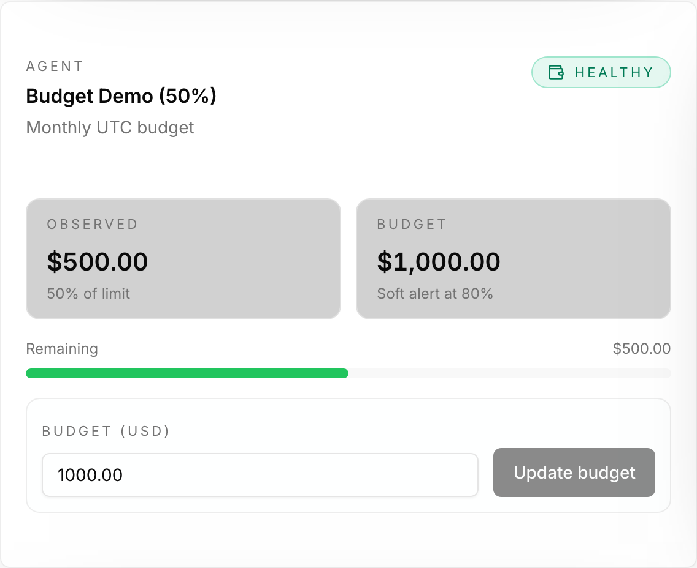

*Normal operation — **Healthy**, green bar, no action needed.*

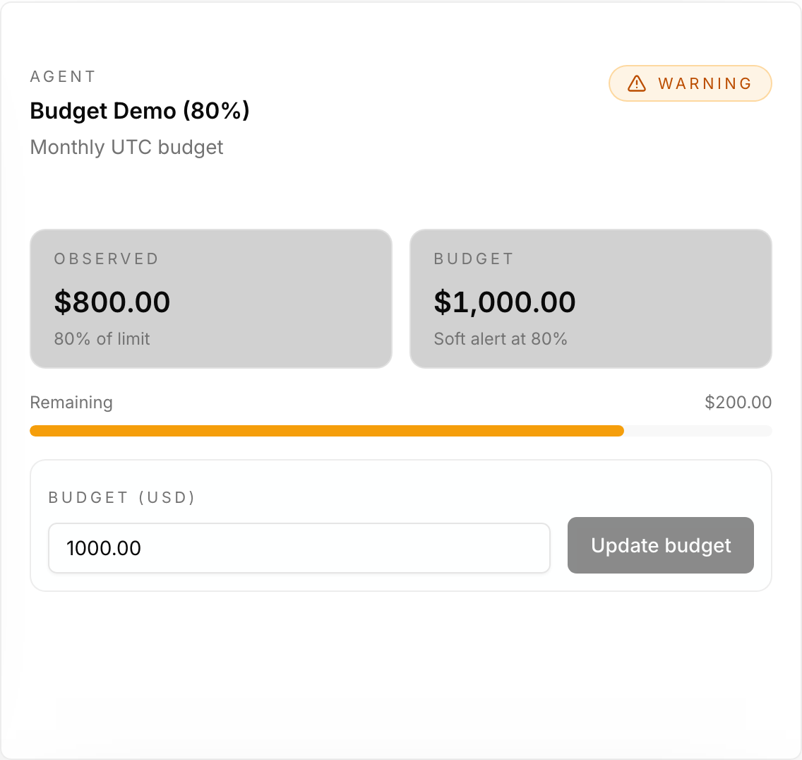

*Warning threshold reached — the badge flips to **Warning**. This is your signal to intervene before the hard stop.*

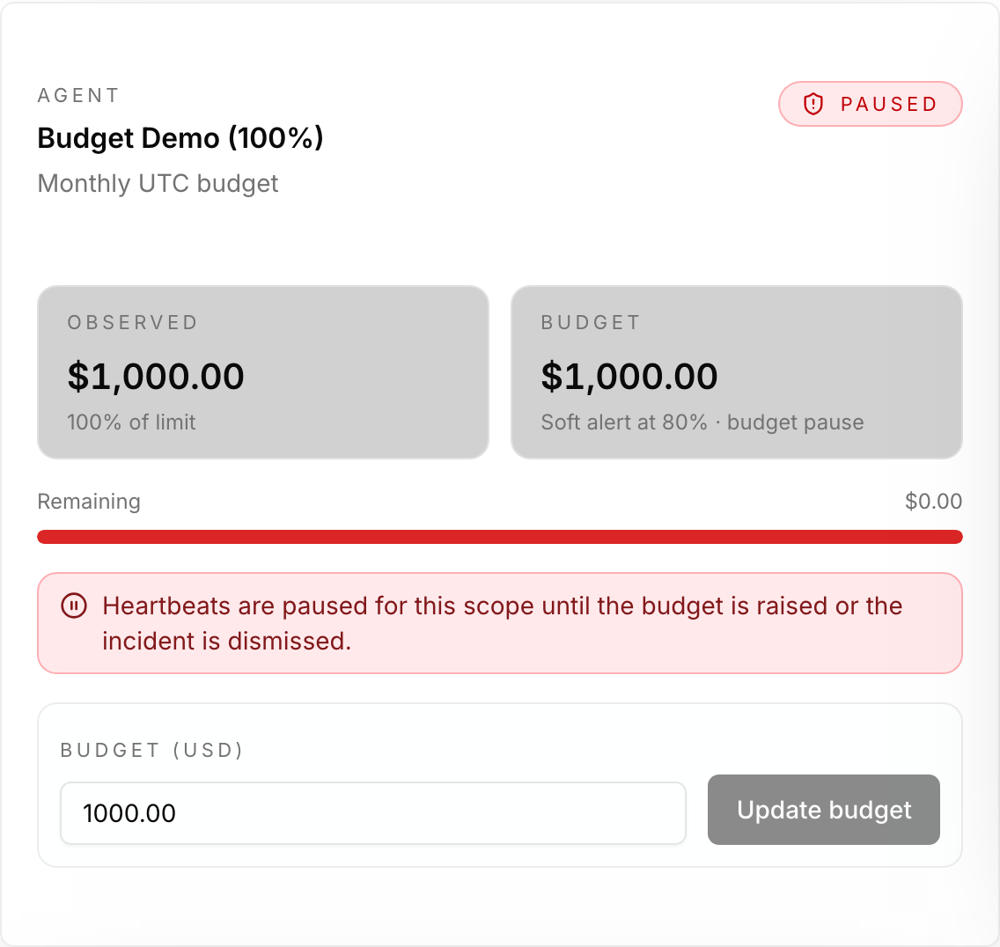

*Budget exhausted — the card shows **Paused** and the agent is auto-paused. Increase the budget or wait for the month to reset.*

---

## Monitoring Spending

### From the Dashboard

The **Month Spend** card on the dashboard shows what the company has spent this month and how that compares with the company budget (for example, `62% of $100.00 budget`). If any budget has been breached, a red banner above the cards counts the active incidents and paused agents.

Check the card whenever you open Paperclip. Click it to jump to the Costs tab under Audit, where the **Overview** breaks spend down by agent and by project:

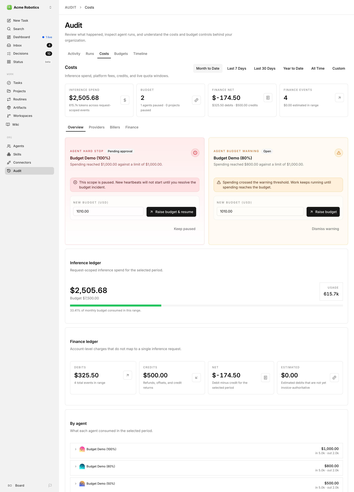

An agent whose total has jumped unexpectedly since your last check is worth investigating.

### Drilling into One Agent

In the **By agent** card on the Costs tab's Overview, click an agent's row to expand it. You get one line per provider and model the agent used, with its share of the agent's spend, the cost, the token count, and the biller.

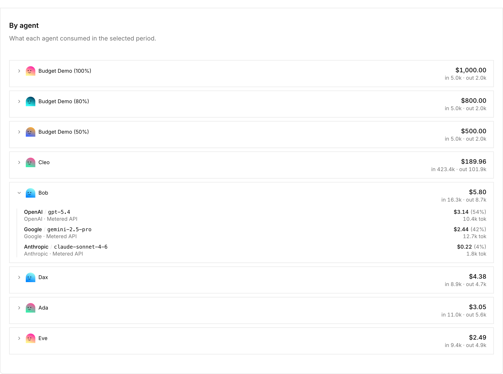

From an agent's own page, the **Audit** section of its overview links straight to that agent's **Runs** (to inspect individual heartbeats) and **Budgets** (to see its cap and utilisation). This is useful when you want to understand why a particular agent is spending more than expected.

### From Audit

For anything cross-agent — "which provider got the most money this week?", "which project ate the most budget?", "how much of our ledger is still estimated?" — open **Audit** and pick the tab and view that match the question. On the **Costs** tab: Overview for a general health check, Providers/Billers for vendor accounting, Finance for invoice reconciliation, Decisions and Fast responses for small-model requests. The **Budgets** tab is for hard-stop management.

---

## Cost-Saving Tips

**Use a less expensive model for worker agents.** The CEO agent benefits from the most capable model available (like Claude Opus), since it needs to reason about strategy. Worker agents doing more routine tasks — writing content, processing data, running searches — can often use a faster, cheaper model like Claude Sonnet without a meaningful drop in quality. You set the model in the agent's adapter configuration.

**Reduce heartbeat frequency for background agents.** An agent that runs every 15 minutes uses roughly 4× as many API calls as one that runs every hour. For agents that don't need to respond quickly, a longer interval saves money with little downside.

**Write tighter task descriptions.** Agents read their full task description, context, and conversation history on every heartbeat. Open-ended tasks with long context chains accumulate cost quickly. Specific, concise task descriptions with clear "done" criteria keep context small and focused.

**Pause agents during off-hours.** If your company doesn't need to run 24/7, manually pause agents at the end of the working day and resume them in the morning. Most of the autonomous work can happen within a defined window.

**Watch the cost-per-run on new agents.** After a new agent completes its first few heartbeats, check its spend in the **By agent** card on the Costs tab. If it's higher than expected, check what it's doing: long context chains, excessive tool use, or a misconfigured prompt can all inflate cost.

**Prefer subscriptions when usage is predictable.** If you have an agent whose workload is steady and fits comfortably inside a provider's plan window (e.g. an Anthropic Pro subscription), routing through the subscription biller can be cheaper than pay-as-you-go API pricing. Use the Providers view's quota windows to confirm the subscription has headroom before committing an agent to it, and compare the **Subscriptions** tile with **API spend** to check the plan is paying for itself.

**Reconcile finance regularly.** Invoice-authoritative numbers are always more accurate than estimates. A few minutes a month importing the real invoice (through the [accounting API](../../reference/api/costs.md#import-provider-invoices)) keeps your ledger honest and catches pricing changes early.

---

Your company's finances are now under control. The next guide covers the **Activity** tab under Audit — the complete audit trail of everything that has ever happened in your company, and how to use it to understand and debug agent behaviour.

[Audit: Activity →](./activity-log.md)
