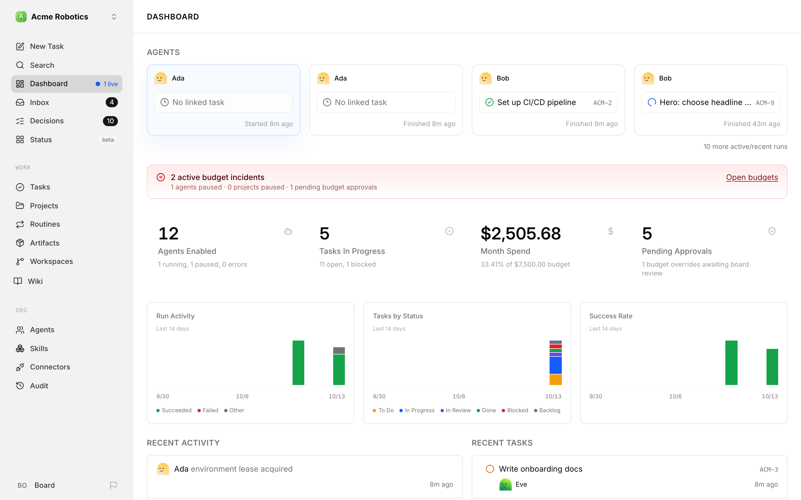
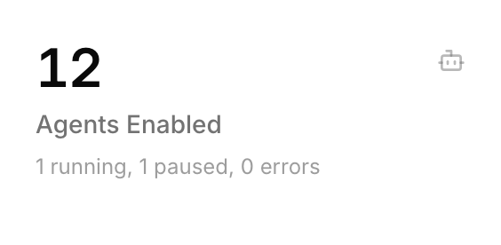
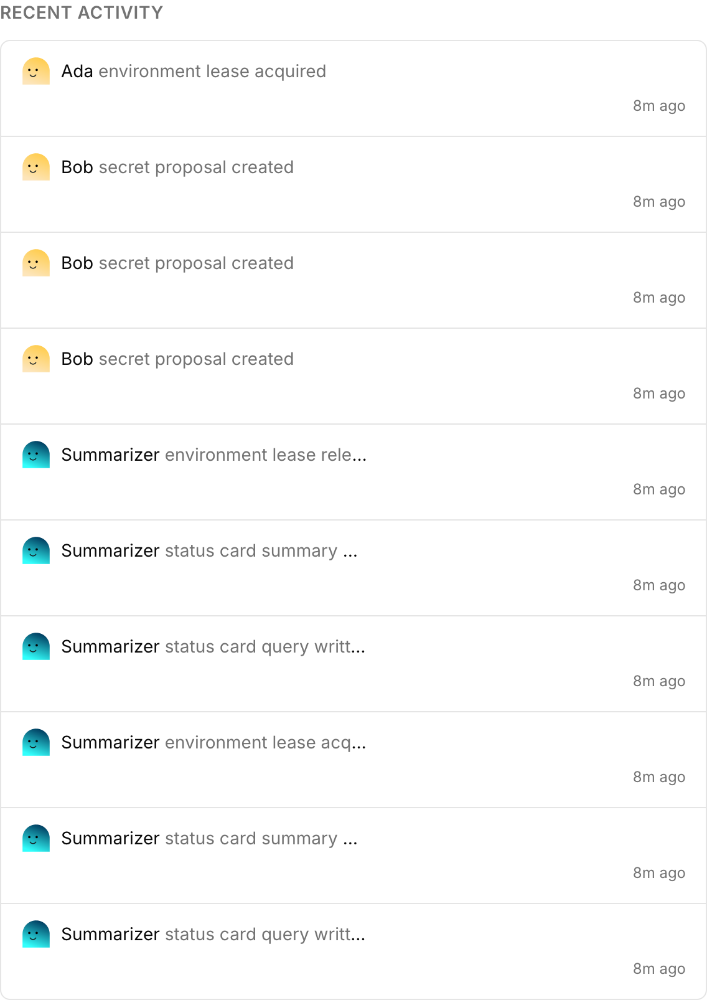
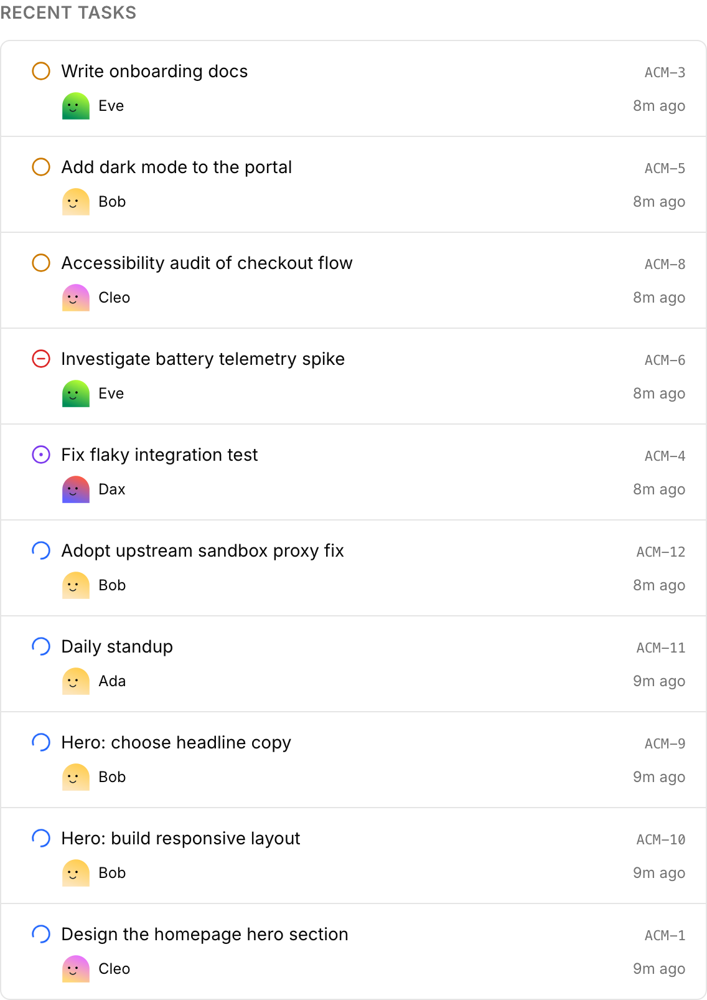

# The Dashboard

The dashboard is your control centre. When your AI company is running, this is the page you'll return to most — it tells you, at a glance, whether everything is moving forward or whether something needs your attention.

Think of it like the cockpit instruments on a plane. You don't need to read every dial every second, but you do want a clear signal when something is off. The dashboard gives you that signal.

---

## Agents Section

At the top of the dashboard, Paperclip shows your live agent activity in the **Agents** panel, followed by a row of overview cards. This is the quickest way to tell whether work is moving.

The first overview card, **Agents Enabled**, rolls your agent states into one number: the total count of enabled agents, with a line underneath that breaks out how many are running, paused, or in error. Click the card to jump to your agents list.

Here's what each state means:

| State | What it means |
|-------|---------------|
| **Active** | The agent is enabled and ready to work. Idle agents are counted here. |
| **Running** | The agent is currently in the middle of a heartbeat — it's working right now. |
| **Error** | The agent's last heartbeat failed. It is not working and hasn't stopped gracefully. |
| **Paused** | The agent has been deliberately stopped — either by you, or automatically because it hit its budget limit. |

> **Warning:** Any agent showing "error" needs attention. The error won't fix itself. Open the agent, then use the **Runs** link in the **Audit** section of its overview to see the transcript of what went wrong — then fix the underlying issue (usually an API key problem, a budget running out, or a misconfigured adapter).

The most common healthy pattern early on: one agent **running** while the others stay **active**. If you see multiple agents in error or paused unexpectedly, that's worth investigating before leaving things to run.

---

## Overview Cards

The four cards across the top summarize the company at a glance:

- **Agents Enabled** — how many agents are available to work, plus how many are currently running, paused, or in error.
- **Tasks In Progress** — how many issues are actively being worked, plus how many remain open or blocked.
- **Month Spend** — how much the company has spent this month against the current company budget.
- **Pending Approvals** — how many approvals are waiting on you, including budget-related approvals when they exist.

If any budget has been breached, a red banner appears above the cards with the number of active budget incidents, how many agents and projects are paused, and an **Open budgets** link.

---

## Charts, Recent Activity, and Recent Tasks

Below the cards sit three charts covering the last 14 days: **Run Activity**, **Tasks by Status**, and **Success Rate**. They're good for spotting trends — a dip in success rate or a pile-up of blocked tasks shows up here before it shows up anywhere else.

Further down, two lists sit side by side: **Recent Activity** on the left and **Recent Tasks** on the right (on narrower screens, Recent Activity comes first and Recent Tasks stacks below it).

---

## Recent Activity Feed

The **Recent Activity** list shows the 10 most recent events across your whole company — task status changes, comments, approvals, agent state changes, and budget events.

This feed isn't meant for deep investigation — it's a pulse check. Scan it after a few hours away and you'll quickly understand what's been happening. For detailed investigation, open **Audit** in the sidebar (covered in the [Audit: Activity guide](./activity-log.md)).

---

## Recent Tasks

Next to the activity feed, the **Recent Tasks** list shows the tasks that changed most recently, each with its status icon, assignee, task identifier, and how long ago it was updated. Click any row to open the task.

---

## Reading the Dashboard at a Glance

Once your company has been running for a few days, checking the dashboard takes about 30 seconds. Here's how to read it quickly:

| Signal | Healthy | Needs attention |
|--------|---------|-----------------|
| Agents | Mostly active or running | Any in `error` or unexpectedly paused |
| Tasks in progress | Work is moving | Nothing in progress for hours, or too many blocked issues |
| Month spend | Climbing predictably | Sudden jump or active budget incidents |
| Approvals | Queue manageable | Pending approvals piling up |
| Recent activity | Steady, understandable motion | Long stretches of silence or repeated failures |

The dashboard refreshes in real time — you don't need to reload the page. If you're actively watching a heartbeat in progress, you'll see the running state appear and then resolve within a few minutes.

---

You now know how to read your company's health at a glance. The next guide covers tasks in depth — how to create them manually, track progress, and give feedback to agents.

[Managing Tasks →](./issues.md)
