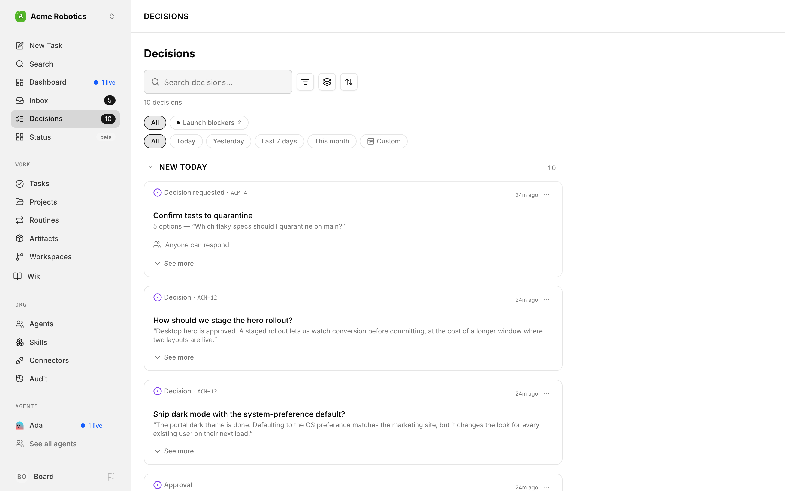
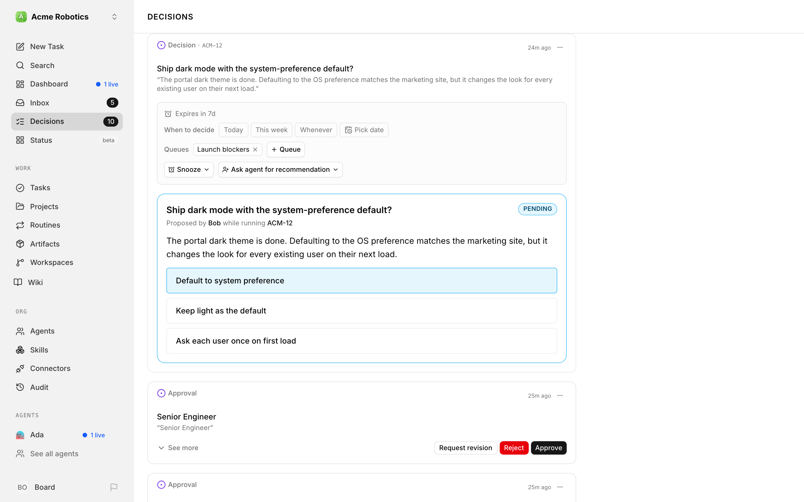
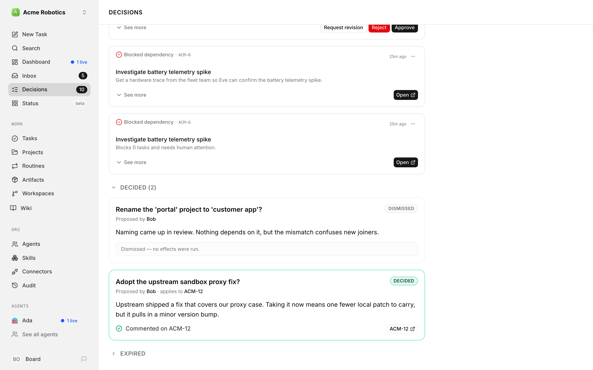
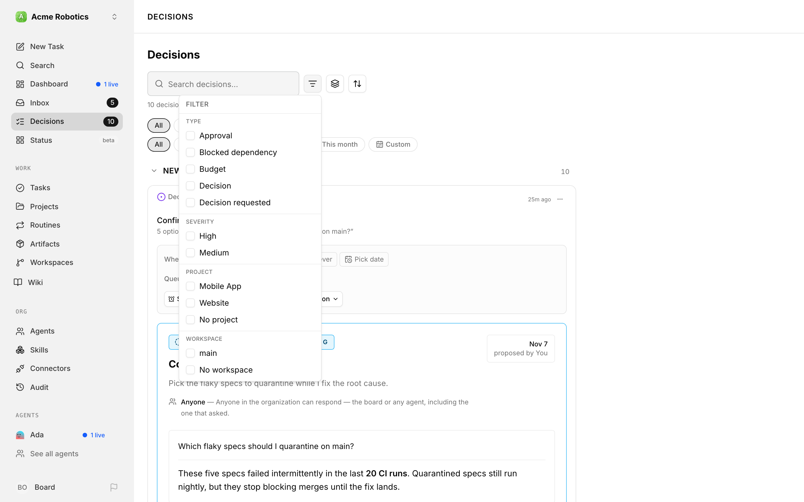
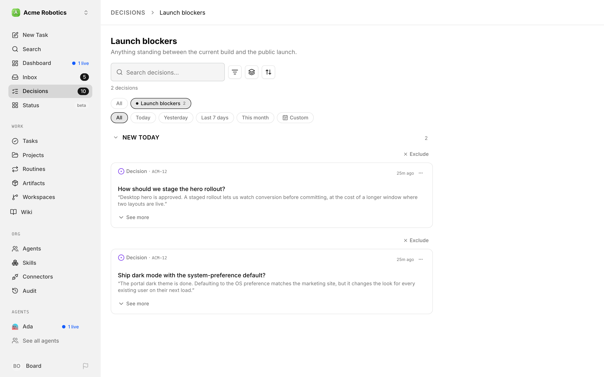
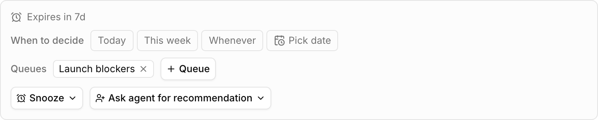
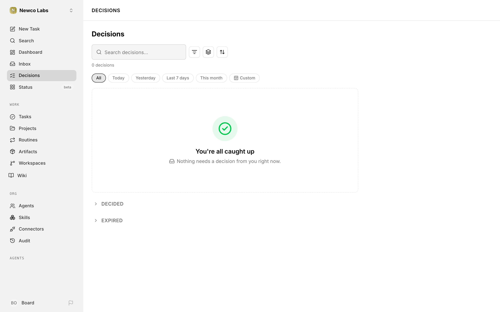

# Decisions

The **Decisions** page gives you one place to see work that needs a human call. Instead of checking approvals, blocked issues, failed runs, and budget warnings separately, you can start here and work through a ranked queue.

In the standard Coordinator workspace, this queue is called **Inbox**: click **Inbox** in the sidebar. See [Inbox](../../experimental/coordinator-workspace.md#inbox) for how it works there. In the [Classic workspace](../../experimental/coordinator-workspace.md#use-the-classic-workspace-instead), the sidebar item is **Decisions**, and it appears once you turn on **Decisions** under **Settings → Experimental**. Either way, you can go directly to `/decisions`.

---

## Read the queue

Each row explains why it needs you now and links to the work behind it. You may see approvals, questions from agents, join requests, recovery actions, blocked dependency chains, reviews, failed runs, budget alerts, agent-error alerts, or a decision an agent has proposed.

Paperclip ranks the visible queue by recent activity and urgency. That makes it a good starting point for your operating day, but it is not a permanent event archive: a row leaves when its underlying work no longer needs attention.

Rows that Paperclip can complete in place — approvals, issue-thread interactions, join requests, and proposed decisions — give you the relevant decision controls. A few problem rows have their own quick fixes too: a failed run offers **Retry run**, and a budget hard stop lets you **Keep paused** or raise the limit and resume. Other rows take you to the original issue, alert, or record so you can inspect the context before you act.

When a request is tied to a task that has since been closed, or a confirmation has been replaced by a newer one, Paperclip keeps it out of your current cards so you don't answer something that no longer matters.

---

## Choose whose cards you see

Not every card is for you. Paperclip works out who each card belongs to, and a row of tabs at the top of the page lets you switch between them:

| Tab | What's in it |
|---|---|
| **For you** | Cards meant for you. This is where the page opens, and its count is the number on the sidebar badge. |
| **Unassigned** | Cards that need a person but have no owner yet. Any board member can answer one, or claim it. |
| **Company** | Company-wide alerts for operators: failed runs, agent errors, budget stops, and join requests. |
| **Archived** | Cards you archived or snoozed for yourself. |
| **Everyone** | Every person's cards. You only see this tab if you can act in the company. Viewers don't get it. |

Each card tells you why it's there. On your own cards a **Why me?** line gives the reason, such as *Sent to you*, *Assigned to you*, *You started this chat*, *You are the reviewer*, or *You created the original task*. A card meant for someone else shows **For @name**. An ownerless card starts with *No owner yet.* and then says who can answer it, such as *Any board member can answer it.*

While ownerless cards are waiting, **For you** shows a banner such as *3 cards need an owner*, with **Open Unassigned** to jump straight there. Those cards never count toward your badge.

Placement only decides where a card shows. It doesn't change who is allowed to answer it: the card's own rules still decide that.

---

## Decide who gets cards nobody owns

When a card names nobody, it waits in **Unassigned** until someone claims it. You can give those cards an owner up front instead, so they land on a real person's **For you** list.

In **Company Settings**, the **Decisions** section has two owners. Each one saves as soon as you pick it:

- **Default decision owner** — ownerless cards go to this person. Choose **Unassigned (no default owner)** to keep them in the claimable pool.
- **Budget owner** — a budget hard stop also goes to this person, with **Raise limit** and **Keep paused**. The **Company** tab still shows it to every operator. Choose **No budget owner (Company view only)** to leave hard stops there alone.

A project can have its own **Decision owner**, set in the project's properties. Cards on that project's work that name no person go to the project's decision owner first, before the company's default. Leave it on **Company default** to use the company setting.

Each owner must be an active member of the company. Like everything else about placement, an owner only changes where a card shows, not who may act on it.

---

## Claim, hand off, or withdraw a card

An ownerless request shows a **Claim** button next to its *No owner yet* line. **Claim** makes it yours: it moves to your **For you** list and leaves everyone else's **Unassigned** tab.

Every card also has a **Close…** menu (the **⋯** button) with the actions that make sense for it.

- **Transfer to…** — hands a request to someone else. It moves to their **For you** list, and the history records the transfer. Only the person it's addressed to, or a company owner or admin, can move someone else's request. The new person must be able to open the task, and a question asked in a chat stays with the person in that chat.
- **Withdraw request…** — closes a request for everyone because it's out of date. It never counts as an approval. You can add a reason, which shows in the history and is sent to the agent that asked. Hire requests can't be withdrawn: reject them instead. Cards that aren't requests, such as failed runs, budget stops, and reviews, have their own actions instead.
- **Archive for me** and **Snooze for me** — hide the card just for you. See [Set something aside](#set-something-aside-without-losing-it).
- **Open source** — opens the task or record behind the card.

If the card is meant for someone else, Paperclip checks first: *This is for @name. Continue?*, or *Withdraw anyway?* for a withdrawal. If someone else answers first, the first answer wins and you see *Already answered by @name*.

### Stale cards

A card that has gone quiet moves into a collapsed **Stale** group below your current cards, with a chip saying why: **Task closed**, **Waiting 30+ days**, **Expires soon**, or **No owner for 7+ days**. An ownerless card that hits seven days also moves to **Company**. A stale card is still open, and you can still answer it.

**Withdraw all stale** clears the group in one go. It asks first and lists every card. Required approvals and governed requests stay open (you withdraw those one at a time), and so do cards that have no request to withdraw.

---

## Answer a decision an agent proposed

Some rows are more than a notification. When an agent works out what should happen next but isn't allowed to do it alone, it raises a **decision**: a short question, an explanation, and up to eight options. Each option spells out exactly what Paperclip would do if you picked it — post a comment, create an issue, change a status, reassign work, clear a blocker, or cancel an issue and everything under it.

You answer it right in the row. Options that need a little context from you show up to four fields first; a required field is marked, and the options stay disabled until you fill it in.

A few things make this safe to do quickly:

- **Nothing has drifted behind your back.** When the agent proposed the decision, Paperclip recorded what the affected issues looked like. If one of them has moved since, the row says so — *"1 target changed since this was proposed"* — and disables any option that depends on the old state.
- **Destructive options ask twice.** Choosing an option that cancels an issue tree opens a confirmation panel listing every issue that would be cancelled, and asks you to type the issue identifier before it will run.
- **Saying no is a real answer.** **Dismiss — no effects** closes the decision without changing anything, and records it as a "no" rather than letting it quietly time out. Paperclip counts dismissals separately from expiries, so agents get honest feedback about which proposals are worth making.
- **Decisions expire on their own.** A proposal that nobody answers lapses — after seven days by default — and so does one whose target issue has since been cancelled.

Once you answer, Paperclip runs the option's changes one at a time and shows you the outcome, including anything it had to skip because a target had moved. If an agent asked to be woken when the decision resolves, that happens automatically.

Two collapsible sections at the bottom of the page, **Decided** and **Expired**, keep the recent history so you can look back at what was chosen and what it did. For the full record, click **Decision history** at the top of the page. It lists every closed card, approvals included, whether it was answered, withdrawn, expired, or closed with its task. It opens on **Handled by me or for me**. Switch to **Everyone** for every person's history, or filter by outcome, agent, or project. The **Handled for me** filter shows only the cards meant for you that someone else dealt with.

You may also meet a decision from the other direction. When a proposal raised elsewhere would change an issue you are looking at, that issue shows a strip saying so and links you back here — decisions are always answered from this one page.

---

## Focus on the next decision

Use the toolbar to make a busy queue manageable:

- **Search decisions…** finds items by words in their title, task identifier, reason, project, workspace, or the agent that raised them. A count under the toolbar shows how many decisions are in view.
- **Type**, **Severity**, **Project**, and **Workspace** filters narrow the queue to the work you own right now.
- **Group by** offers `none`, `date`, `type`, `project`, and `severity`.
- **Sort** offers `newest` and `oldest`.

Your filter, grouping, and sort choices (but not your search) stay with your current browser, so you can set up the view that fits your review rhythm.

---

## Group work into named queues

A busy queue mixes very different kinds of work. **Queues** let you split it into named lanes — a pull-request lane, a plan-review lane, a lane for one project's questions — without changing anything about the work itself.

A queue is a label that points at items. Adding an item to a queue doesn't move it, doesn't change its status, and doesn't remove it from anywhere else: an item can sit in several queues at once, and taking it out again leaves the underlying approval, question, or run exactly as it was.

Paperclip fills three queues for you as it builds the feed, creating each one the first time something matches:

| Queue | What lands in it |
|---|---|
| **PRs** | Items whose issue has a pull request attached. |
| **Plans** | Plan revisions waiting for you to confirm them. |
| **Questions** | Structured questions an agent has asked and is waiting on. |

You can turn that automatic filling off per queue if you would rather curate a lane by hand. Turning it off leaves the queue and everything already in it alone — Paperclip just stops adding more.

You can also create queues of your own, add and remove items, and read a queue's contents through the [Decisions API](../../reference/api/decisions.md). One thing worth knowing: a queue only ever shows you items you are allowed to see, and its item count is counted the same way, so two people can look at the same queue and see different totals.

---

## Say when something needs you

Filters tidy your view. **Triage** does something different: it records, for everyone, when a piece of work actually needs a decision.

You can give any item a decide-by target of **today**, **this week**, **whenever**, or a specific calendar date, and you can snooze it until a moment in the future. Both stick to the item itself rather than to your browser, so the deadline your colleague set is the deadline you see. Paperclip keeps a history of who changed what.

Triage changes how the queue reads in two ways. The feed can rank by deadline instead of recent activity — soonest first, then the *whenever* pile, then everything nobody has triaged yet. The sidebar badge, by contrast, counts your **For you** cards. A card stays in that count until someone answers it, whatever its deadline.

Set triage in the UI with the **When to decide** row on an expanded item. You can also set it through the [Decisions API](../../reference/api/decisions.md).

> Triage snoozing is not the same as the personal snooze below. A triage snooze hides the item for the whole company; the snooze in your queue is yours alone.

---

## Set something aside without losing it

If a card is real but not for this moment, open its **Close…** menu and archive it or snooze it. **Archive for me** hides it until its content changes. **Snooze for me** hides it until the time you choose. Log entries, automatic retries, and unrelated comments don't bring a card back, but a real change to what you're deciding does.

The snooze choices are **1 hour**, **4 hours**, **Tomorrow morning**, and **Next week**. Right after you archive or snooze a card, Paperclip shows an **Undo** action for eight seconds.

Your hidden cards live on the **Archived** tab, with snoozed ones in their own **Snoozed** group that says when each comes back. Choose **Restore** (or **Restore now** for a snoozed card) to bring one back, or **Change snooze time** to move it.

These choices are personal to you. Your teammates still see the card, and nothing changes about the underlying issue, approval, run, or budget policy.

---

## See what others did for you

When someone else answers, withdraws, or transfers a card that was meant for you, a short update appears at the top of **For you**, such as *Answered by @name* or *Transferred to @name by @name*, along with any reason they gave. Updates stay for seven days, or until you dismiss them, and never count toward your badge.

---

## When the queue is empty

**You're all caught up** means Paperclip has no visible item that needs a decision from you. The other tabs have their own empty messages, such as *No cards need an owner.* on **Unassigned**. If you've typed a search or turned on filters, **No decisions match your search or filters.** means the work may still exist — clear your search and broaden the filters before assuming nothing needs attention.

---

## Related

- [Approvals](./approvals.md) — review and resolve formal approval requests.
- [Blocked Inbox](./blocked-inbox.md) — focus specifically on stopped issues.
- [Issues](./issues.md) — inspect and guide the work behind a decision.
- [Attention API](../../reference/api/attention.md) — build a board-facing integration around the same queue.
- [Decisions API](../../reference/api/decisions.md) — propose and resolve decisions, and manage queues and triage.
- [Decision Training](../../reference/api/decision-training.md) — keep a decision as a labelled training example, and export what you have collected.
- [Costs and Budgets: Decisions](./costs.md#decisions) — not to be confused with this queue: the **Decisions** view under **Audit → Costs** lists small-model requests made by a company's decision model, and what they cost.
