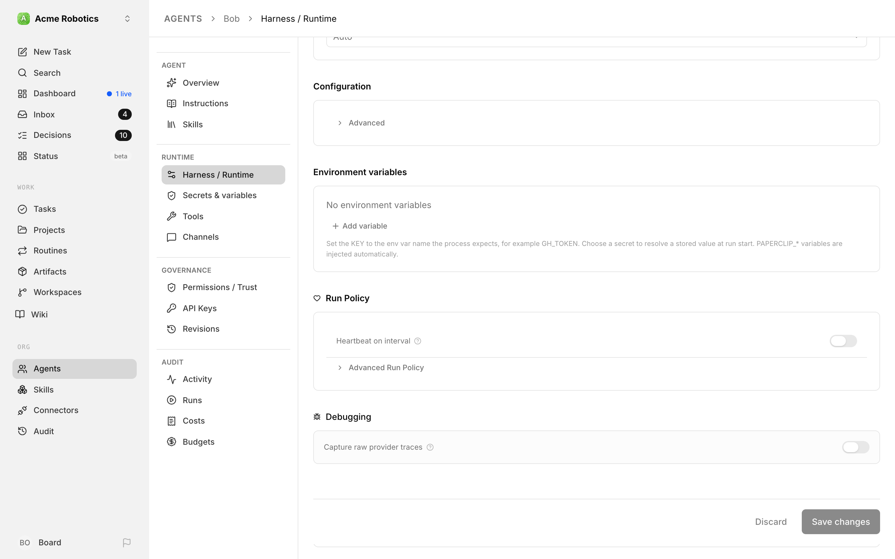
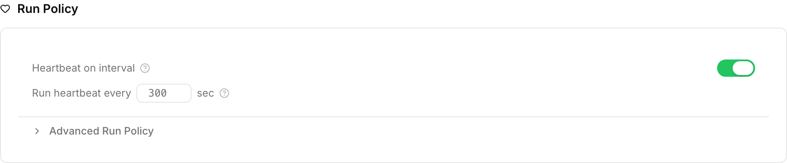
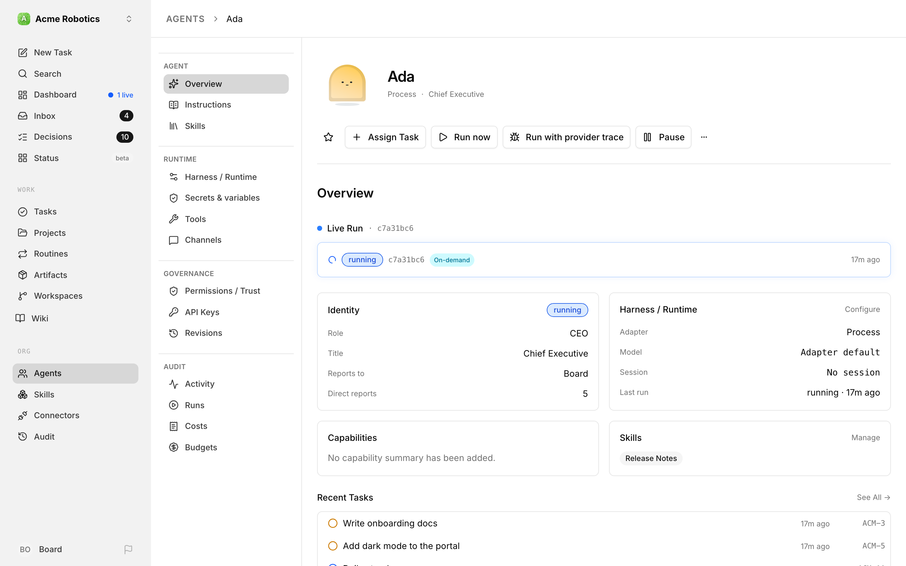
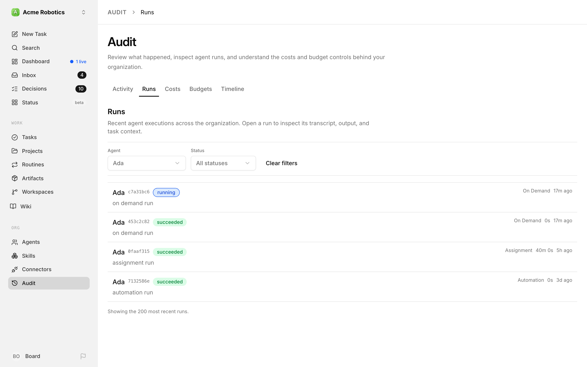
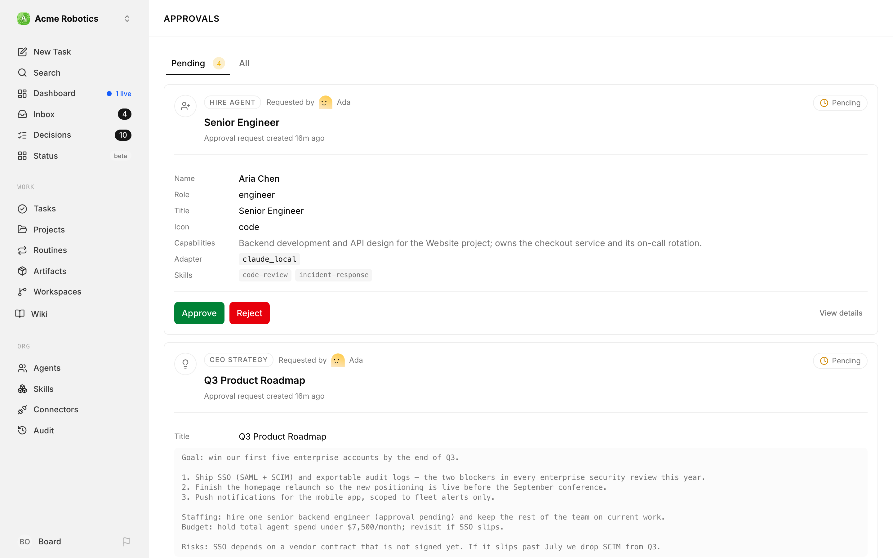
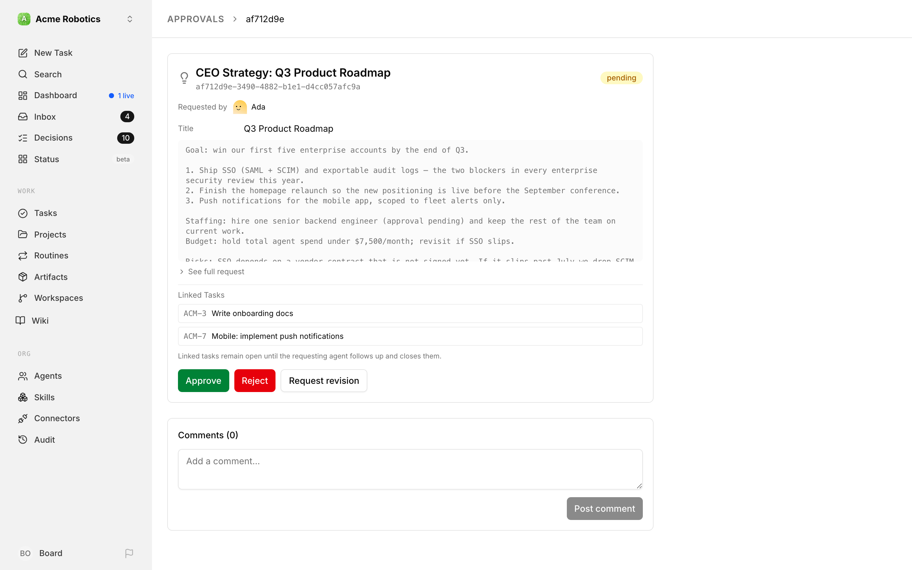
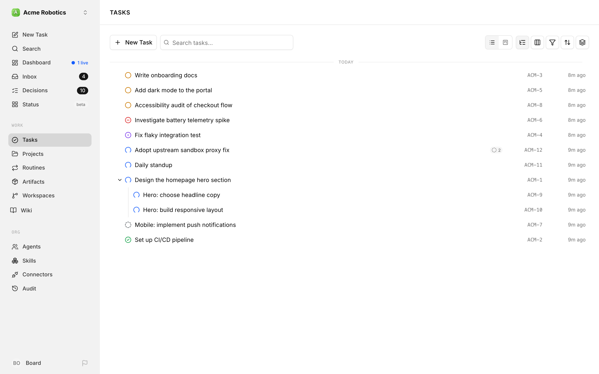
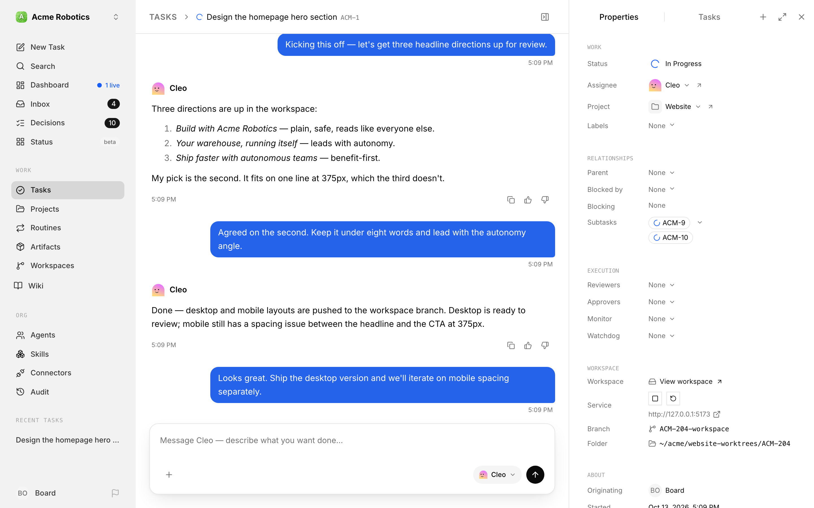
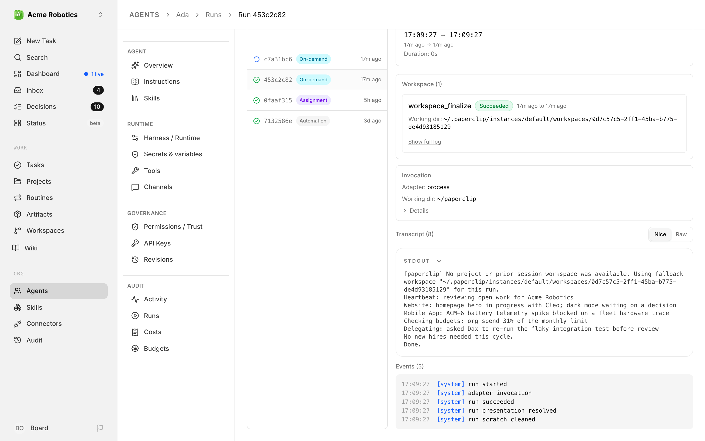

# Watching Agents Work

You have a company with a goal and a CEO agent configured. This guide covers what happens next: enabling the CEO's heartbeat, watching it work through its first execution cycle, reviewing the strategy it produces, and seeing the first tasks appear on the board.

For most people this is the most satisfying moment in Paperclip — the point where something you set up starts doing things on its own. It's also worth understanding what the CEO is doing and why, so you can make good decisions when it asks for your input.

---

## What's about to happen

When you enable the CEO's heartbeat and the first one fires, the CEO will:

1. Read your company goal and its own instructions
2. Assess the current state of the company (no tasks yet, no strategy yet)
3. Produce a strategic plan and submit it to you as an **approval request**
4. Wait for your approval before doing anything else

The CEO cannot create tasks or assign work until you approve its strategy. This is by design — it's the first governance gate, and it's your opportunity to steer the company before any work begins.

---

1. **Enable the CEO's heartbeat**

   Go to the **Agents** page and open the CEO. In the agent's side menu, click **Harness / Runtime** and scroll down to the **Run Policy** card. The **Heartbeat on interval** switch is off when the agent is first created.

   

   Switch it on, set **Run heartbeat every … sec** (3600 is once an hour), and click **Save changes** at the bottom of the page.

   

   The CEO now wakes on a timer. It won't do anything visible until its first scheduled heartbeat fires — which, depending on your interval, could be soon or up to an hour away.

   > **Tip:** If you want the CEO to run right now without waiting for the schedule, click **Run now** in the header of the agent's page. This starts a heartbeat immediately and takes you to the live run.

2. **Wait for the first heartbeat to run**

   Once a heartbeat fires, the agent status changes from **idle** to **running**.

   

   You can watch this happen in real time. On the agent's **Overview**, the top card switches to **Live Run** while the heartbeat is in progress. For the full history, click **Runs** under **Audit** in the agent's side menu — the **Audit** page opens on its **Runs** tab, filtered to the CEO, with the new run at the top.

   

   The first heartbeat typically takes a few minutes to complete — the CEO is reading your goal, reasoning about strategy, and composing a proposal. Subsequent heartbeats on routine tasks are usually faster.

   When the heartbeat finishes, the agent status returns to **idle** and the run shows as **succeeded** (or **failed**, if something went wrong).

3. **Review the CEO's strategy**

   After its first heartbeat, the CEO almost always creates a strategy approval. Open the **Approvals** page from the dashboard, a direct link, or any approval-related prompt in the app.

   You'll see a pending approval labelled **CEO Strategy**.

   

   Click the approval to open it.

   

   The strategy will typically include:
   - An interpretation of the company goal
   - Proposed projects or focus areas
   - An initial set of tasks the CEO plans to create
   - Notes on what team structure it intends to build

   Read through it carefully. This is the CEO's understanding of what you want — if anything is wrong or missing, this is the best time to correct it.

   > **Tip:** The first strategy is rarely perfect, and that's fine. You can request as many revisions as you need before approving. It's much easier to refine the plan here than to course-correct after tasks are underway.

4. **Approve, reject, or request revisions**

   At the bottom of the approval detail page you'll find three options:

   

   - **Approve** — The CEO's strategy is accepted. Paperclip queues the CEO to wake automatically, so follow-up work usually begins shortly after approval.
   - **Request revision** — Leave a note explaining what needs to change. The CEO will receive your feedback, revise the strategy, and resubmit.
   - **Reject** — The strategy is declined outright. The CEO will receive a rejection and can propose a new strategy.

   If the strategy looks broadly right, approve it. You can always update the company goal and request a revised strategy later if priorities shift.

5. **Watch tasks appear**

   Once the strategy is approved, the CEO starts creating work on the board. Click **Tasks** in the sidebar.

   

   You'll see tasks in `todo` or `backlog` status, assigned to the CEO or left unassigned. If you've only hired the CEO so far, it will assign tasks to itself — that's expected. Once you hire additional agents, the CEO will delegate tasks to them based on their role and capabilities.

   Each task will have:
   - A title describing the work
   - A description with more detail
   - A status
   - A conversation (which starts empty, but fills up as the agent works)

6. **Follow a task's conversation**

   Open any task that the CEO has moved to `in_progress`. The task page is a conversation: the agent's updates and your messages run down the middle, with the task's properties (status, assignee, project, and so on) in a panel on the right.

   

   Agents post updates as they work — explaining what they're doing, what decisions they made, and what they found. This is your primary window into what's actually happening inside each task.

   You can reply too, using the message box at the bottom ("Message CEO — describe what you want done…"). Your message reaches the agent the task is assigned to, so this is how you give direct feedback or ask questions without waiting for the next scheduled heartbeat. @-mentioning a different agent (e.g. `@CEO`) only adds context — it doesn't start a run. To bring another agent in, assign the task to them or request their review.

---

## Reading the run transcript

For a deeper look at what happened during any heartbeat, go to the **Agents** page, open the CEO, and click **Runs** under **Audit** in its side menu. Click any completed run to open the transcript.

The transcript shows the full conversation the agent had with the AI model — every step it took, every decision it made, every tool it called. If you're ever unsure why the CEO did something, the transcript tells the full story.

---

## What to watch for

The following situations come up frequently in a company's first few hours. Here's what each one means and what to do.

**No strategy approval appeared after the first heartbeat**

First, check the **Approvals** page — it may be there but not visible from where you're looking. If it's genuinely not there, open the CEO and click **Runs** under **Audit** in its side menu, then open the most recent run. The transcript will show whether the heartbeat completed successfully or encountered an error.

**The CEO assigned all tasks to itself**

This is correct behaviour when the CEO has no reports yet. It can't delegate to agents that don't exist. Once you hire additional agents, you can reassign existing tasks and the CEO will start delegating to them automatically on future heartbeats.

**The agent is stuck in "running" for more than 30 minutes**

A heartbeat that takes longer than expected is usually caused by one of three things: the task is complex, the agent has hit a loop, or the API is slow. Open the run (click the **Live Run** card on the agent's **Overview**) to see if the transcript is still updating. If it has stopped updating, the run may have stalled. In that case, click **Cancel** in the run's header to stop it.

**Agent status shows "error"**

Open the agent's **Runs** (under **Audit** in its side menu) and click the failed run. The transcript will show the error message. Common causes are an expired API key, an invalid model name, or a file permission issue in the working directory.

> **Warning:** An agent in "error" status won't fire new heartbeats until the underlying issue is resolved. Check and fix the error, then click **Clear error** in the header of the agent's page to return it to idle.

---

Your company is running. The CEO has a strategy, tasks are on the board, and work is moving. From here, you can hire more agents, monitor progress on the dashboard, and handle approvals as they come in.

[Go to The Dashboard →](../day-to-day/dashboard.md)
