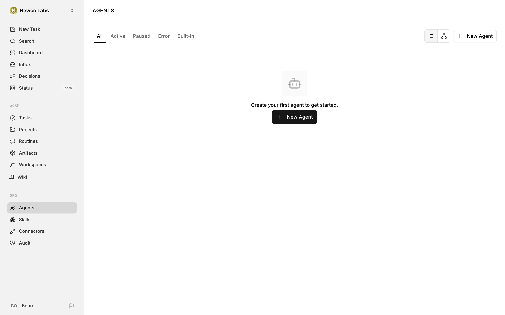
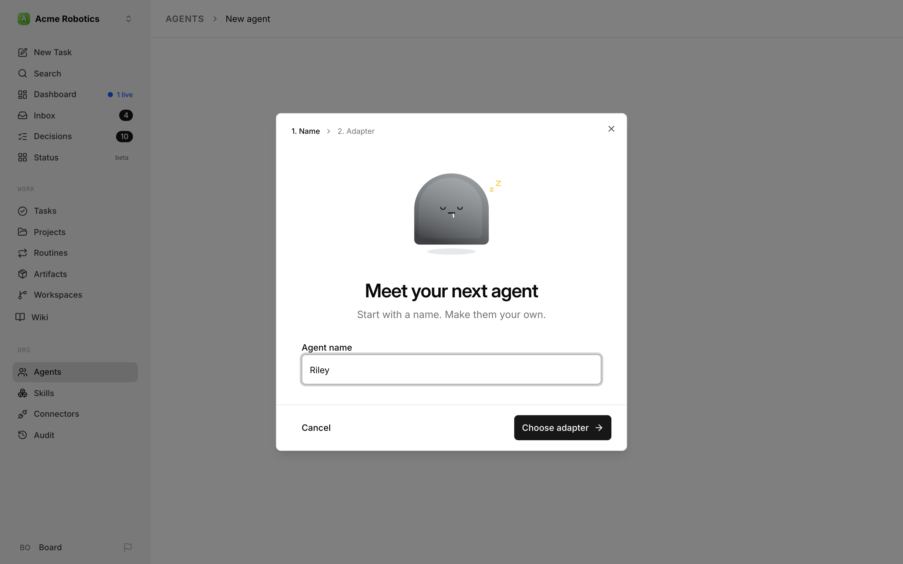
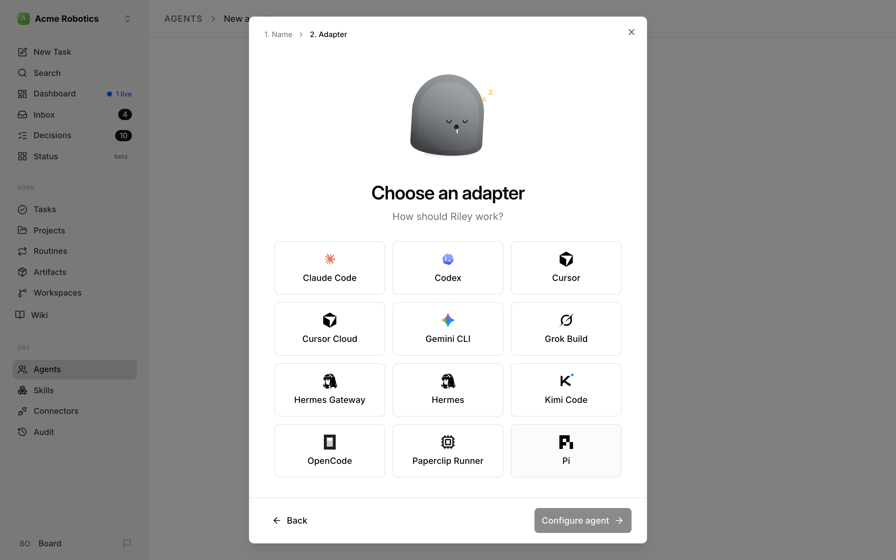
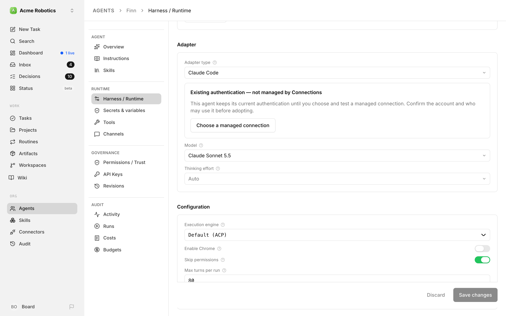
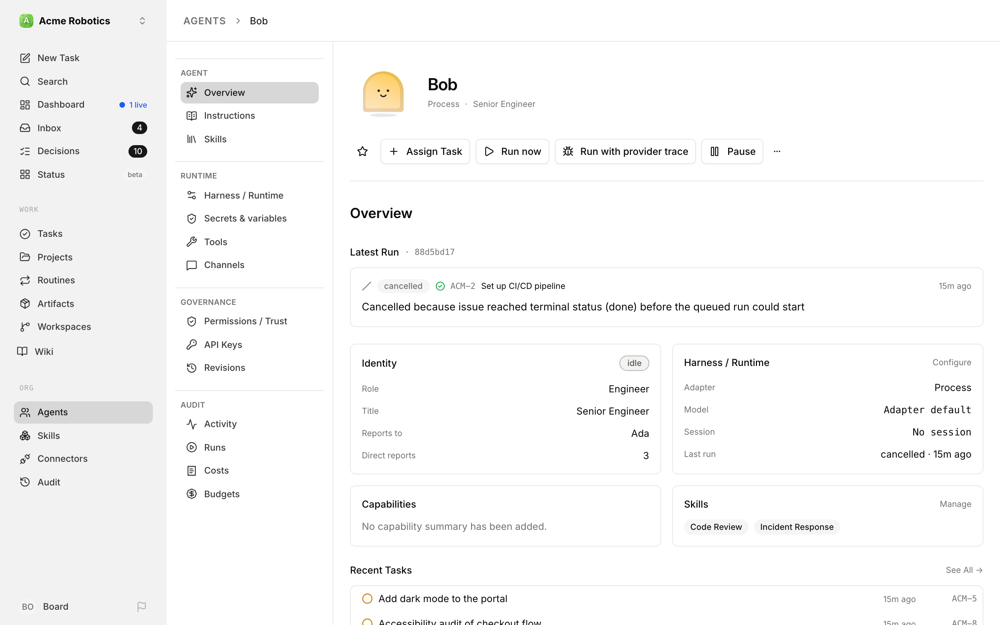
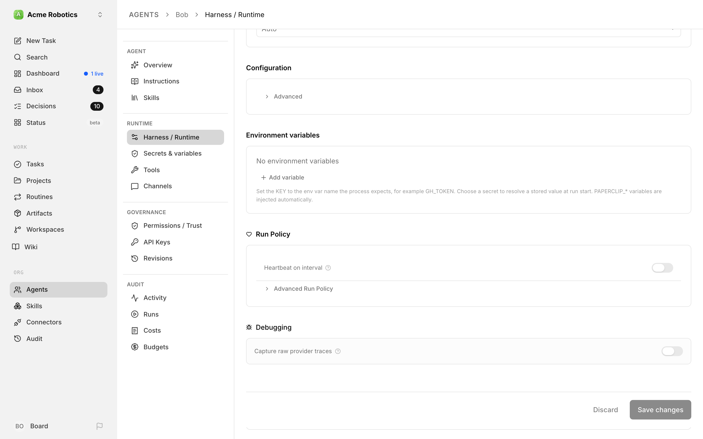
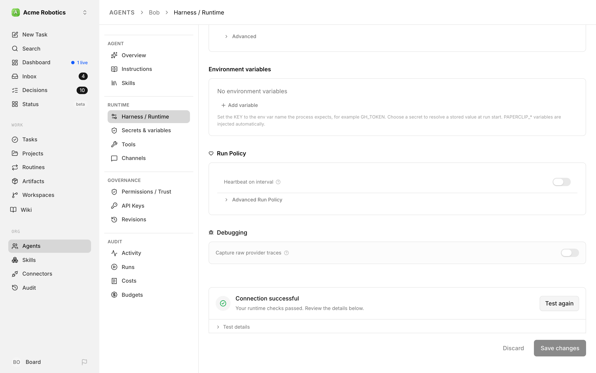
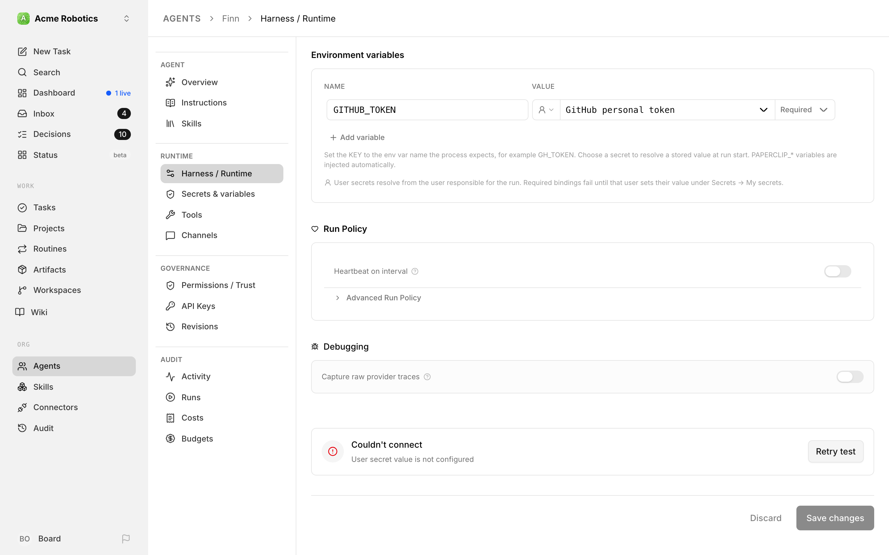

# Hire Your First Agent

An agent isn't just "an AI". It's a configuration — a specific role, with a specific AI system powering it, operating under a specific budget, with defined rules for when and how it wakes up and works.

When you hire an agent, you're telling Paperclip: which AI system should run this agent, what role does it play in the company, and what constraints does it operate within. The AI itself (Claude, Codex, etc.) lives outside Paperclip. Paperclip is the management layer above it.

The CEO is always the first agent you create. It has a special role: reading the company goal, proposing a strategy, creating tasks, and delegating work to its reports. Nothing in your company moves until the CEO is running.

---

## Before you start

You'll need:
- A company already created (see [Create Your First Company](./your-first-company.md))
- A way to pay for the AI: a Claude or ChatGPT subscription you can sign in with, or an API key from Anthropic (for Claude Code) or OpenAI (for Codex) — see the [Installation guide](./installation.md) for how to get one
- **For Claude Code:** [Claude Code](https://docs.anthropic.com/en/docs/claude-code) installed on your Mac

---

1. **Open the Agents page and click "New Agent"**

   In the sidebar, click **Agents**. If this is your first agent, you'll see an empty list with a prompt to create one. Click **New Agent**.

   

2. **Name your agent**

   A dialog titled **Meet your next agent** opens. It has two short steps — **1. Name** and **2. Adapter** — shown at the top.

   Type a name in **Agent name** (e.g. "CEO") and click **Choose adapter**.

   

   There's no role to pick. The first agent in a company is always the **CEO**, and Paperclip sets that for you. The CEO reports directly to the board — to you. Agents you hire later start with a general role and report to the CEO; you can change both afterwards on each agent's **Harness / Runtime** page.

3. **Choose an adapter**

   An adapter tells Paperclip how to run your agent. The dialog now asks **Choose an adapter**, with one card per adapter. Pick one and click **Configure agent**.

   

   <!-- tabs: Claude Code (Recommended), Codex -->

   <!-- tab: Claude Code (Recommended) -->

   **Claude Code** runs a Claude Code agent directly on your Mac. The agent can work with files in its workspace, run terminal commands, write and edit code, and call Claude on your behalf.

   This is the most capable and most commonly used adapter for Paperclip agents.

   **Prerequisites:** Claude Code must be installed on your Mac. If you haven't installed it, follow the [Claude Code installation guide](https://docs.anthropic.com/en/docs/claude-code) — it's a separate Anthropic product. Come back here once it's installed.

   <!-- tab: Codex -->

   **Codex** runs an OpenAI Codex agent directly on your Mac. Like Claude Code, it can work with files and run commands in its workspace — but it's powered by OpenAI's models rather than Anthropic's.

   **Prerequisites:** You'll need the OpenAI Codex CLI installed. Check the [OpenAI documentation](https://platform.openai.com) for installation instructions.

   <!-- /tabs -->

4. **Connect your model provider**

   After the dialog closes, you land on a setup page with your agent's (still sleepy) character at the top and the steps down the left: **Connect**, **Configure**, and **Confirmation**.

   On **Connect**, pick the **Environment** the agent runs in (the default is fine to start with), then connect Claude or OpenAI — either sign in with your subscription or provide an API key. Paperclip stores a key you enter as a secret, so it never sits in plain text in the agent's settings.

5. **Configure and test**

   On **Configure**, choose the **Model** that powers this agent. For Claude Code, `claude-opus-4-6` is the most capable and best for strategic roles like the CEO; `claude-sonnet-4-6` is faster and cheaper for routine work. For Codex, the default model is a sensible starting point. Some adapters also offer a **Thinking effort** setting — leave it on **Auto** if you're not sure.

   

   *The screenshot shows the same Model and Thinking effort settings on an existing agent's **Harness / Runtime** page — that's where you change them after setup.*

   At the bottom, the **Test your agent** card checks that your runtime and model can respond. Click **Run test**. When it says **Connection successful**, you're good to go.

6. **Finish setup**

   Click **Finish setup**. Paperclip creates the agent and shows **Your agent is ready**, with the adapter, model, and environment it'll use.

   From here, click **Edit configuration** to open the agent's settings, or **Assign CEO a Task** (the button uses your agent's name) to give it its first job. You can also open the agent from the **Agents** list. You should see it with a status of **idle** — configured and ready, but it hasn't run a heartbeat yet.

   

7. **Decide on a heartbeat schedule**

   New agents start with their timed heartbeat switched off. They still wake when you give them work or click **Run now** — they just don't wake on a timer. You'll turn the timer on in the next guide, once you're ready to let the CEO start working.

   The setting lives in the **Run Policy** card on the agent's **Harness / Runtime** page: switch on **Heartbeat on interval** and set **Run heartbeat every … sec**.

   

   > **Tip:** Don't set the interval too short early on. Every heartbeat costs money. For a CEO, once per hour (3600 seconds) is a good starting point. You can make it faster later once you understand your company's rhythm.

8. **Think about a budget**

   The setup flow doesn't set a spending cap. Once the agent has a budget policy, you manage it from **Audit → Budgets**; to create one, use the CLI or API (see [Agents: Budgets](../org/agents.md#budgets)). [Costs & budgets](../day-to-day/costs.md) explains how agent and company budgets work together.

   > **Warning:** The CEO is typically the most active agent — it runs on every heartbeat and does more complex reasoning than worker agents. Budget it slightly higher than you would a worker. $30–50 per month is a reasonable starting point for a CEO. You can always adjust this later.

   Remember: an agent budget is separate from the company budget. Both apply — if either limit is reached, the agent pauses.

9. **Test again if needed**

   You can re-run the check any time. Open the agent, go to **Harness / Runtime**, and scroll to the **Test your agent** card at the bottom. Click **Run test** (or **Test again** if you've tested before).

   Paperclip checks the runtime — for Claude Code, that Claude Code is installed and reachable and that your connection works — and waits for the model to respond.

   

   If the test succeeds, you're ready. If it fails, the card says **Couldn't connect** or **Connection needs attention**, with details underneath:

   

   See the troubleshooting section below.

---

## Troubleshooting

**"Test your agent" fails**

The two most common causes:
- The provider connection is wrong — double-check the API key you entered (no extra spaces) or sign in to your subscription again. On an existing agent, the key is set as `ANTHROPIC_API_KEY` or `OPENAI_API_KEY` under **Environment variables** on **Harness / Runtime**.
- Claude Code isn't installed, or isn't at the path Paperclip expects — confirm you can open Claude Code from your Mac independently of Paperclip.

**Agent shows "error" status after its first heartbeat**

On the agent's page, click **Runs** under **Audit** in the side menu. That opens the **Audit** page's **Runs** list filtered to this agent; click the most recent run. You'll see a full transcript of what happened. Error messages in the transcript will point to what went wrong.

**Budget immediately shows near 100%**

This usually means the model name is invalid and the API is returning error responses that still count against usage, or the bound API key doesn't have available credits. Verify the model name matches exactly what your AI provider supports, and check your API provider's billing page to confirm your account has credit.

---

Your CEO agent is configured. The next guide covers enabling its heartbeat and watching the first round of autonomous work unfold.

[Watching Agents Work →](./watching-agents-work.md)
