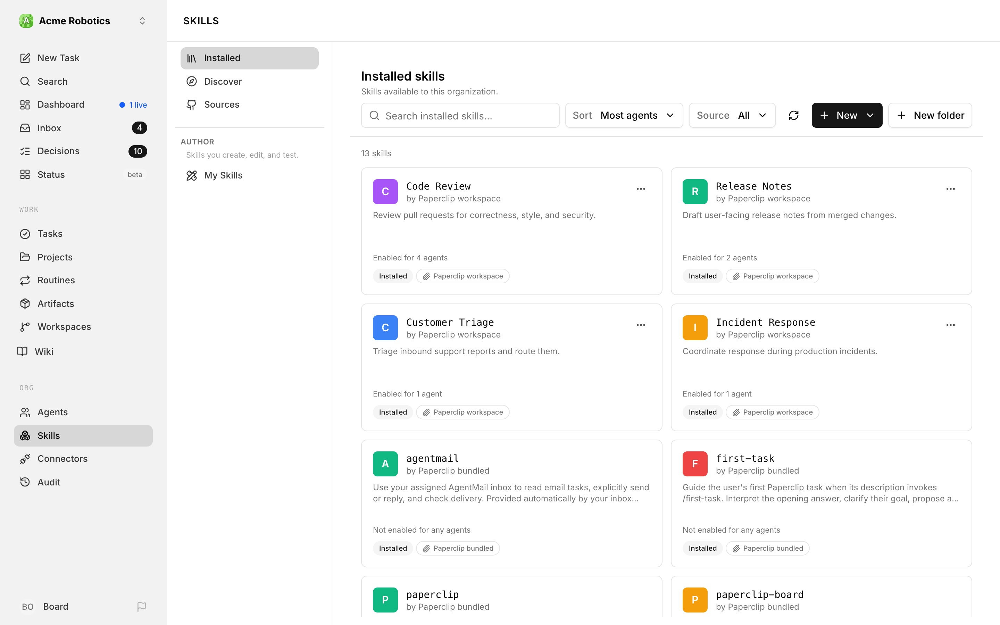
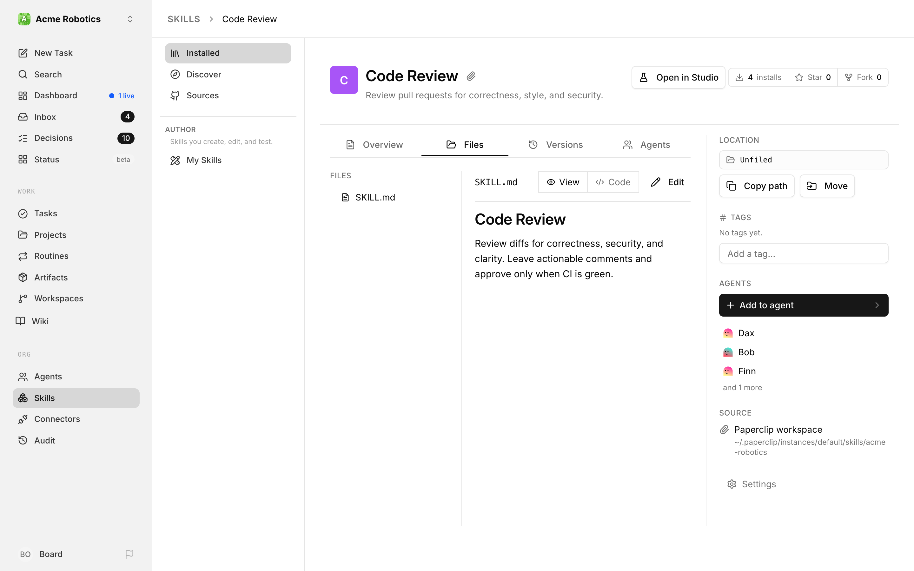
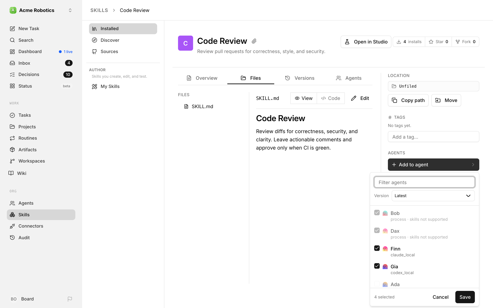

# Skills

When you want an agent to follow a specific procedure — a code review checklist, a deployment runbook, a customer response template — you could put those instructions in the agent's main configuration. But if you want multiple agents to use the same procedure, or want to keep agent configurations lean and focused, that's where skills come in.

A skill is a reusable instruction document that agents can load on demand. Instead of baking every procedure into every agent's configuration, you write a skill once in the company skill library and make it available to any agent that needs it. The agent reads the skill's description when it starts a task, decides whether the skill is relevant, and loads the full instructions only when it needs them.

---

## What a skill looks like

A skill is a folder containing a `SKILL.md` file. The file has a short frontmatter block (the routing description) and a body (the actual instructions).

```
skills/
└── code-review/
    ├── SKILL.md
    └── references/
        └── examples.md
```

The frontmatter description is what the agent reads first — it's written as decision logic so the agent knows when to use this skill:

```markdown
---
name: code-review
description: >
  Use when asked to review a pull request or code diff.
  Don't use when writing new code from scratch.
---

# Code Review

When reviewing code, check the following...
```

The agent sees the name and description for every available skill at the start of its heartbeat. If the description matches what the agent is doing, it loads the full skill content and follows the instructions.

---

## Why this matters for performance and cost

Skills keep the base context small. An agent with 10 skills doesn't load all 10 into its context on every heartbeat — it only loads the ones that are relevant to the current task. This means:

- Fewer tokens consumed per run (lower cost)
- Cleaner, more focused context for the agent (better results)
- Easier to maintain — update a skill in one place, all agents benefit

---

## Adding a skill

Skills are managed from the company-level **Skills** page. Tabs under the toolbar switch between **Installed**, **Discover**, and **My Skills**; **Sources** lives in the **New** menu (see below). If **Streamlined UI** is turned off in Experimental settings, a side menu switches between **Installed**, **Discover**, **Sources**, and (under **Author**) **My Skills** instead. The **Installed skills** view shows every skill in your library as a card, with how many agents use it and where it came from. Click a card to open that skill's detail page.

Above the cards you'll find a **Search installed skills…** box, a **Sort** menu, a scan button (the circular arrow), and two buttons: **New folder**, for organizing your library, and **+ New ▾**. Every way of adding a skill starts from the **New** menu:

- **Create new skill** — write one from scratch in Skill Studio.
- **Discover skills** — browse skills from every available source.
- **Import from GitHub** — link a repository under **Sources**.
- **Manage sources** — open the **Sources** list.
- **Import from path or URL** — paste a local path, GitHub URL, or `skills.sh` command.
- **Import skills from project** — scan a project's workspaces for skills.

The sections below walk through each one, depending on where your skill is coming from.

### 1. Import from a GitHub repository

If your skills live in a GitHub repository, the best home for them is **Skills → Sources**. Choose **New → Import from GitHub**, pick a repository, tick the skills you want, and Paperclip keeps them linked to that repository and up to date as it changes. [Sync skills from a GitHub repository](#sync-skills-from-a-github-repository) below walks through it. If the repository is already attached to one of your projects, its skills are imported for you — see [Skills from your project repositories](#skills-from-your-project-repositories).

You can also choose **New → Import from path or URL**. That opens an **Import a skill** dialog with one field — paste a GitHub URL (or a `skills.sh` install command) and click **Import**. The dialog also links out to **Browse skills.sh** and **Search GitHub** if you're still looking for something. A plain GitHub repository, folder, or `SKILL.md` URL is filed under **Sources** too, so it gets the same refresh controls. GitHub-sourced skills are pinned to a specific commit — you can check for updates and upgrade the pin from the skill detail pane.



### 2. Import from a gist

Gists work through the same **Import from path or URL** dialog. Paste the gist URL and Paperclip treats it like a remote file source — useful when you want to share a one-off procedure without setting up a full repository.

### 3. Import from a local file or folder

You can also paste a local path (Linux, WSL, or Windows) into the **Import from path or URL** dialog. Paperclip walks the folder, finds any `SKILL.md` files, and imports them. This is the right choice when you already keep skills in a project workspace on disk — the scan button (the circular arrow next to **New**, labelled *Scan project workspaces for skills*) re-runs the local import across every project workspace in the company so newly added `SKILL.md` folders show up automatically.

For safety, a local path has to sit inside a folder Paperclip already knows about: your company's managed skills folder, one of your project workspaces, or the folder Paperclip cloned a project into for you (a managed checkout). That last one means a project Paperclip checks out on your behalf can import its own skills in place, even if it has no workspace registered. A path anywhere else is refused with *"Local skill source is outside approved company workspace roots"* — add the folder as a project workspace first, or copy the skill somewhere Paperclip manages.

### 4. Import from the skills.sh marketplace

[skills.sh](https://skills.sh) is a community catalog of ready-made skills. Each listing provides a copy-ready install command; paste it into **New → Import from path or URL** and Paperclip imports the skill along with its source metadata (you will see a small skills.sh badge on the skill row).

### 5. Import skills straight from a project

If your skills already live in a repository that one of your projects points at, you don't need to hunt for the path yourself. Choose **New → Import skills from project** and the dialog does the looking for you: *"Pick a project, scan its workspaces for skills, and import them as references."*

It walks you through three steps.

**Pick a project.** You get the company's project list, with a **Filter projects** box at the top and a line under each project name telling you how many workspaces it has. Projects with nothing scannable are greyed out.

**Choose what to import.** Paperclip scans that project's workspaces for `SKILL.md` files and shows everything it found, grouped by workspace and then by the folder it was found in. Tick the ones you want. A **Search discovered skills…** box narrows a long list. If a skill's slug collides with something already in your library, the row is flagged as a conflict and an **Import as** field appears so you can give the incoming copy a different, lowercase URL-safe slug instead of overwriting anything.

If the scan comes up empty you'll see **No skills found**, along with a note about which well-known agent-harness folders were searched. Skills kept somewhere non-standard can still come in through **Import from path or URL**, described above.

**Review the result.** The last step summarises how many skills were imported, updated, and skipped, and each imported skill gets an **Open** link straight into Skill Studio.

One thing worth understanding before you use this: *"No files were copied. These skills reference the files in the project workspace — editing them in Skill Studio saves directly back to those files."* A project-imported skill is a live link to your checkout, not a snapshot. That is exactly what you want when the repository is the source of truth, and something to be deliberate about otherwise — see [Editing a skill that isn't yours to edit](#editing-a-skill-that-isnt-yours-to-edit) if you'd rather work on a copy.

### Creating a skill from scratch

If none of those sources apply, choose **New → Create new skill**. Skill Studio opens a **Create a new skill** page that walks you through four steps — **Basics**, **Design**, **Content**, and **Review** — and you can jump between them at any time:

- **Basics** — the skill name (the human-readable name shown on its card), an optional shortname (the `kebab-case` key the agent uses to reference this skill — leave it blank and Paperclip derives it from the name), and a one-line description. Write the description as routing logic ("Use when… Don't use when…"), because that's what the agent reads before loading the skill body.
- **Design** — a **Color** for the skill's tile and optional **Categories**.
- **Content** — the instructions body itself.
- **Review** — check everything and pick the **Sharing** scope (**Organization** or **Private**).

Click **Create skill** and the skill is added to the library as a Paperclip-managed, editable entry.

The skill is now available in the company library. When creating or editing an agent, you can attach optional skills from that library.


### Install a ready-made skill from the built-in catalog

You don't have to write every skill from scratch. Paperclip ships with a built-in **catalog** of ready-made skills you can browse and install with a click — a head start for common procedures.

The catalog comes in two flavours:

- **Bundled** skills are the everyday kit — things like keeping docs maintained, triaging issues, planning tasks, running QA acceptance, managing a GitHub PR workflow, and sketching low-fidelity UI **wireframes**.
- **Optional** skills are extras you add when you need them — for example, browser-driving an agent, drafting a release announcement, running a design critique, or researching what people have said about a topic in the last 30 days.

The catalog isn't only for engineers. Design, product, and research roles get a head start too: the `wireframe` skill, for instance, lets an agent draft black-and-white, low-fidelity screen layouts as SVG files before anyone commits to building the real thing — handy for a designer or product agent who wants to show structure first — and the `last30days` skill pulls recent posts and engagement from across the web so a researcher or marketer can see what people are actually saying about a topic right now. "Bundled" doesn't mean "forced on everyone": you still browse, pick, and install the ones you want.

A few catalog skills aren't shipped inside the app at all — they're pulled from an external repository pinned to a specific version. You install and update them the same way; Paperclip just fetches the files on your behalf. Either way the app knows the exact version you have, so the keep-it-current, audit, and reset features below work for every catalog skill.

Browse the catalog, pick a skill, and install it into your company library. Installing puts the skill in the library only — it doesn't attach it to any agent, so you stay in control of who uses it. From there it behaves like any other installed skill: open it, read its `SKILL.md`, and assign it to the agents that need it.

Because these skills come from Paperclip, the app knows exactly which version you installed. That means a catalog skill can be **kept up to date**: Paperclip can check whether a newer version shipped and install the update, audit the skill's contents for safety before you trust it, and reset the skill back to its original shipped version if it was edited locally. For the mechanics of installing, updating, auditing, and resetting catalog skills, see the [Skills reference](../../reference/skills.md#3-app-shipped-catalog).

---

## Sync skills from a GitHub repository

Plenty of teams already keep their skills in a GitHub repository, reviewed through pull requests like everything else. **Sources** lets you point Paperclip at that repository, choose which skills to bring in, and keep them current as the repository moves on — without retyping URLs or losing track of where each skill came from. The page's tagline sums up the default: *"Skills from your repositories stay up to date automatically."*

You'll find it through **Import from GitHub** and **Manage sources** in the Skills page's **New** menu (or under **Sources** in the Skills side menu if Streamlined UI is turned off).

### Add a repository

1. On the **Skill sources** page, click **Import from GitHub**.
2. Pick a repository from the list. It combines repositories from every GitHub connection you can use in **Apps**, so you don't have to remember which account owns what. Private repositories show a lock icon.
   - Haven't connected GitHub yet? Click **Connect GitHub to see your repos**. **Add repos** does the same when you need a repository that isn't listed. Either one takes you through the normal setup in Apps and then brings you straight back to the importer with your draft intact.
   - Want a public repository you haven't connected? Click **... or add public repo by URL** and paste it into **Repository URL**. A plain repository URL follows the default branch; paste a branch URL such as `https://github.com/owner/repository/tree/my-branch` to follow a different branch.
3. Click **Find skills**. Paperclip scans the whole repository — hidden and nested folders included — and shows its progress as it goes. You can **Cancel scan** at any point; nothing is imported until you say so.
4. Review what it found. Every skill starts out checked, with the folders that hold them already expanded. Untick any skill you don't want in your library. **Search skills or files…** narrows a long list.
5. Click **Import repository** to bring them in.

**The repository's files travel together.** Skills often lean on shared material outside their own folder — a script in a top-level `scripts/` folder, a policy file, a helper skill next door. So a new import saves the repository's supported files at the scanned commit alongside the skills you picked, and agents get those files with the skill. Unticking a skill only keeps it out of your library; its files still come along as supporting material for the others. Click **View files** — the button shows the count, as in **View 234 files** — to see exactly what's included, licence and credit files too.

Before you import, it's worth opening a skill to look inside. Click it (or one of its files) for a read-only preview of the exact files at the scanned commit. The preview lists any **Runtime requirements** the author declared — Paperclip only shows these; importing never installs dependencies or runs scripts — and a **Files not included** list for anything the skill points at that isn't coming with it.

**Warnings don't block the import.** Anything worth knowing is collected in one expandable list under the tree, labelled with a count such as **3 import warnings**: references to files that don't exist, files that were left out (too large, a symlink, or flagged by Paperclip's safety checks), and skills that need attention. A skill whose `SKILL.md` has a problem stays selected and is marked **Needs setup**; everything that's usable still imports. The same warnings stay on the source afterwards, so you can come back to them.

Imported skills go straight into your company library, ready to assign to agents like any other skill.

### Keep sources up to date

Back on **Skill sources**, each repository row shows the branch it follows (**Default branch**, or the branch name), when it last updated, and the skills you installed from it. Two things keep it current:

- **Automatic updates** are on for every source unless you turn them off. While Paperclip is running, it checks each source about every five minutes and brings in whatever changed on the tracked branch. If you'd rather review every change before your agents see it, untick **Automatic updates** in the row's **⋯** menu — the row then reads **Automatic updates paused**.
- **Refresh**, the button on the row, fetches the branch's latest commit right now, whether automatic updates are on or not.

The row's **⋯** menu has the rest:

- **Select skills** reopens the picker. New skills that appeared in a repository you added yourself wait here — the row reads *"1 new skill available"* (or however many) — until you tick them and click **Save selection**. Unticking an installed skill stops syncing it, but *"Unchecked skills stay installed."*: the skill keeps its content and its agent assignments.
- **Choose connection** and **Choose a new branch** — see [Change the branch or connection](#change-the-branch-or-connection) below.
- **Disconnect source** removes the repository from Sources — see [Remove a source](#remove-a-source).

The **⋯** button at the top of the page, next to **Import from GitHub**, holds **Manage GitHub connection**, which takes you to your GitHub connection in Apps.

An update keeps each skill's identity, folder, assignments, and history, and creates a new version only when the files actually changed. Agents already mid-run, and agents pinned to a specific version, keep what they had; the next run picks up the new version. If an update fails, your agents keep the last good version, and the row shows the error with when it last tried and a **Review source** link. When the fix is a different connection or branch, a **Choose connection** or **Choose a new branch** button appears right under the error. A skill that was deleted upstream stays installed and is marked **Removed from source · installed copy kept**.

Automatic updates have a work allowance per source, so a very large repository can't keep Paperclip busy downloading. If a source hits it you'll see *"Automatic refresh is temporarily limited. Use Refresh now, or wait for automatic updates to resume."* — **Refresh** still works straight away.

Because Paperclip stores a complete copy of every synced skill, agents can use them without reaching GitHub during a run.

### Change the branch or connection

**Choose a new branch** opens a dialog that names the repository and what it currently tracks. Pick a branch from the list — the repository's default is marked **Default** — or type any name into **Search or enter a branch name…** and choose **Use "*name*"**. Paperclip lists up to 100 branches, so typing is the way to reach one that isn't shown. Click **Change branch**; Paperclip checks the branch exists before saving and tells you *"GitHub could not find that branch or revision. Check the name or choose another branch."* if it doesn't. Your installed skills stay as they are until the next successful update brings in the new branch's content.

This is also how you fix a source whose branch has gone away — say the repository renamed `main` to `master`. For a source that belongs to a project, the branch comes from the project's repository settings instead, so the error links straight there (**Update *project name* repository**).

**Choose connection** opens **Choose GitHub connection**: *"Automatic updates will use your access to this connection. Installed skills and selections stay in place."* Pick one and click **Save connection**. Automatic updates run with the access of whoever set up the source, or whoever last chose its connection — so if that person leaves the company, the source shows *"The person who connected this source no longer has company access. Choose another GitHub connection."* until someone picks a new one.

### Remove a source

Choose **Disconnect source** from the row's **⋯** menu. Paperclip asks what should happen to the skills you imported from it, and you have to pick one:

- **Keep editable copies** — *"Move them to My Skills. Assigned agents keep using them."* Each skill keeps its ID, key, versions, and agent assignments, and becomes an ordinary editable skill. It no longer receives updates from the repository.
- **Delete skills** — *"Remove them from the library. Detach skills used by agents first."* If any of them are still assigned to an agent, the removal is refused until you detach them.

Then confirm, and the repository leaves Sources. You can add it again later; that starts a fresh source and leaves any copies you kept alone. Sources that were disconnected under the old behaviour show **Remove source** instead and go through the same choice. If someone changed the source while the dialog was open, you'll be asked to **Reload source** and choose again.

### Skills from your project repositories

If a project already points at a GitHub repository, you don't have to import its skills at all. When you attach a GitHub repository to a project workspace, Paperclip queues an import in the background, and the skills it finds land in your library on their own. The source follows the branch the workspace uses, picks up new skills added to the repository later without asking, and updates like any other source.

Repositories that projects already pointed at before this existed — or whose import couldn't start on its own — appear at the top of **Skill sources** with the project's name, the branch, and an **Import skills** button. While an import runs, the row tells you where it's at: *"Import queued. Skills will appear here when ready."*, then *"Checking repository for skills… This can take a few minutes for large repositories."* If it fails, the button becomes **Retry import**. When several projects use the same repository and branch they share one source; importing for the remaining projects lives in that source's **⋯** menu as **Import project skills**.

A few things are worth knowing:

- **Private projects keep their privacy.** A source that came from a project is marked **Project access**, and its skills are only visible to people and agents who can read one of its projects. Testing one in Skill Studio needs an agent with that access too — otherwise you'll see *"Choose an agent with access to this skill's project."* Keeping editable copies when you remove the source keeps the same restriction.
- **Change the branch in the project.** Because the project decides which branch is tracked, **Choose a new branch** isn't offered for these sources. Update the repository branch in the project's settings instead.
- **Big batches wait their turn.** Paperclip runs up to 20 queued imports per project and 100 per company at a time; the rest show *"Waiting for earlier repository imports to finish."* and start on their own as earlier ones finish. Automatic first imports also share a work allowance per company, so a burst of large repositories may pause with *"Automatic repository import is temporarily limited. It will resume when work credits refill."*

### Synced skills are read-only

A skill synced from GitHub belongs to its repository, so you change it there and let the next update bring it in (or click **Refresh**). In Skill Studio it carries a **Read-only** badge and the note *"This skill is synced from GitHub and is read-only."* The skill's detail pane shows where it came from — **Synced from GitHub**, its path in the repository, and the commit — with a **Manage source** link back to Sources.

If you want to tweak one for your company without touching the repository, click **Make a copy** to create an editable copy (see [Editing a skill that isn't yours to edit](#editing-a-skill-that-isnt-yours-to-edit)).

Skills you imported from GitHub before Sources existed are picked up automatically and appear under Sources; refresh them once to complete their local copy.

---

## Organising skills into folders

A flat list is fine for five skills and painful for fifty. The Skills page has a **Folders** rail down the left side that lets you file skills into a nested tree, so you can group them the way your company actually thinks about them.

The rail is laid out in a fixed order:

- **All skills** — everything, ignoring folders. This is the view you land on.
- **My Skills** — your own personal space. Every board user gets one, and only you see what's in yours. It's the right home for a skill you're still drafting and don't want the whole company tripping over.
- **Company** — the shared folders. These are yours to create, nest, rename, and rearrange. If you haven't made any yet you'll see *"No company folders yet."*
- **Projects** — one folder per project, filled in automatically. It's a mirror of your project structure, so a skill that came in from a project workspace has an obvious home.
- **Bundled** — the skills that ship with Paperclip, grouped by category. Read-only.
- **System → Unfiled** — everything that hasn't been filed anywhere yet.

**My Skills**, **Projects**, and **Bundled** are managed by Paperclip itself, so you can't rename or delete them. **Company** folders are entirely yours. Use the **+** next to the **Folders** heading to add one at the top level, or open a folder's **⋯** menu for **Rename**, **Edit color**, and — handily — **Move to Company** / **Move to My Skills**, which promotes a personal folder to the shared tree or pulls a shared one back into your own space. To reparent a folder somewhere deeper, use **New folder inside…** on the parent, or the move picker with its **Search folders** box and **Move here** button.

Folders nest up to four levels deep, which is usually more than enough. Below the tree you'll find a **Tags** section — folders tell you *where* a skill lives, tags describe *what it is*, and picking a tag filters within whatever part of the tree you're looking at.

If you want to script any of this — creating folders, moving skills between them, reordering — the whole tree is available over REST. See the [Folders API](../../reference/api/folders.md) for the field shapes, nesting limits, and the rules around system-managed folders.

---

## Skill Studio

Writing a skill in one window and testing it in another gets old quickly. **Skill Studio** is a dedicated workspace where you author a skill, hand it a piece of input, run it against a real agent, and read the result — without leaving the page.

Open it from a skill in your library, or from the **My Skills** tab on the Skills page. The breadcrumb reads **Skills → Studio → <skill name>** so you always know where you are.

### My Skills

The **My Skills** tab (`/skills/studio`) is headed *"Skills you can open, edit and test in Studio."* It shows the skills in your library as cards, most recently updated first. It has the same toolbar as the other tabs, with a **Search my skills…** box. Click a card and the skill opens straight in Studio rather than on its detail page. If there's nothing there yet, you'll see *"No skills yet. Create a skill to start working in Studio."*

### The landing page

If **Streamlined UI** is turned off, landing on `/skills/studio` without a skill selected gives you two lists to get back to work fast instead:

- **Recently visited** — the skills you opened in Studio on this browser.
- **Recently updated** — the skills the company changed most recently, each row showing when it was updated and a small avatar of whoever last edited it.

There's a skill picker in the header (searchable by name, slug, or key) and a **New skill** button. If the company has no skills at all yet, you get an empty state with **Create a new skill** instead.

### Three panes

Once a skill is open, Studio splits into three panes. Drag the dividers to resize them; your layout is remembered for next time. On a narrow screen the three panes become tabs instead.

**Left — the skill itself.** A file tree of everything in the skill folder, with an editor underneath. Markdown files open in the rich editor, and if the file has frontmatter you get a dedicated panel for it above the body so the routing description isn't buried in raw YAML. Everything else opens as plain text.

**Middle — the input.** This is the text you're going to hand the agent. You can paste something one-off, or pick a saved input to reuse. Saved inputs are organised with `/` in their name, exactly like folders — name one `onboarding/happy-path` and it nests. The **+** button starts a fresh **New input (not saved)**; save it when it turns out to be worth keeping. Collapse the whole pane with the chevron when you want more room, and it folds down to a single **Input folded** strip.

**Right — test runs.** Pick an agent, press **Run**, and watch the run appear in the history below. Runs refresh themselves while they're in flight and settle on one of **succeeded**, **failed**, or **cancelled**. Click any run to open its detail view with the output, any documents or attachments it produced, and — for a failed run — an error card explaining what went wrong. If the agent asked a question mid-run, you can answer it inline from the run detail rather than going hunting for the task.

### Editing and saving

Studio is explicit about unsaved work, because a half-edited skill is not what you want to test against. As soon as you change a file you get an **Unsaved** badge, an **Unsaved edits** chip in the header, and a note reminding you that *"Unsaved edits live only in this Studio session. Save to create the next version before running tests or switching files."* Try to switch files with unsaved edits and Studio asks before discarding them.

**Save** writes the file and creates the next version of the skill immediately — the header shows the current revision as `v1`, `v2`, and so on, and **Version history** opens the full list so you can look back or restore an earlier one.

The toolbar above the file tree covers the rest of the housekeeping: **Add file**, **Add folder**, **Delete file**, and **Delete folder**. Two things to know. `SKILL.md` cannot be deleted — the button stays disabled with a tooltip saying so, which makes sense given it's the file agents read first. And adding a folder seeds it with a `README.md`, because a folder with nothing in it has nowhere to show up in the tree.

The **⋯** menu in the header has **Share link**, which copies the current Studio URL — including which input and which run you're looking at — so a teammate opens exactly the view you're describing.

### Running a test

The **Run** button tells you why it's unavailable rather than leaving you guessing. Hover it and you'll get exactly one reason:

- *"This skill has no files to test"*
- *"Pick an agent to run"*
- *"Add or paste input text to run"*
- *"Save skill edits before running"*

That last one is the important one — you always test what's actually saved, never a draft that only exists in your browser.

Under **Advanced** you can choose the **run template**, which is the wrapper Paperclip puts around your input. **Default test template** is the sensible starting point; **No template** *("Run only the input text.")* hands the agent your raw input and nothing else. You can also save your own templates alongside the built-in ones, and edit, duplicate, or delete them. Your choice is remembered per company.

Test runs happen on a hidden harness task, which keeps them out of your real issue list. Runs are kept for a while and then expire — an expired run still shows its stored snapshot, but the link out to the underlying task is disabled with **Test task expired**.

### Creating a skill in Studio

**New skill** opens a create page that walks you through the basics: **Name** and a route-safe **Slug** (derived from the name unless you set your own), a **Tagline**, a **Color** and **Categories** for how the skill appears in the store and the switcher, and a **Sharing** choice of **Company** ("Visible inside this company.") or **Private** ("Only visible in your library."). A public option is shown but marked *Coming later*. Expand **Starter content** if you want to write the opening `SKILL.md` right there. Press **Create skill** and Studio opens the new skill for editing.

If you started from a folder — say, from inside **My Skills** — the new skill is filed there rather than landing in **Unfiled**.

---

## Skills your agents create during a task

You don't always have to write the skill yourself. Say you ask an agent to turn a procedure it just worked out into something reusable — "save how you reviewed these release notes as a skill." An agent running on Paperclip's native runner has a **Create skill** tool for exactly that: it writes a complete, single-file `SKILL.md` and saves it straight into your company's skill library.

A few things keep this predictable:

- **It only happens in Auto mode.** The tool is available when the task runs in Auto mode (and in skill test runs), not in Ask or Plan mode — see [Work Modes](../day-to-day/work-modes.md).
- **It follows your skill policy.** Creating a skill this way goes through the same rules as creating one in Skill Studio. With no policy in place, agents are allowed; if you've restricted `skills.create`, the agent is refused just like anyone else. See [Who is allowed to change skills](#who-is-allowed-to-change-skills).
- **It doesn't attach the skill to anyone.** The new skill lands in the library only. No agent starts using it until you (or an agent allowed to) assign it — see [Assigning a skill to an agent](#assigning-a-skill-to-an-agent).
- **Retries don't make duplicates.** If the agent's request is interrupted and retried, it gets back the skill it already made instead of a second copy.

When a skill is created, a **Skill created** card appears in the task's thread with the skill's name and description. Click it and the skill opens in its own tab in the task's side panel, showing its slug, current revision, and instructions. That tab always reads the live library copy, so it's not a second version to keep in sync. Use **Open in Skill Studio** to edit it; when you come back to the task, the tab shows what you saved. If the skill is later deleted, or you don't have access to it, the tab tells you so — *"Skill no longer available."* or *"You do not have access to this skill."* — while the card in the thread stays as a record that it was created.

The creation is also logged as `company.skill_created`, and it shows up in the task's own history as well as the company activity log.

### Letting an agent improve an existing skill

Skills get better with use, and often the agent that just followed one is the best placed to fix it — "the checklist missed the changelog step; add it." The native runner also gives agents an **Update skill** tool for exactly that. It rewrites a skill's whole `SKILL.md` in one go, the same way a save in Skill Studio does.

The tool is named `update_skill`. The agent reads the skill and its `currentVersionId`, then sends the complete primary file with `expectedVersionId` and an `idempotencyKey` — not just the lines it wants to change.

It's built so an agent can't trample anyone's work:

- **Same modes, same rules.** Like **Create skill**, it's only offered in Auto mode and skill test runs, and it obeys your skill policy — here the `skills.edit` rule. If an agent may not edit that skill, it's refused. It can only change skills you could edit in Studio, so read-only skills (the built-in catalog, GitHub sources, skills.sh) are off limits.
- **No overwriting newer edits.** The agent has to say which version of the skill it read. If someone saved a change in the meantime, the update is refused with *"Skill version changed. Read the current version before retrying."* — the agent rereads the skill and tries again on top of the latest version instead of silently undoing it.
- **Retries don't double up.** If the request is interrupted and retried, the agent gets back the original result instead of creating a second version.
- **Everything is recorded.** Each changed update becomes a new version in the skill's history, so you can compare or restore it in Studio, and it's logged as `company.skill_file_updated` against the task that made it.

After a version conflict, the agent rereads the skill and uses a new retry key for its revised request. The [Skills reference](../../reference/skills.md#native-runner-skill-tools) shows the input shape. Implementation reference: [tool contract](https://github.com/paperclipai/paperclip/blob/a6306ba606eb87c89b9ef0344e9fe8e0025580f9/packages/paperclip-runner/src/protocol-actions/update-skill.ts) and [file API binding](https://github.com/paperclipai/paperclip/blob/a6306ba606eb87c89b9ef0344e9fe8e0025580f9/server/src/services/skill-tools.ts).

---

## Renaming a skill

Names age. The `code-review` skill you wrote in week one turns out to be your PR triage procedure, and every agent that uses it is now working from a name that misleads whoever reads the roster next. You can rename it without unpicking anything.

Renaming changes three things at once, because in Paperclip they travel together:

- The **name** — what you and your team see in the library. The `name:` line in the skill's `SKILL.md` frontmatter is rewritten to match, so the file and the library never disagree.
- The **slug** — the `kebab-case` shortname used in URLs. Give it explicitly if you want to, or leave it out and Paperclip derives it from the new name.
- The **key** — the stable identifier agents reference. It follows the slug, so a new slug means a new key.

That last one is where renaming would normally hurt, and it's the part Paperclip handles for you. **Every agent that had the old skill attached is moved to the new key automatically**, keeping any pinned skill version as it was. Nothing silently detaches, and nobody has to go around the Agents list re-ticking checkboxes.

A few things worth knowing before you rename:

- **Only Paperclip-managed skills can be renamed.** Skills from the built-in catalog, GitHub, skills.sh, or a project scan are read-only for the same reason their contents are — see [Editing a skill that isn't yours to edit](#editing-a-skill-that-isnt-yours-to-edit) if you want an editable copy you *can* rename.
- **The new slug has to be free.** If another skill in the company already uses it, the rename is refused rather than overwriting anything, and you'll be told which one clashed.
- **It's audited.** The rename is written to the company activity log as `company.skill_renamed`, recording the previous and new name, slug, and key, plus every agent that was reassigned.
- **It obeys the skill policy.** Renaming counts as an edit, so if your company restricts who may change skills, the same rule applies here — see [Who is allowed to change skills](#who-is-allowed-to-change-skills).

If you'd rather script it, the endpoint is `POST /api/companies/{companyId}/skills/{skillId}/rename`. It takes a `name` (required, and it has to be a single line) and an optional `slug`; leave the slug out and it's derived from the name. The response hands back the renamed skill along with the previous name, slug, and key, and the list of agents that were reassigned.

---

## Editing a skill that isn't yours to edit

Plenty of good skills come from somewhere you don't control: a GitHub repository, skills.sh, the built-in catalog. Those are read-only on purpose, so nobody quietly rewrites a pinned skill under your agents' feet. Open one in Studio and you'll see a **Read-only** badge, an explanation of why, and a **Make a copy** button.

**Make a copy** opens a dialog titled *Edit a copy of …* that forks the skill into an editable, Paperclip-managed copy in your library. Before it does anything it runs a precheck and tells you plainly how many agents currently use the original — and offers a switch, on by default, to move those agents over to your copy. That's the decision that actually matters: fork without moving the agents and you've made a copy nobody runs; fork with the switch on and your edits take effect on the next run. The original is left untouched either way.

Once the copy exists, its Studio header carries a lineage chip reading **Forked from `owner/repo` @ `<short sha>`**, linking back to the skill it came from — so months later it's still obvious where this thing started. And if you already made a copy of this skill and haven't diverged from it, Studio offers to open that existing copy instead of minting another one.

**Skills imported from a project are a special case.** They're editable, but they aren't a copy — they point at files in your working tree. Studio says so with a persistent notice naming the location and warning that *"Saves write to the project working tree and are not committed."* There's an **Edit a copy instead** link right there if you'd rather not touch the checkout.

---

## Who is allowed to change skills

By default, nothing is locked down: every agent can create, import, install, edit, test, and remove skills, and you won't see any permission chrome in the UI at all. That's deliberate — most companies never need to think about this.

When you do want to tighten it, the **company skill policy** is where you say which agents may take which skill actions, on which skills, and from which sources. Once a policy is in place and something is actually denied, Paperclip stops being silent about it: the blocked action surfaces a banner naming what was denied and what to do about it, rather than a generic error.

For the policy document shape, the eight skill actions, and how a decision is reached, see the [Company Skill Policy API](../../reference/api/company-skill-policy.md).

---

## File inventory

Every skill is a folder, not a single file. Open a skill's detail page and switch to its **Files** tab (next to **Overview**, **Versions**, and **Agents**) to see its **file inventory** — the full tree of files underneath the skill's root. The inventory pinpoints each file with a few pieces of metadata that matter in practice:

- **Entry file** — the top-level `SKILL.md` that agents read first. It is always sorted to the top of the tree and contains the skill's frontmatter (name, description) plus the instructions body.
- **Other files** — subfolders such as `references/` or `scripts/` hold supporting material (examples, style guides, helper scripts). The file kind icon tells you at a glance whether each leaf is markdown, a reference document, or a script.
- **Editable** — a skill is editable only when Paperclip controls its source. Skills imported from GitHub, gists, or the skills.sh catalog are **read-only**: you can view any file but cannot save changes; the detail pane shows an explanation badge instead of an Edit button. Paperclip-managed and local-folder skills open in the Markdown editor when you click **Edit**.
- **Deprecated** — when a skill is retired, it is marked deprecated in the library and hidden from agent skill menus. Existing agents keep working until you detach the skill from them.
- **Virtual** — some entries in the inventory are virtual: they represent content the adapter synthesises at runtime (for example, materialised runtime skills for adapters that do not support skills natively). Virtual entries are tagged in the row and cannot be edited directly.



Above the file viewer you'll see the file's name, a **View** / **Code** toggle, and **Edit** when the skill is editable. The skill's metadata sits in a column on the right of the page, whichever tab you're on:

- **Location** — the folder the skill is filed in, with **Copy path** and **Move** buttons.
- **Tags** — the skill's tags, with an **Add a tag…** field.
- **Agents** — the agents currently attached to this skill, with an **Add to agent** button.
- **Source** — where the skill came from (for example a Paperclip workspace, a local folder, or GitHub), with its path or locator underneath.
- **Updates** — GitHub-sourced skills only. Shows the pinned commit Paperclip is locked to, a **Check for updates** button and, when an update exists, an **Install update** action.
- **Settings** — the skill's configuration, at the bottom of the column.

The skill **Key** (the stable identifier adapters use) and its **Mode** (Editable or Read only) live on the **Overview** tab, in the details under **About**.

---

## Adapter sync preferences

Different adapters handle skills differently. The Agent → Skills tab surfaces this as a small **skill application mode** badge next to the "*N* of *M* enabled" count, above the skill list — hover it for details:

- **Kept in workspace** (`persistent`) — the adapter writes skill files into the agent's workspace directory and leaves them there between runs. Most long-running local adapters use this mode.
- **Applied on next run** (`ephemeral`) — the adapter materialises skill files for each run, then cleans up afterwards. This is the default for sandboxed adapters that treat the workspace as disposable.
- **Tracked only** (`unsupported`) — Paperclip cannot push skills into the adapter, so it only records which skills you have assigned. Adapters like `openclaw_gateway` fall into this category; you will see a banner directing you to manage skills inside the remote runtime (for example, OpenClaw) rather than from Paperclip.

Assignments still save regardless of mode — the mode only controls whether Paperclip physically syncs the skill files. Warnings surface in an amber banner when, for example, a desired skill is missing from the company library or the adapter rejected a sync.

---

## Assigning a skill to an agent

Skills live at the company level, but each agent decides which of those skills to use. You can attach skills from either side: from the skill, or from the agent.

**From the skill.** Open the skill's detail page from the **Installed** view. In the right-hand column, under **Agents**, click **Add to agent**. A picker opens with a **Filter agents** box, a **Version** menu, and a checkbox per agent — tick the agents that should get the skill and click **Save**.



**From the agent.** To see and change everything one agent uses:

1. **Open the agent's detail page** from the Agents list or the org chart.
2. **Switch to the Skills tab.** The top line reads "*N* of *M* enabled", next to the skill application mode badge and a **Search skills** box.
3. You will see these groups:
   - **Enabled on this agent** — the skills this agent uses now. Flip a row's switch off to detach it.
   - **Available from the library** — every other skill in the company library that the agent *could* use. Flip a row's switch on to assign it.
   - **Automatic and detected skills (read-only)** — a collapsible group for skills the adapter supplies or picked up from somewhere Paperclip does not control (for example, a global skill bundle on the host). These are shown for visibility only.
4. Changes autosave shortly after you stop clicking — a small status chip shows "Saving soon…", then "Saving…", then "Saved". The agent will pick up the new skill list on its next run.

A **Browse skills store** button at the top of the tab jumps to the company-wide Skills page, so you can open the underlying skill to tweak its instructions without losing your place.

> **Tip:** If a skill you expect is not under **Available from the library**, it is not in the company library yet. Add it from the Skills page first, then come back.

You may notice a `first-task` skill in your library and on the first agent you created during onboarding. That's Paperclip's own guide for your very first task — how the agent reads your answer to the opening question, proposes a plan or a single task, and waits for your go-ahead before hiring or doing the work. Paperclip enforces that wait on its side too: until you accept the agent's latest proposal, the agent can't create new tasks and can't mark the first task done. Answering the opening question doesn't count as acceptance, and if the agent wrote a plan document, you need to accept its current revision — an edit after your acceptance needs a fresh go-ahead. If you decline the proposal, the agent can wrap up the first task, but still can't create work from it. The skill only applies to that onboarding task, not to the agent's other work, and other agents don't get it automatically.

---

## Pinning a beta release of the Paperclip skill

The bundled `paperclip` skill — the base procedure every agent follows on each run — keeps moving. Most of the time that is exactly what you want: better guidance ships and every agent picks it up. But sometimes you want one agent held still, either because you are comparing how two versions of the procedure behave or because a particular snapshot suits a run you would rather not disturb while you evaluate a newer one.

**Beta releases** let you do that. A release is a frozen snapshot of the Paperclip core skill, seeded into your company library alongside the live version. Pin an agent to one and that agent runs the snapshot; every other agent keeps running the live default.

### Turn it on first

The picker stays hidden until someone enables it. Open **Settings → Experimental** and flip the **Beta skills** card: *"Allow agents to pin beta releases of the Paperclip core skill. Disabling this returns every agent to the default live skill without removing saved pins."*

It is off by default everywhere — cloud and self-hosted alike — and it is not one of the cloud-managed flags, so it stays yours to turn on and off on any instance. See [Experimental features](../../experimental/overview.md) for how that page behaves.

### Pick a release

Open the agent, go to the **Skills** tab, and find the Paperclip core skill row — it needs to be enabled for that agent. A **Skill release** dropdown appears alongside it:

- **Default — current (recommended)** — no pin at all. The agent runs the live skill and picks up every future change. This is where every agent starts.
- Each frozen release, shown as its name plus the day it was cut — for example **V7 — Roster champion · released 2026-07-21** — carrying a small **Beta** badge.

Two releases ship today: **V0 — Original**, the original snapshot of the core skill, and **V7 — Roster champion**. Both are historical by design. **V7 — Roster champion** predates three later edits to `SKILL.md`, `references/api-reference.md`, and `references/company-skills.md`, and the live default keeps that newer guidance — which is the trade-off worth holding in mind. A pin buys you a procedure that will not move, and costs you every improvement made since it was cut. That is why the default option says *recommended*.

Choosing a release saves immediately rather than waiting for the usual autosave, and the skill row picks up a **Beta · V7** style badge so you can see at a glance which agents are pinned. Switch back to **Default — current (recommended)** to clear the pin.

### What happens when the flag is off

Turning **Beta skills** back off erases nothing. Saved pins stay on the agent — they are simply ignored, and every agent goes back to the live default skill on its next run. Turn the flag on again and those pins apply again.

The same rule holds over the API: saving a version pin while the flag is off is rejected with *"Beta skill version pins require the Beta skills experimental setting to be enabled."* For the request shape, the release fields, and where the snapshots come from, see [Skills reference → Beta releases of the bundled `paperclip` skill](../../reference/skills.md#beta-releases-of-the-bundled-paperclip-skill).

---

## Trust level

Skills are loaded into agent runs as additional instructions, so where they come from matters. Paperclip uses the **Source** badge on every skill row to make that provenance obvious:

- **Paperclip-managed** — authored inside Paperclip. You have full control of the contents; these are the safest skills to give an agent.
- **Local folder** — pulled from a project workspace on the same machine. Trust level matches whatever you trust the folder itself with.
- **GitHub / skills.sh** — pinned to a specific commit or release. A skill synced through **Skills → Sources** follows its repository automatically, so anyone who can push to that repository is effectively writing instructions for your agents. If you want a second look at every change before it reaches them, turn off **Automatic updates** for that source and use **Refresh** when you're ready. Other GitHub and skills.sh skills only move when you click **Install update** on the detail pane.
- **Gist / URL** — point-in-time imports of external content. Treat these like any third-party code: review the body before you attach the skill to an agent.

Before attaching a skill to a high-trust role (your CEO, a finance agent, an operator with access to secrets), open the skill and read its `SKILL.md` end-to-end. The **Used by** list on the detail pane makes it easy to audit which agents are already exposed to a given skill.

---

## What makes a good skill

**Write the description as routing logic.** The description is not a marketing pitch — it's the signal the agent uses to decide whether to load the skill. Include "Use when" and "Don't use when" guidance.

**Be specific and actionable.** The agent should be able to follow the skill without guessing. Vague instructions ("review the code carefully") produce vague output. Concrete checklists and steps produce consistent results.

**Include examples where they help.** Code snippets, example outputs, before/after comparisons — concrete examples are more reliable than abstract descriptions.

**Keep each skill focused on one concern.** A skill that covers code review, deployment, and customer communication is three skills fighting for attention. One skill, one purpose.

**Put supporting detail in `references/`.** If a skill needs supporting documents — style guides, example files, reference material — put them in a `references/` subfolder rather than cramming everything into `SKILL.md`.

---

## Skills across agents

Skills live at the company level, not inside one specific agent. This means:

- Your CTO and Backend Engineer can share a `code-review` skill without duplicating it
- Your CEO can use a `delegation-checklist` skill that your CMO also uses for their own task breakdown
- Updating a skill improves all agents that use it at once

You can also scan and import skills from project workspaces when you already have skill files on disk. That's useful for teams migrating existing `SKILL.md` folders into the Paperclip library — see [Import skills straight from a project](#5-import-skills-straight-from-a-project).

---

## Working with skills programmatically

Most of the time you will manage skills from the UI, but the same operations are available as REST endpoints when you want to script onboarding or reproduce a known agent setup from another company.

- **List the skills attached to an agent**: `GET /api/agents/{agentId}/skills`
- **Sync the attached set**: `POST /api/agents/{agentId}/skills/sync` with `{ "desiredSkills": [...], "mode": "add" | "remove" | "replace" }`. Each `desiredSkills` entry is a skill UUID, canonical key, or unique slug. The required `mode` chooses how the list applies: `add` unions the named skills into the current set, `remove` drops only the named skills, and `replace` reconciles the set to match exactly — adding any missing and removing any not in the list.
- **Provision skills at hire time**: pass `desiredSkills` on `POST /api/companies/{companyId}/agents` so the agent comes online with the right set already attached.

The skills must already be installed at the company level before you can attach them. For the full reference — file shape, install pipeline, canonical keys, versioning, and troubleshooting — see:

- [Skills reference](../../reference/skills.md) — everything about how skills work on disk and over the wire.
- [Agents API → Skills](../../reference/api/agents.md#skills) — request/response shapes for the agent-level routes.
- [Skills reference → GitHub skill sources](../../reference/skills.md#github-skill-sources) — the routes behind **Skills → Sources**.
- [Folders API](../../reference/api/folders.md) — creating, nesting, and reordering the skill folder tree.
- [Company Skill Policy API](../../reference/api/company-skill-policy.md) — restricting who may create, import, edit, test, or remove skills.

---

## You're set

Skills give your agents reliable, reusable procedures that improve consistency and reduce cost. The next guide covers export and import — how to back up, share, and reuse company configurations.

[Export & Import →](../power/export-import.md)
