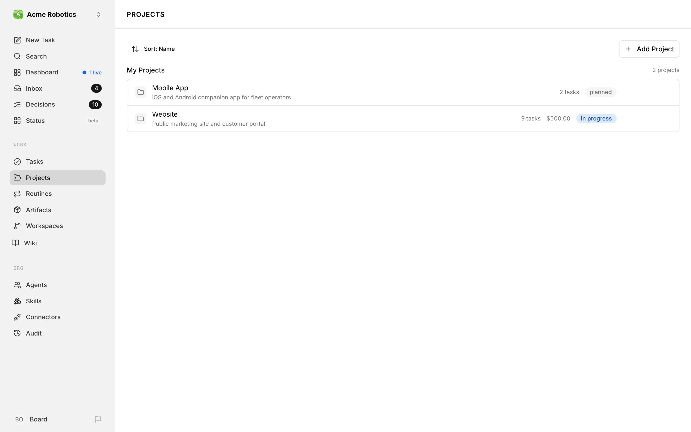
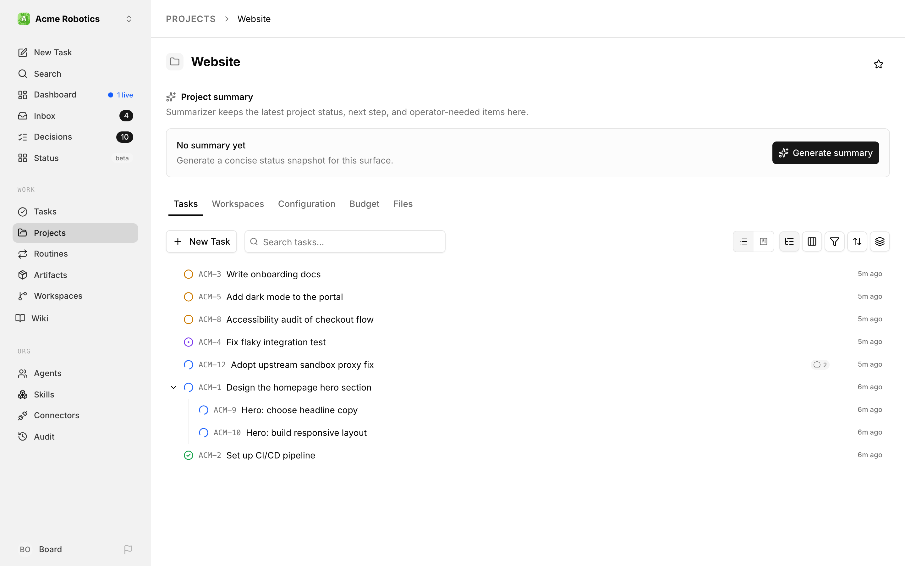
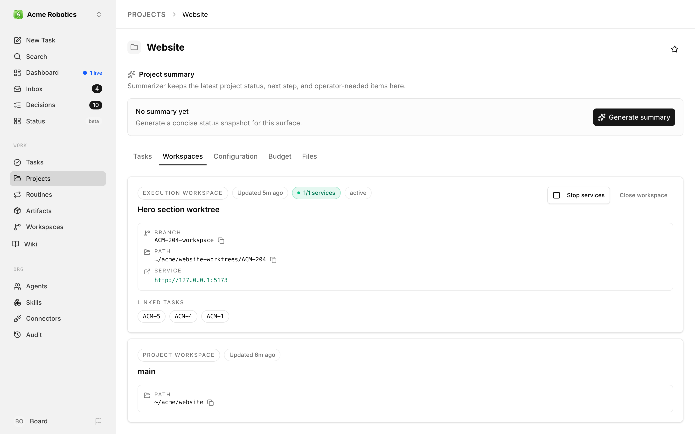
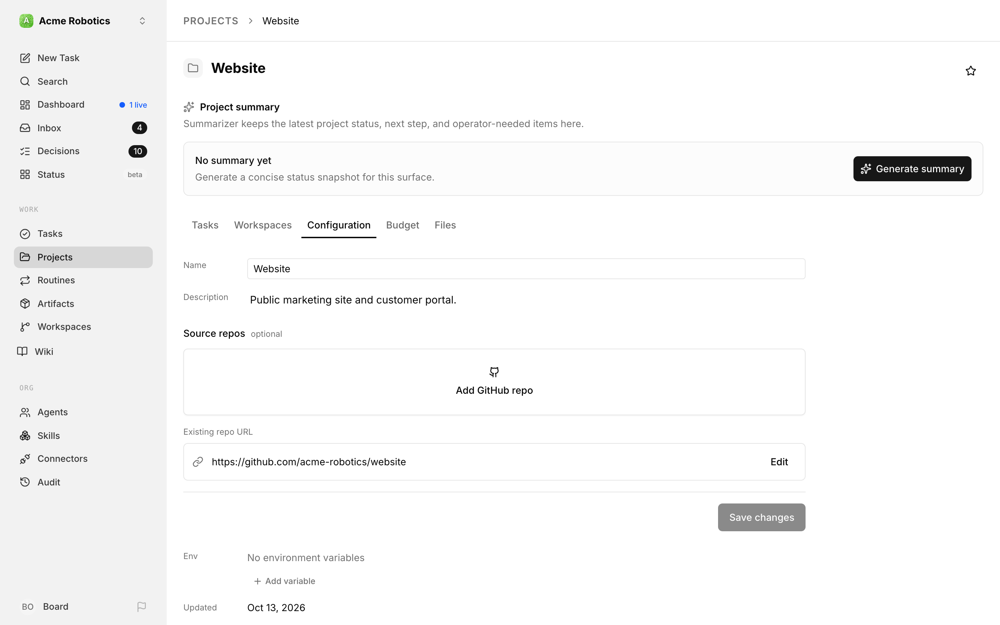
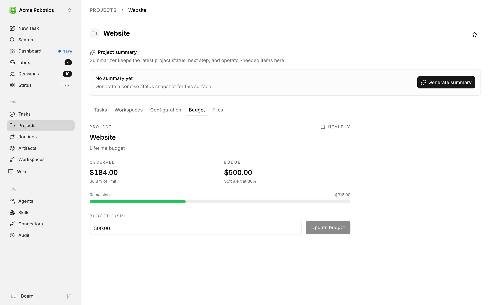

# Projects

A project is the container Paperclip uses to group related work. If goals answer "why are we doing this?" and issues answer "what exactly needs doing?", projects sit in between: they bind a body of work to a concrete place — a repository, a working directory, a budget envelope, a set of execution workspaces — where agents can actually pick up tasks and make progress.

Every issue in Paperclip lives under a project. Every execution workspace is scoped to a project. Budgets can be pinned to a project. When you tell an agent "work on the marketing site", you are really telling it "work on issues in the Marketing Site project, using the code and configuration the project points at". Projects are how the abstract strategy the CEO writes becomes something concrete an agent can check out and run.

This guide walks through the project list, then the tabs you see when you open a project: **Tasks**, **Workspaces**, **Configuration**, and **Budget** (plus any tabs your plugins add, such as **Files**).

---

## Project List

The Projects page lists every active (non-archived) project in the currently selected company. A **Sort: Name** control sits at the top left and an **Add Project** button at the top right.

Projects are grouped into **My Projects** and, if you've left any, **Other Projects** (shown dimmed). Each section header shows how many projects it holds.

### Row anatomy

Each row is a single project entry. Reading left to right you see:

- **Project tile** — a small square with the project's icon (a folder unless you've picked another). If the project has a color, the tile is tinted with it; otherwise it stays neutral gray.
- **Project name** — the main title. Clicking the row opens the project detail page and defaults to the Tasks tab (unless you previously visited the project, in which case Paperclip restores the tab you last used).
- **Description** (subtitle) — the project description if one has been set. If the project has no description, this area is empty.
- **Task count** — how many tasks the project holds, for example "9 tasks".
- **Budget** and **Target date** — shown in muted text only when the project has a budget or a target date set.
- **Status badge** — the current project status, such as `planned` or `in progress`. The badge color is consistent with issue status badges used elsewhere in the app.
- **Lock** — a private project shows a lock on the right of its row, and also in the sidebar and the composer's project picker.
- **Join / Leave** and a **star** — personal controls for your sidebar (see [Keeping projects (and agents) in your sidebar](#keeping-projects-and-agents-in-your-sidebar)).

Archived projects are filtered out of this list. You can still reach them by following a direct link, and you can unarchive them from the project's Configuration tab.

### Sorting and actions

The list doesn't have filters, but you can change the order. Click **Sort: Name** and choose **Name**, **Updated**, **Created**, or **Target date**. Click the active option again to flip between ascending and descending.

The top-right **Add Project** button opens the New Project dialog, where you can set the name, description, target date, initial status, and color. The Configuration tab is where you come back later to change repository bindings, environment variables, and execution workspace behaviour — the create dialog only covers the minimum a project needs to exist.

If the company has no projects yet, the list is replaced with an empty state prompting you to add the first one.

### Keeping projects (and agents) in your sidebar

As a company grows, the **Projects** and **Agents** groups in the left sidebar can get crowded. To keep yours focused, you can **join** or **leave** individual projects and agents — a personal setting that only affects your own navigation.

- Hover a project or agent in the sidebar and use the **Join** / **Leave** control. Leaving hides it from your sidebar; joining brings it back.
- Everything is **joined by default**, so a brand-new project shows up for everyone until they choose to leave it.
- This is purely cosmetic and per-user. Leaving a project doesn't pause it, archive it, or change anything for your teammates — it still runs, and it's still reachable from the Projects and Agents pages. You're just tidying your own view.

Each join or leave is recorded in the company activity log, so the change is auditable even though it only affects one person's sidebar.

---

## The project header

Open a project and the top of the page gives you its identity at a glance:

- **Icon and color** — click the tile next to the name to pick a different icon or color.
- **Name** — click it to rename the project inline.
- **Star** — the star button in the top right pins the project for quick access.
- **Project summary** — a card where Paperclip's built-in Summarizer agent keeps the latest project status, next step, and operator-needed items. Until the Summarizer is configured, the card shows a **Set up Summarizer** button instead.

Below the header sit the tabs. There's no separate Overview tab any more: the project's description lives on the Configuration tab, and its day-to-day progress lives on the Tasks tab.

Paperclip doesn't keep a single "percent complete" field for a project. Progress is the shape of the Tasks tab — how many tasks are `todo`, `in_progress`, `in_review`, `done`, or `cancelled`.

### Tabs added by plugins

Plugins can add their own tabs after **Budget**. For example, the example File Browser plugin adds a **Files** tab with a file browser and editor for the project's workspace. If you see a tab not covered in this guide, it comes from a plugin installed on your instance.

---

## Tasks Tab

The Tasks tab is the project's task board. It's the same task list you see on the global Tasks page, pre-filtered to this project. For most day-to-day work this is the tab you'll spend the most time on, and it's where a project opens by default.

### What is shown

The tab uses the shared task list, so the view, grouping, filter, and sort controls are identical to the global view:

- Each row shows the task identifier, title, status icon, and when it was last updated, plus a live-run indicator when an agent is currently working on it.
- Sub-tasks nest under their parent, and you can collapse a parent to hide them.
- Live run indicators refresh every few seconds while the tab is open, so you can watch a run pick up, advance, and finish without refreshing the page.

### Filtering and view state

Your view settings on this tab — grouping, sort order, which groups are collapsed — are saved separately from the global task view, per project. Switching to another project and back restores the same layout. Switching to the global task list doesn't disturb the project-scoped view.

There's no "filter by project" control here because the list is already scoped to the project. You can still filter by status, responsible agent or person, creator, label, and more from the **Filter** button, or use the **Search tasks...** box.

### Creating tasks in the project

Tasks created with the **New Task** button on this tab default to the current project, so you don't have to set the project field by hand. To create a task in a different project, switch to that project first or use the global **New Task** dialog and pick the project explicitly.

### Relationship to execution workspaces

Each task may be tied to an execution workspace — a specific working copy of the project's code — when an agent picks it up. The Workspaces tab (next section) groups tasks by the workspace they're running in, which is often a more useful lens once work is in flight. See [Execution Workspaces](./workspaces.md) for the underlying model.

---

## Workspaces Tab

The Workspaces tab shows the workspaces attached to the project: the project's own checkout plus any execution workspaces agents have created. It only appears when the **isolated workspaces** experimental setting is enabled for your instance. Without it, Paperclip sends you to the Tasks tab instead.

### What a workspace card shows

Each workspace is a card. A tag at the top tells you which kind it is — **Execution workspace** or **Project workspace** — next to when it was last updated and, if it has runtime services, how many are running. Inside the card you'll find:

- The workspace name, plus its branch, path, and any running service URL. Copy buttons sit next to the branch and path.
- **Linked tasks** — the tasks currently tied to that workspace, so you can see what work is running there.
- **Start services** / **Stop services** — controls for any runtime services the workspace defines (dev servers, watchers, databases). Runtime services aren't auto-started; you control them from this card.
- **Close workspace** — on execution workspaces only. It opens the close dialog; closing stops the workspace's runtime services and archives it.

Execution workspaces whose status is `cleanup_failed` are grouped into a separate section labelled **Cleanup attention needed**, rendered in amber. These couldn't be fully torn down and need a human decision: use **Retry close** on the card, or investigate the underlying path yourself.

### Project workspace vs. execution workspaces

The project's primary checkout always shows up here as a **Project workspace** card (in the screenshot above, the one called `main`). It's the default every task runs in when no isolated workspace is provisioned, so it has no close control. Execution workspaces are the isolated checkouts Paperclip creates for individual tasks. For the full mental model of primary, isolated, and reused workspaces, see [Execution Workspaces](./workspaces.md).

### When agents create workspaces

Agents create isolated workspaces when they pick up a task that's configured to run in isolation, or when you explicitly request one. The Workspaces tab is where you monitor, manage, and close them over time. If the list grows long, closing the oldest completed ones is safe — once the underlying branch has been merged or discarded, the workspace no longer serves a purpose.

---

## Configuration Tab

The Configuration tab is where the project's editable properties live. Most fields save as you edit: you'll see a small **Saving** / **Saved** indicator next to the field label. The one exception is the source repositories section, which has its own **Save changes** button (described below).

### Basic properties

- **Name** — the project name shown in the list and in every breadcrumb. Changing it is safe; links that use the project's slug continue to resolve.
- **Description** — the full description, rendered as markdown. Click it to edit; it saves when you leave the editor.
- **Env** — environment variables for the project (see below).
- **Updated**, **Target Date**, and **Created** — read-only dates. Target Date only appears when the project has one.

### Project visibility

The **Visibility** row decides who can find the project. Projects start **Open to company**, so everyone in the company can see them. Tasks you've made private on their own still keep their own access rules.

Turn the switch on to make the project **Private**. Then only its access members can find it, and members can read every task in it. A task in the project can still be shared directly with someone outside it. Click **Manage access** to open **Private project access**, where you add a person or agent or remove one. People who can't change access see **View access** instead.

To open a private project to the whole company again, turn the switch off. Paperclip asks you to confirm in **Open this project to the company?**. The project's private tasks stay private. Members who only had access through the project lose it, so share those tasks directly first if they should keep it. Choose **Keep private** to back out.

New tasks in a private project are private automatically. See [Private tasks and sharing](../day-to-day/issues.md#private-tasks-and-sharing).

### Source repos

The **Source repos** section (marked optional) is where you connect the project to GitHub:

- **Add GitHub repo** picks a repository from your connected GitHub accounts. If you haven't connected GitHub yet, you can connect it from here. Once a repo is added, the button becomes **Add another repo**.
- **Existing repo URL** shows a repository URL bound the older way, as a plain link. Click **Edit** to change it.

Repository changes don't auto-save. When you've made your picks, click **Save changes** (or **Discard changes** to undo). You'll see **Changes saved** once they're stored.

When a workspace points at a GitHub repository, Paperclip imports that repository's skills into your library in the background and keeps them up to date. See [Skills from your project repositories](../org/skills.md#skills-from-your-project-repositories). The skill source follows the branch set on the workspace, so change the branch here, not in Skills.

### Codebase and local folder

Below the first divider, the **Codebase** section shows where the project's code lives on the machine running Paperclip. Use **Set local folder** (or **Change local folder**) to point the project at a directory. Agents work directly in this folder, or in isolated worktrees derived from it. If the project's primary workspace defines runtime services, they're listed here too.

### Environment variables

Each project can define environment variables that are injected into agent runs and execution workspace commands. You manage them in the **Env** row:

- Use **Add variable** to add one, and rename or delete variables inline.
- Secret-valued variables are stored via the secrets store and rendered masked.
- Project variables extend the environment an agent sees when it runs inside this project; they don't change anything at the company level.

### Execution workspace configuration

When isolated workspaces are enabled, the Configuration tab shows an **Execution Workspaces** section with the per-project knobs:

- **Enable isolated task checkouts** — whether this project uses isolated workspaces at all. If off, every task runs in the project's primary checkout.
- **New tasks default to isolated checkout** — when on, new tasks get their own isolated workspace by default. When off, new tasks stay on the primary checkout unless someone opts in. Individual tasks can override.
- **Shared workspace concurrency** — how runs share the primary checkout: **Auto**, **Serialize**, or **Allow**.

Click **Show advanced checkout settings** for the rest:

- **Environment** — which environment isolated runs use (only shown when environments are enabled and more than one is available).
- **Base ref** — the git ref (branch, tag, or commit) new isolated workspaces branch from.
- **Branch template** — the naming convention Paperclip uses for new branches (for example, a template that includes the task identifier).
- **Worktree parent dir** — where Paperclip places new git worktrees on disk.
- **Provision command** and **Runtime provision command** — optional commands run when a new workspace is set up (for example, to install dependencies).
- **Teardown command** — an optional command run before a workspace is closed.

These settings map to the behaviours described in [Execution Workspaces](./workspaces.md). You'll usually set them once per project and rarely touch them again.

### Archive and unarchive

At the bottom of the Configuration tab, in the **Danger Zone**, is the **Archive project** button. Paperclip asks you to **Confirm** before it archives. Archiving hides the project from the sidebar and project selectors, but it doesn't delete anything: tasks, workspaces, and history stay intact. On an archived project the same control reads **Unarchive project**.

When you archive, the page navigates back to the dashboard and shows a confirmation toast. If the archive fails (for example because of a server error), a failure toast appears and the project stays active.

### Pause by budget hard stop

If the project is currently paused because its budget policy hit a hard stop, a red **Paused by budget hard stop** pill appears at the top of the project page (not inside this tab specifically, but worth noting here because the resolution path is the Budget tab). Resume the project either by raising the budget or by resolving the budget override approval.

---

## Budget Tab

The Budget tab is where the project-scoped budget policy lives. This is a project-level cap, distinct from:

- **Agent budgets** — per-agent caps, set on each agent's configuration.
- **Company budgets** — the overall cap for the company.

Project budgets are useful when a single project needs a hard spending ceiling independent of the agent doing the work. For a first principles tour of budgeting, see [Costs & Budgets](../day-to-day/costs.md).

### Reading the budget card

The Budget tab renders a single policy card for this project's budget:

- **Scope** — always `project` on this tab, targeting the current project's id and name.
- **Metric** — `billed_cents`. Paperclip tracks billable cost in cents and converts to a currency figure for display.
- **Window** — `lifetime`. Project budgets default to a lifetime cap rather than a rolling window; the total spend against the project counts against the amount.
- **Amount** — the configured cap. Editable in the card.
- **Observed amount** — how much has been spent so far against the project.
- **Remaining amount** — amount minus observed.
- **Utilization percent** — the observed share of the cap, with a warn threshold (default 80%) after which the card visually signals that the project is approaching its limit.
- **Hard stop enabled** — when true, exceeding the cap pauses the project automatically. This is the behaviour that triggers the "Paused by budget hard stop" pill described above.
- **Notify enabled** — when true, the company is notified as the project crosses the warn threshold.
- **Paused** — whether the project is currently paused (and why, in **Pause reason**).

### Setting or changing the amount

Click the amount field, enter the new cap in dollars (the UI converts to cents), and save. The change invalidates the budget overview, the project detail view, the project list, and the dashboard, so every surface that shows a budget number updates.

If the project has no explicit policy, the card is rendered in a placeholder state with zero amount, zero observed, and `isActive: false`. Saving a non-zero amount creates the policy.

### Distinct from agent and company budgets

A project budget does not replace agent budgets or the company budget. All three apply in parallel:

- An agent hitting its own budget stops, regardless of project budget headroom.
- A project hitting its budget pauses the project, regardless of which agent was working in it.
- The company budget is the overall ceiling; if it stops, no agents in any project can spend further.

See [Costs & Budgets](../day-to-day/costs.md) for how these three interact, how to read the company-wide cost overview, and how to resolve a budget override approval when a hard stop is reached.

### Resume after a hard stop

When the project is paused by a hard stop, you have two options:

1. **Raise the amount** from the Budget tab. Once the new amount exceeds observed spend, the project can resume on the next run.
2. **Resolve the budget override approval** from the approvals queue. Budget approvals are the formal path an agent uses to ask for more headroom without a human manually raising the cap.

Both flows are described in more detail in the approvals and costs guides.

---

## Where to go next

- Task-level work: [Managing Tasks](../day-to-day/issues.md).
- The goal model that sits above projects: [Goals](./goals.md).
- The execution surface beneath projects: [Execution Workspaces](./workspaces.md).
- Budget mechanics in more depth: [Costs & Budgets](../day-to-day/costs.md).
