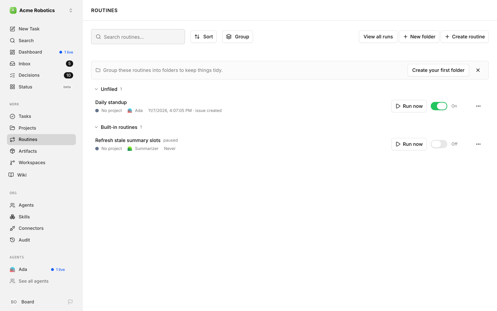
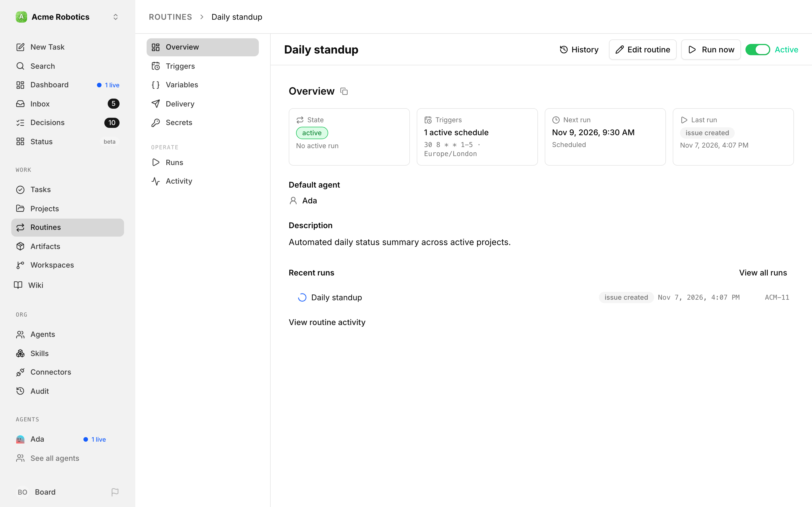
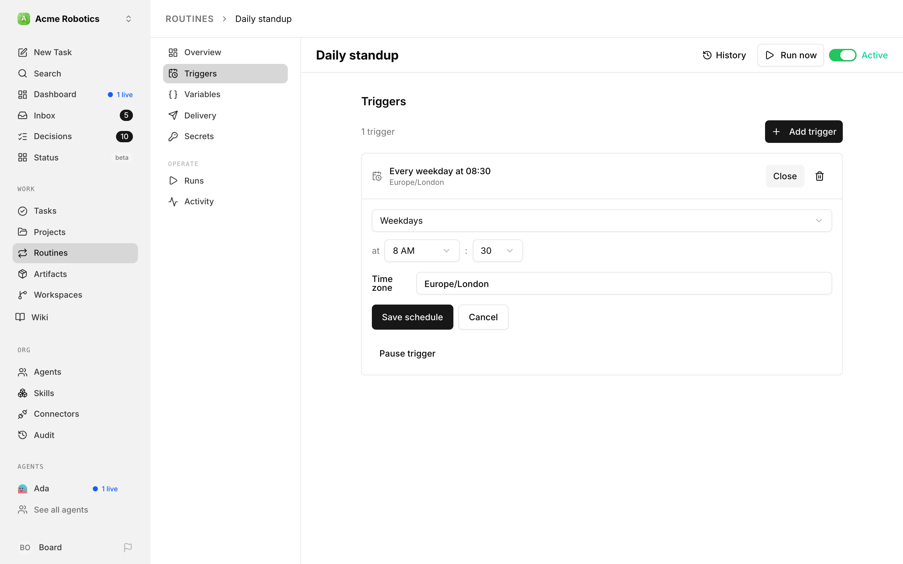

# Heartbeats & Routines

When you first hire a few agents, it's tempting to give each one a timer — "wake up every few minutes and see if there's anything to do." It feels proactive. In practice, it's the fastest way to end up with a sidebar full of paused agents, surprise token bills, and a dashboard you have to fight with just to keep things quiet.

Paperclip is designed around a different default: agents stay dormant until real work arrives. This guide explains the two mechanisms that drive an agent — **heartbeats on an interval** and **routines** — and when to reach for each one. It also walks through the Routines UI, from the list view down to the routine page where you see and change its triggers, variables, and history.

---

## The two ways an agent starts running

An agent can be woken up in four ways:

| Source | What triggers it |
|---|---|
| **Timer** | A heartbeat interval ticks (e.g. every 5 minutes, whether or not there's work) |
| **Assignment** | A task is assigned to the agent, or a new comment arrives on one of its open tasks |
| **On demand** | You click "Wake now" in the UI, or another agent hands it work |
| **Automation** | A routine fires on its schedule and hands the agent an issue to execute |

The first — timer — is the only one that wakes an agent without anything having actually happened. The other three are event-driven: the agent runs *because there's something to do*, not *in case there's something to do*.

---

## Why timer heartbeats are opt-in

A new agent ships with timer heartbeats **turned off** by default. That's deliberate, and it's the setting you should usually keep.

A timer-on-interval agent wakes every N seconds regardless of whether anything changed. Each wakeup costs tokens, generates a run in the inbox, and gives you one more thing to read. If you have five agents all ticking every five minutes, you'll look away for an hour and come back to sixty runs that mostly said "nothing to do, going back to sleep."

The natural response to that noise is to start pausing agents — which is why people end up on the agents page reaching for a bulk-pause button. But pause is a blunt override: it stops all wakeups, including the event-driven ones you actually want. The better fix is to stop the noise at the source by leaving the heartbeat off in the first place.

> **Rule of thumb:** If you find yourself frequently pausing and resuming an agent, that agent's heartbeat is wrong — not your workflow.

---

## Heartbeat settings on an agent

An agent's heartbeat settings live in its `runtimeConfig`, under `heartbeat`. To see or change them, open the agent and, in its side menu under **Agent**, click **Advanced**. The settings open as a YAML document. Under `spec`, an agent created from the **New Agent** flow starts with a block like this:

```yaml
runtimeConfig:
  heartbeat:
    enabled: false
    intervalSec: 300
    wakeOnDemand: true
    skipTimerWhenNoActionableWork: true
    cooldownSec: 10
    maxConcurrentRuns: 20
```

- **`enabled`** — the master switch for the timer. Off by default. Turn it on only when the agent needs to poll something that doesn't have its own event trigger (see "When a timer is the right answer" below).
- **`intervalSec`** — how often the timer fires, in seconds. It only matters when `enabled` is `true`. If you need a timer at all, prefer minutes or hours, not seconds.
- **`wakeOnDemand`** — leave this on. It's what lets assignments, comments, and routines reach the agent.
- **`cooldownSec`** — minimum gap between runs, useful for bursty work.
- **`maxConcurrentRuns`** — how many tasks the agent can work in parallel.

Change the values in place and click **Save changes**. Keep the other lines under `runtimeConfig` — the whole block replaces the saved one when you save. See [Edit an agent as YAML](../org/agent-configuration-yaml.md) for the details. You can also send the same `runtimeConfig` to the API with [Update Agent](../../reference/api/agents.md#update-agent).

The combination you want for most agents: `enabled: false`, `wakeOnDemand: true`. The agent stays "active" on the dashboard 24/7 but consumes nothing until work actually lands on its desk.

---

## Routines — scheduled work the right way

Routines are where scheduled work belongs. A routine is a reusable job definition with a trigger attached to it. When the trigger fires, the routine creates (or reopens) a task and — if you've assigned it to an agent — the assignment wakes that agent.

Two trigger kinds are supported:

- **Schedule** — a cron expression in your timezone. "Every weekday at 9am", "the first of every month", "every Sunday at midnight". Paperclip computes the next run and fires on that clock.
- **Webhook** — a signed URL you can call from anything outside Paperclip. Useful when another system should kick off the work.

You'll find routines on the **Routines** page in the sidebar.

### Creating a routine

1. Open the **Routines** page and click **New routine**
2. Give it a title and write the instructions: what the task should do each time
3. Choose a **Default agent** to handle the work
4. For scheduled work, click **Add schedule** under **Repeats**. The new schedule starts as weekdays at 9:00 AM (`0 9 * * 1-5`) in your browser's time zone, and you can change it right there
5. Click **Create routine**

When the trigger fires, Paperclip creates a task, assigns it to the agent, and that assignment wakes the agent immediately. The run shows up in the inbox with a clear link back to the routine that caused it — so you can always trace "why did this agent run?" back to a specific cause.

> **Tip:** Want the result in your chat instead of buried in a task? Ask for it in the routine's instructions — "send the digest to my chat". The agent posts it to its chat with the routine's [responsible user](#the-responsible-user), with a link back to the routine's task, and the chat shows as unread until you've seen it. See [Messages from tasks and routines](../../experimental/agent-chat.md#messages-from-tasks-and-routines).

### Routine policies worth knowing

Two policies control what happens when schedules overlap or the scheduler has been offline. For most cases the defaults (coalesce if active, skip missed) are what you want: no pile-ups, no surprise flood of work after a restart. See [Catch-up behaviour](#catch-up-behaviour) for the options. You set these through the [Routines API](../../reference/api/routines.md) or the [CLI](../../reference/cli/routine.md); the routine page shows them under **Run rules** whenever they differ from the defaults.

---

## The Routines list



The Routines page is reached from **Routines** in the sidebar. There are no tabs: a single toolbar runs across the top. **New routine** sits on the left. On the right, in this order, you'll find a **Search routines…** box, then icon buttons for **Sort**, **Filter**, **Group**, and **Columns**, and finally a **View all tasks** button. The routine list sits right below.

### List rows and columns

Each row starts with the routine's **title**. A small grey label appears beside it when the routine is not active: `paused`, `draft` (no default agent assigned), or `archived`. The columns after the title are up to you. Open **Columns** to tick the ones you want:

- **Project** — a coloured square and the project name, or "No project" when the routine has none set.
- **Agent** — the default agent's icon and name, or "No default agent" for drafts.
- **Responsible user** — the person automatic tasks run for (see [The responsible user](#the-responsible-user)), or "No responsible user".
- **Last run** — a localised timestamp for the most recent execution, followed by its status. Rows that have never fired show "Never".
- **Enabled** — a switch that flips the routine between `active` and `paused`. The label beside it reads `On`, `Off`, `Draft`, or `Archived`. The switch is disabled for archived routines.

All five are on until you change them, and **Reset columns** brings them all back. On a narrow screen the row scrolls sideways to fit them.

At the end of each row are two buttons:

- **Run now** — a play button that fires the routine straight away (see below). It turns into a spinner while the run starts.
- **More menu** — the `⋯` button exposes **Edit**, **Run now**, **Move to...**, **Pause**/**Enable**, and **Archive**/**Restore**.

Clicking the row opens the routine page. The buttons, switch, and menu don't navigate — they keep you on the list.

### Folders, sorting, filtering, and grouping

Routines can live in folders. By default the list is grouped by folder, and routines you haven't filed yet sit in an **Unfiled** group. Until you've made a folder, a banner suggests grouping your routines, with a **Create your first folder** button (you can dismiss it), and the **Group** menu offers **New folder**.

Once you have folders, a folder rail lets you jump between **All routines**, each folder, and **Unfiled**, each with its routine count. Use a folder's menu to **Rename** it, **Edit color**, or **Delete** it — deleting a folder moves its routines to Unfiled rather than deleting them. To file a routine, open its `⋯` menu and choose **Move to...**. The toast that confirms the move has an **Undo** button. If the folders can't be loaded, the page says so with a **Retry** button, and your routines stay readable in the meantime.

Four toolbar buttons shape the list:

- **Sort** — order routines by **Updated**, **Created**, **Last run**, or **Title**. Click the active option again to flip between ascending and descending. A fresh view starts on **Title**, A to Z.
- **Filter** — narrow the list by **Project**, **Agent**, **Enabled**, **Responsible user**, and **Source**. Tick as many options as you like. **Project**, **Agent**, and **Responsible user** also offer **No project**, **No default agent**, and **No responsible user**. Under **Enabled**, pick **Enabled**, **Paused**, or **Archived**. Archived routines stay hidden unless you tick **Archived**. Under **Source**, **Custom** means routines someone created, whether that was you, a teammate, or an agent, and **Built-in** means routines that came bundled with an agent. The panel's header shows how many filters are on, and **Clear** turns them all off.
- **Group** — group by **Folder** (the default), **Project**, **Agent**, or **None**. Project grouping puts routines without one under "No project"; Agent grouping puts drafts under "Unassigned".
- **Columns** — choose which columns each row shows (see above).

Group headers are collapsible. To find a routine by name, type in the **Search routines…** box. It matches words in each routine's title and description, and works alongside your folders, filters, sort, and grouping. If nothing matches, the list reads *"No routines match your search."* Clear the box to see everything again.

Your search, filters, sort, and grouping are written into the page address, so you can bookmark a view or send the link to a teammate and they'll see the same list. Paperclip also remembers your view, including your columns and collapsed groups, for you in this company, so the list looks the same when you come back.

### Creating a routine from the list

Clicking **New routine** opens the same form you use to edit a routine, titled **New routine**. It has:

- **Title** — what the routine does, for example "Send the weekly digest".
- **Instructions** — a Markdown editor. Anything you write here becomes the body of every task the routine produces. Type `/` for skills and routines, `@` to mention, and `{{name}}` to ask for a value (see [Variable templates](#variable-templates)).
- **Variables** — appears once your title or instructions contain a `{{name}}` placeholder.
- **Repeats** — **Add schedule** to give the routine a schedule and a **Time zone**.
- **Default agent**, **Project**, and **Default responsible user** pickers, plus **Responsibility** when the **Areas & Responsibilities dashboard** experimental setting is on.
- **Secrets** — **Add secret** to give the routine's tasks environment values.

Only the title is required. Draft routines without a default agent are valid — they save and stay off until you assign one. A new routine goes into the folder the list is showing and gets the default priority and delivery settings. When you click **Create routine**, Paperclip opens the new routine's page, where you can add a webhook.

If the routine is created but a later step doesn't save, such as the schedule, you'll see *Routine created* with a note saying what's missing and to open Edit to try again.

### Run now, pause, archive

- **Run now** opens a small dialog where you can fill in runtime variables, override the assignee or project for just this run, and pick an execution workspace if the routine uses one. On submit the run enqueues as a real execution issue.
- **Pause** flips the routine's status to `paused`. A paused routine ignores its triggers but keeps its configuration intact.
- **Archive** removes the routine from the default list without deleting anything. Archived routines can be restored later.

### Seeing every run

To check on executions, click **View all tasks** in the toolbar. It opens the **Tasks** list filtered to the tasks your routines created, newest first (`/issues?view=all&originKind=routine_execution&sortField=created&sortDir=desc`), with the **Routine tasks** filter already ticked. It's the fastest way to answer "did all my morning routines run?" Untick **Routine tasks** under **Visibility** in the filter menu to go back to the full list.

If **Streamlined UI** is turned off in Experimental settings, the Routines page instead shows **Routines** and **Recent Runs** tabs. Recent Runs is a task list filtered to the execution tasks your routines created, with live-run indicators that refresh every few seconds.

---

## The routine page



Opening a routine takes you to its page at `/routines/<routine-id>`. Everything about the routine is on this one page, in two columns: what it is and when it runs on the left, its instructions and the tasks it made on the right. On a narrow screen the columns stack. Older links to the routine's sections, and old `?tab=` links, still work: they open this page.

### Header actions

Three controls sit at the top of the page. With **Streamlined UI** on and a desktop-sized window they're in the bar next to the breadcrumbs; otherwise they sit above the page on the right.

- **Edit routine** — the pencil button. It opens the Edit dialog (see [Editing a routine](#editing-a-routine)).
- **More routine actions** — the `⋯` menu with **Version history**, **Audit log**, and **Archive routine**. On an archived routine it offers **Restore routine** instead, which brings the routine back paused.
- **Run now** — opens the same run dialog as the list row. This is the manual override for any routine. Once the run starts you'll see *Routine run started*, and the new task appears under **History**.

An archived routine has no Edit or Run now button.

### The left column

The left column answers "what is this, and when does it run?":

- **Title** — the routine's name. When a plugin manages the routine, a line under the title reads *Managed by* and the plugin's name. The plugin owns the routine's title, instructions, schedule, and assignee, and you change them in that plugin's settings. Agents are told not to rewrite or copy a plugin-managed routine, and to reply with a link to the plugin's settings page and the routine instead. When your hosting operator manages plugins for you, there's no settings page to link, so agents say that the hosting operator controls the plugin's settings and link the routine instead.
- **Status** — a switch that turns the routine on (`Active`) or off (`Paused`). The label beside it reads `Active`, `Paused`, `Draft`, or `Archived`, followed by a short note: when it runs next (for example "Next run tomorrow at 9:00 AM"), "Runs when a webhook arrives", "Only runs when you start it", "Run now still works" for a paused routine, or "No longer runs" for an archived one. A paused routine also tells you what it's skipping, such as *Scheduled runs are skipped until this routine is on.* A draft has no default agent, so its switch is off and greyed out, and the page offers **Choose a default agent** to turn it on.
- **Repeats** — one row per trigger. See [Repeats: schedules, webhooks, and other triggers](#repeats-schedules-webhooks-and-other-triggers). A routine with no triggers reads *Doesn't repeat. Runs only when you start it.*
- **Default agent** — the agent that does the work, linking to its page. A routine without one shows **Choose an agent**.
- **Default responsible user** — see [The responsible user](#the-responsible-user).
- **Project** — the routine's project, linking to its page, or "No project".
- **Asks for** — shown when the routine has variables. Each one is listed with its default ("Usually …"), or as **Required** or **Optional**.
- **Secrets** — shown when the routine has secrets. Only their names are listed.
- **Run rules** — shown only when the routine's delivery settings differ from the defaults, in plain words. For example, "Queues every run, even while one is still working", "Skips a run while one is still working", "Catches up on runs missed while paused", or "Skips scheduled runs when nothing changed".

With the **Areas & Responsibilities dashboard** experimental setting on, a **Responsibility** field also lists the responsibilities the routine falls under, whether directly or through its project.

### Instructions

The right column starts with the routine's **Instructions**. Long instructions show their first paragraph with a **Show all** button (**Show less** folds them again). The copy button next to the heading copies the whole Markdown text. If the routine has no instructions, the page says *No instructions yet. The agent only gets the title.* with an **Add instructions** button.

You can comment on the instructions the same way you comment on an issue document. Select some text and click **Comment** (or, while the comments panel is open, press `⌘⇧M` / `Ctrl+Shift+M`) to start a thread anchored to exactly that text. Once there are open threads, a **comments** button with the count appears next to the heading; click it to open the comments panel beside the full instructions. A link to one of the comments opens the page with the panel already open.

New comments need a saved revision to anchor to, so the **Comment** button is disabled while that isn't possible, with a short reason in its tooltip.

### History

Below the instructions, **History** lists the tasks this routine created, newest first, 20 at a time. Click **Load more** to see older ones. Click a task to open it; the breadcrumb brings you back to the routine when you're done. If the routine hasn't created a task yet, History says when the first one starts, or *No tasks yet. Each run creates a task here.*

Runs that didn't create a task have no row here. When runs were folded into a task that was still open (the default concurrency policy), a note under the list counts them, for example *2 runs were folded into a task that was still in progress.* Other skipped ticks, such as ones stopped by the activity gate, aren't shown on the page; the API's [List Runs](../../reference/api/routines.md#list-runs) endpoint gives the full record, including `failureReason`.

Going the other way works too. Every task a routine creates shows a **Routine** row in its **Properties** panel, just below **Parent**. It names the routine that made it and links straight back to the routine page, so you don't have to hunt for it by hand. If that routine has since been deleted, the row simply doesn't appear.

If History can't load, it shows an error with a retry button in its place. If the page can't refresh, it keeps what it already loaded on screen and shows the error above it.

### Repeats: schedules, webhooks, and other triggers

Each trigger is a row under **Repeats**, so you see at a glance when the routine runs. Rows are greyed out while the routine or the trigger is paused.

- **Schedule** — the cron in **plain English**, such as "Weekdays at 9:00 AM" (an expression that matches no preset is shown as the raw cron), with its time zone on the right (or **Paused**). Click the row to change it in place: the popover has the [schedule editor](#cron-picker), a note saying which time zone the times are in, and **Remove schedule**, **Pause** (or **Resume**), and **Save schedule** buttons.
- **Webhook** or **GitHub webhook** — with its label if it has one, and a status on the right: **Setup unfinished**, **Testing · events don't run**, **Waiting for the first event**, **Receiving events**, **Key rejected**, or **Paused**. While the routine is off, a live webhook reads **Ignoring events**. Click the row to open the [webhook dialog](#webhook-triggers).
- **Standing check** — "Each time the agent wakes up". The agent carries out the instructions each time it wakes and reports what it found, without creating a task by itself. Standing checks come from the experimental [Areas & Responsibilities dashboard](../../experimental/responsibilities.md), and new ones can only be added while it's turned on.
- **API** — "Started by an API call".

Click a standing check or API row for a small popover with **Remove** and **Pause** (or **Resume**).

Removing a trigger from the page leaves a line such as *Weekdays at 9:00 AM removed.* under Repeats, with an **Undo** button in case you clicked it by mistake.

### The responsible user

Every task a routine creates runs under a person's authority. To see whose, look at **Default responsible user** on the routine page. Automatic tasks run for this person. Manual runs use the person who starts them: if you click **Run now** on a teammate's routine and pick your own agent, the task and the agent's run both use your account, and the routine keeps its saved responsible user.

To hand a routine to someone else, or adopt it yourself, open **Edit**, search under **Find a person…** in **Default responsible user**, pick an active company member, and save. The change applies to future automatic tasks. Tasks the routine already created keep the person they had. You need permission to assign tasks (`tasks:assign`). For everyone else, including agents and Viewers, the picker is disabled. Once a routine has a responsible user you can change it, but you can't clear it.

When an agent creates a routine, the responsible user is the person the agent is acting for. If there's no such person, Paperclip uses the parent task's responsible user or creator, then the company's default. The agent is still recorded as the routine's creator.

You can also ask an agent to change the routines you're responsible for, in your chat or a task you made: *"move the weekly report to Monday at 9"*, *"pause the pricing check"*. It can change the title, instructions, agent, project, status, priority, and schedule. Each change is a new revision, which you can put back from [Version history](#version-history-and-audit-log) if you have permission to assign tasks. Changing which agent runs it needs you to have permission to assign tasks, and so, on a routine the agent doesn't run, do turning it on and changing its schedule.

### Editing a routine

Click **Edit routine** to open the **Edit routine** dialog. It's the same form as [New routine](#creating-a-routine-from-the-list), filled in with the routine's current values, plus a **Webhooks** list. Change what you need, then click **Save changes**. The button stays disabled until something has changed. `⌘Enter` / `Ctrl+Enter` in the instructions editor saves too.

A few things to know:

- **Repeats** in the dialog edits the routine's first schedule: its timing and **Time zone**, or **Remove schedule**. If there's no schedule, **Add schedule** creates one. Change any other schedule from its row on the page.
- **Webhooks** are saved straight away, not when you click Save changes. **Add webhook** opens the [webhook dialog](#webhook-triggers) on top of the Edit dialog; click a webhook to open it, or use its **×** button to remove it, with **Undo** if you change your mind.
- The concurrency, catch-up, and activity-gate settings and the priority aren't in the dialog, and saving never changes them. Use the [API](../../reference/api/routines.md) or [CLI](../../reference/cli/routine.md) for those.
- If you close the dialog with unsaved changes, it asks *Discard your changes?* with **Keep editing** and **Discard**. It can't be closed while it's saving.

### When a save fails

If someone else changed the routine while you had the dialog open, saving is refused and the dialog says *This routine changed while you were editing. Reload to see the latest version.* Click **Reload latest** to load their version into the form, then make your change again.

Saving can take a few steps: the routine's details, then its schedule, then its responsibility. If one step fails after another succeeded, the dialog tells you what was saved and what wasn't, and to save again to finish. Any other error shows its reason next to the save button. Either way, the dialog stays open with your edits until the save goes through.

### Version history and audit log

The `⋯` menu opens two views of the routine's past. Each one has a back button with the routine's title at the top.

- **Version history** (`/routines/<routine-id>/history`) lists the routine's revisions, where you can compare and restore an earlier one. If the restore brings back a webhook, Paperclip shows its new key once so you can copy it.
- **Audit log** (`/routines/<routine-id>/activity`) is a timeline of routine, trigger, and run events — edits, enables, pauses, trigger changes, webhook tests, deliveries, and key replacements.

---

## Cron picker



When you add or change a schedule — in the Edit dialog's **Repeats**, or by clicking a schedule row on the routine page — Paperclip gives you a schedule editor instead of a raw cron input. The editor is a small form with a preset dropdown plus follow-up fields that appear based on what you picked:

- **Every minute** — no extra fields. Emits `* * * * *`.
- **Every hour** — a minute selector. Emits `M * * * *`.
- **Every day** — hour and minute selectors. Emits `M H * * *`.
- **Weekdays** — hour and minute selectors. Emits `M H * * 1-5`.
- **Weekly** — day-of-week, hour, minute. Emits `M H * * D`.
- **Monthly** — day-of-month, hour, minute. Emits `M H D * *`.
- **Custom (cron)** — a raw expression field for anything the presets don't cover.

Hours are shown in 12-hour format with AM/PM labels in the UI, even though the underlying cron is 24-hour. Minutes snap to five-minute increments in the preset modes (0, 5, 10, ...), matching the resolution of the scheduler. Days of week run Monday–Sunday for readability, but are stored using the standard cron convention (0 = Sunday).

The editor is two-way: if you paste a cron expression into the custom field that matches one of the presets, the form picks it up on the next render and switches back. Expressions it can't classify stay on "Custom" so you never lose an edit.

The editor itself doesn't print a summary line. Once saved, the schedule's row under **Repeats** on the routine page describes it in plain words, such as "Weekdays at 9:00 AM" or "Every day at 10:00 AM". An expression that matches no preset shows as the raw cron.

### Timezone handling

Every schedule trigger is saved with an explicit **timezone**. A schedule you add in the UI starts in your browser's time zone (`Intl.DateTimeFormat().resolvedOptions().timeZone`). The scheduler evaluates cron expressions in that timezone, not in UTC. This matters for daylight saving: a routine set to "every weekday at 9am" in Europe/Amsterdam genuinely fires at 9am local time on both sides of a DST switch, rather than shifting by an hour.

To change the time zone later (for example, you moved), open **Edit**, pick another zone in the **Time zone** menu under **Repeats**, and click **Save changes**. The menu offers the schedule's current zone, your browser's zone, `America/Los_Angeles`, `America/Chicago`, `America/New_York`, `Europe/London`, and `UTC`; for any other zone, use the [API](../../reference/api/routines.md). The Edit dialog changes the routine's first schedule. The schedule's row under **Repeats** always shows the time zone it's saved with.

---

## Webhook triggers

A schedule is one way to start a routine; a webhook is the other. Instead of firing on a clock, a webhook trigger hands you a URL that an outside system POSTs to — a GitHub event, a deploy script, another SaaS tool — and that inbound call starts the routine. Reach for it whenever the work should happen *because something happened elsewhere*, not at a fixed time.

To add one, open the routine, click **Edit routine**, and click **Add webhook** under **Webhooks**. The webhook dialog opens on top of the Edit dialog. Everything you do in it is saved straight away, so you don't need to click **Save changes** for the webhook.

### Choosing what's sending the webhook

The dialog first asks **what's sending the webhook**: **Another app or script**, or **GitHub**. Your answer decides the setup steps you see and how the webhook checks each delivery (see [Signing modes and the replay window](#signing-modes-and-the-replay-window)). Click **Create webhook** to make it.

### Copying the URL and secret

As soon as the webhook exists, the dialog shows you two things to copy into the sending system:

- a **Webhook URL** (labelled **Payload URL** for GitHub) — the address the outside system POSTs to
- a **Secret key** (labelled **Secret** for GitHub) — the credential that proves a delivery really came from your system

Copy both now. **The key is only shown once** — *Copy it now. It's hidden after you close this.* Later the dialog just says *The secret key is hidden.* with a **Replace key** button. If you didn't save it, replace it rather than hunting for the old value (see [Rotating the secret](#rotating-the-secret)).

If an agent sets up the webhook for you, Paperclip tells it not to paste the secret into chat, a comment, or a task. Instead, the agent links you to the routine. Its message may still mention **Generate new key** or **Edit webhook** from the older layout; on the routine page, open the webhook from its row under **Repeats**, click **Replace key**, and copy the key Paperclip shows you there. Replacing the key stops the earlier one from working. The same goes for the URL of a webhook with no signing, because that URL alone is enough to start the routine.

While the key is on screen, the dialog also gives you a copy-ready **Agent instructions** block bundling the URL, the key, and step-by-step wiring — handy when you'd rather hand the connection off to one of your agents to set up.

### The generic path (another app or script)

For a custom app or a script, the setup is:

- Add a webhook pointing at the **Webhook URL**, using the **POST** method.
- Send a **JSON object** as the body — not an array or a bare string — with **`Content-Type: application/json`**.
- Authenticate in whichever way your app supports:
  - **Signing secret** — if the app has a "signing secret" field, paste the **Secret key** there. Paperclip accepts an HMAC-SHA256 signature over the exact request body in either the **`X-Hub-Signature`** or **`X-Hub-Signature-256`** header, formatted `sha256=<hex digest>`. This is how most SaaS tools sign their webhooks.
  - **Custom header** — if the app lets you set your own headers instead, add one named **`Authorization`** whose value is **`Bearer`** followed by a space and the secret key.
- Subscribe only to the events that should actually start the routine.
- Send a unique **`Idempotency-Key`** header for each event and reuse it on retries. That way a retried setup test can never start the routine once the webhook is live. If your app can't send that header, Paperclip treats a signed retry with an identical body as the same event.

Whatever JSON the app sends is attached to the task the routine creates, inside a clearly marked data block that tells the agent to read it as data, not as instructions. Very large payloads are trimmed in the task description (the full payload is still kept on the routine run).

> Webhooks created before this shared setup used Bearer-only authentication. They keep working unchanged, and for those the webhook dialog still shows the ready-to-paste **Authorization header value**.

### Example: Fireflies meeting summaries

A common use of the generic path is kicking off a routine whenever a meeting summary is ready in Fireflies — "read the summary, list decisions and action items with owners". There's no special Fireflies trigger to pick; it's a regular webhook on the **Another app or script** path:

1. Give the routine's agent access to your Fireflies connection (see [Fireflies](../../connectors/fireflies.md)) — the webhook only tells the agent *which* meeting is ready; the agent reads the meeting through that connection.
2. Add a webhook trigger and choose **Another app or script**.
3. In Fireflies' Webhooks V2 settings, paste the **Webhook URL**, and paste Paperclip's **Secret key** into Fireflies' **Signing Secret** field. That's the routine's own key, not your Fireflies API key.
4. Subscribe only to the `meeting.summarized` event (**Meeting Summarized** in Fireflies), save, then send a test event and finish setup as usual (see [Finishing setup to enable the webhook](#finishing-setup-to-enable-the-webhook)).

Fireflies needs to reach the URL over the public internet, so the reachability notes below apply.

### The GitHub path

Choose **GitHub** and Paperclip gives you GitHub-shaped steps:

1. In your repository, open **Settings → Webhooks → Add webhook**.
2. Paste the **Webhook URL** into **Payload URL**, and set **Content type** to **application/json**.
3. Paste the **Secret** into GitHub's **Secret** field. GitHub signs each request with an **`X-Hub-Signature-256`** header, so you don't use Bearer authentication on this path.
4. Choose the events that should start the routine, enable the webhook, and save.

### Example: repair failed runs reported by Sentry

If your Paperclip instance reports failed runs to Sentry, a routine can turn each failure into a repair task for one of your agents. You don't have to watch Sentry and file each one by hand. This is a regular webhook on the **Another app or script** path. Sentry decides which failures to send, and Paperclip gives it the tags it needs to decide.

Every run-failure event Paperclip sends to Sentry carries an `event_kind` tag of `run_failure`, plus `run_id`, `task_id`, and `company_id`. It also gets three tags about where the failed work came from:

- `automation_origin_status`: `complete` when Paperclip could trace how the task was created and found at most five routines in that history, `unknown` otherwise.
- `automation_routine_ids`: up to five routine IDs found in that history, comma-separated. `none` means no routine ID was found, which only rules out a routine when `automation_origin_status` is `complete`. It's `unknown` when the lookup didn't return an answer.
- `task_shareable`: `false` when the failed task or a task it came from is private. `true` when none that Paperclip could read is private, which covers the full history only when `automation_origin_status` is `complete`. `unknown` otherwise.

The routine-ID tag is what keeps the setup from looping. It covers child tasks and follow-ups too, so when a repair task itself fails, its event still names the repair routine. Filter that routine out in Sentry and the error stays in Sentry without starting another repair.

To set it up:

1. Turn on run-failure reporting with `PAPERCLIP_SENTRY_RUN_FAILURES` (for example `unexpected`), and set `PAPERCLIP_PUBLIC_URL` so events link back to the task and run. See [Error Monitoring (Sentry)](../../reference/deploy/environment-variables.md#error-monitoring-sentry). Only new events get the tags, so check a fresh failure in Sentry before you go on.
2. Create the repair routine, assign it to an agent, and set its concurrency policy to **Always enqueue** so every failure gets its own task. Keep the routine paused for now. Sentry's alert JSON is attached to the task, with the IDs inside `data.event.tags`. So in the instructions, ask the agent to read `task_id` and `run_id` from there, check the failed task and run before changing anything, and reuse an existing repair task or PR when the same failure shows up again. Don't add required `{{task_id}}`-style variables: Sentry doesn't send them as top-level fields.
3. Copy the routine's ID from its page URL. You'll exclude it in Sentry.
4. Add a webhook trigger, choose **Another app or script**, and copy the **Webhook URL** and **Secret key**.
5. In Sentry, create an internal integration with an alert action that posts to the **Webhook URL**, with a custom header `Authorization: Bearer <secret key>`.
6. Add an alert that fires on every captured event, not only new or regressed issues, so repeat failures still reach the routine. Require **all** of these tag conditions, then send it to your integration:
   - `event_kind` equals `run_failure`
   - `company_id` equals your company's ID
   - `automation_origin_status` equals `complete`
   - `task_shareable` equals `true`
   - `automation_routine_ids` does not contain the repair routine's ID. Add one of these per repair routine if you have several.
7. Send a Sentry test notification while the webhook dialog is still open, wait for **Test event received**, click **Done**, and turn the routine on.

Two things to keep in mind:

- **Duplicates.** Sentry can't send a different `Idempotency-Key` for each event, and a fixed one would swallow every failure after the first. Leave it out and let the agent spot repeats, as in step 2.
- **Privacy.** Paperclip copies the whole Sentry event into routine history and the repair task, and anyone in the company can read routine history. Set up data scrubbing in Sentry for credentials, request data, and other sensitive fields before you turn the alert on.

The [Fire Public Trigger](../../reference/api/routines.md#fire-public-trigger) reference covers the webhook details, including [routine-wide execution receipts](../../reference/api/routines.md#routine-wide-execution-receipts) for senders that can provide a stable key per event.

### Is your webhook URL reachable?

A webhook only works if the sending app can actually reach the URL Paperclip gives you. When the URL looks like it won't be reachable from outside, the webhook dialog shows a yellow warning banner explaining why:

- **Other apps can’t reach this localhost URL** — the address points at `localhost` or a loopback address, which means "this machine" to whoever sends the request.
- **This webhook URL appears to be private** — a private-network address or an internal hostname. Only senders on the same network can reach it; public apps like GitHub usually can't.
- **This Tailscale URL may not be public** — a `.ts.net` address. Tailscale Serve is private to your tailnet even over HTTPS; senders outside the tailnet need Tailscale Funnel or another public HTTPS address. If Funnel is already on for this URL, you can carry on.
- **Use HTTPS for webhooks from other apps** — the URL is plain HTTP. Many apps refuse it, and HTTP doesn't encrypt your webhook credentials or payloads.
- **Check the webhook URL** — the address isn't a valid HTTP or HTTPS URL.

The warning is advice, not a block: you can continue for local or private-network use, such as a script on the same machine. For public senders, give Paperclip a publicly reachable HTTPS address — the banner links to [HTTPS and public access](../../reference/deploy/https.md) for the setup. Paperclip can only judge the URL itself; it can't see your DNS, firewall, or whether Funnel is on, so a URL with no warning isn't a guarantee either.

### Finishing setup to enable the webhook

A brand-new webhook trigger starts in a **setup-pending** state, and that's on purpose. While setup is pending, any delivery that arrives **only tests the connection** — it doesn't start the routine or create a task. That lets you wire things up and confirm they work without kicking off real work by accident.

Verify it while the webhook dialog is still open. The status at the top reads **Waiting for a test event**:

- Send a test event from the sending app. In GitHub, open the webhook's **Recent Deliveries** and choose **Redeliver**; in another app, use its "send test" button or simply perform the action that should fire the webhook.
- Keep the dialog open; it checks for new deliveries every couple of seconds. The status changes to **Test event received** (*The connection works. No task was created.*) once a delivery arrives and authentication passes. If you see **The last event was rejected**, the key didn't match: fix the key in the sending app, or replace it, and resend.
- Click **Done** to enable the webhook. If no test event has arrived yet, the button reads **Finish without testing** instead. Closing the dialog any other way finishes setup too. From then on, real events start the routine.

One thing to know: **the test event is not replayed.** Finishing setup does not re-fire the delivery you sent while testing — only events that arrive *after* you enable the webhook start the routine. And if the routine itself is paused, finishing setup saves the webhook but leaves it dormant until you turn the routine on. Until then, the webhook's row reads **Ignoring events**, and the sending app gets an error.

### Testing a live webhook again

Changed something in the sending app and want to check it without starting real work? Open the webhook from its row under **Repeats** (or from **Webhooks** in the Edit dialog) and click **Test webhook**. The button is there for a webhook that's finished setup and isn't paused.

While it's testing, every delivery that passes authentication, including real events from the sender, is recorded as a test and **doesn't start the routine**. The dialog's footer reads *Testing. No tasks are created.* Send an event, wait for **Test event received**, and click **Finish testing** to go live again. Closing the dialog finishes testing too. Events that arrived while testing aren't replayed, and the webhook's status goes back to its last real delivery.

If a webhook that was already live is left in test mode, for example because someone started a test and never finished it, its row under **Repeats** reads **Testing · events don't run**. Open it and click **Finish testing**.

Each test start is recorded in the routine's [audit log](#version-history-and-audit-log) as *Started testing a webhook*.

### Signing modes and the replay window

Under the hood, each webhook trigger carries a **signing mode** that decides how Paperclip authenticates an inbound call, plus — for the timestamped mode — a **replay window**:

- **Signing mode** — `app_webhook`, `bearer`, `hmac_sha256`, `github_hmac`, or `none`. `app_webhook` is what **Another app or script** creates: it accepts either a Bearer token or an HMAC-SHA256 body signature. `github_hmac` is what **GitHub** creates, and `bearer` is the older Bearer-only mode. The webhook dialog only creates those first two; to pick another mode, use the [API](../../reference/api/routines.md#update-trigger). The dialog's setup steps follow whichever mode the webhook has.

  Only you and other board users can pick `none`. When an agent sets up a webhook for you, it has to use an authenticated mode such as `bearer` (the default) or `hmac_sha256`. If the app sending events can't authenticate its requests, Paperclip tells the agent to ask a person to choose the unauthenticated option.
- **Replay window (seconds)** — how far back a signed request's timestamp may be, used only by the timestamped `hmac_sha256` mode. It defaults to 300 seconds and doesn't apply to the other modes, which don't carry a timestamp.

### Rotating the secret

If a secret leaks — or you just want to reissue credentials — open the webhook from its row under **Repeats** and click **Replace key**. There's no confirmation: the key is replaced as soon as you click. Rotation mints a fresh secret, invalidates the old one immediately, and **keeps the same webhook URL**, so you only have to update the secret in the sending app, never the endpoint. The new secret is shown once in the dialog, so copy it right away.

### Enabling, disabling, and archiving a trigger

Each trigger has its own **enabled** state, so you can switch a single trigger off without touching the rest of the routine. In the UI that's **Pause** and **Resume**: in a schedule's popover, in a standing check's or API trigger's popover, and in the webhook dialog's footer. **Remove** (or **Remove schedule**) archives a trigger, retiring it from the active set with an **Undo** to bring it back. To delete a trigger for good, use the [API](../../reference/api/routines.md#delete-trigger). A routine can carry several triggers at once — a nightly schedule and a GitHub webhook side by side, for example — and they all fire independently.

---

## Variable templates

Routines can accept **variables**: named inputs that you reference inside the title or instructions using `{{name}}` placeholders. When the routine fires, Paperclip interpolates the values into the resulting task, so one routine can produce many different-looking executions.

### Defining variables

Variables are detected automatically. Any `{{name}}` placeholder in the title or instructions becomes a tracked variable, and a **Variables** table appears below the instructions in the New routine and Edit dialogs, one row per variable under **Name**, **Type**, **Default**, and **Required**. For each detected variable you can set:

- **Type** — `text`, `textarea`, `number`, `boolean`, `select`, or `date`.
- **Default** — the baseline used when nothing else is provided.
- **Required** — whether a run needs a value.
- **Options** — a comma-separated list, only for `select`. The options become a dropdown on the run dialog.

A variable can also carry a **label**, a friendly name shown on the run-now dialog and under **Asks for** on the routine page. The dialogs keep a saved label as it is but don't edit it; set it through the [API](../../reference/api/routines.md).

The `date` type renders a date picker in the run-now dialog. Use it when a routine's prompt needs to reference a specific date — for example `{{reportDate}}` — so you can pick the date each time without editing the routine body.

Editing a placeholder in the title or body keeps the table in sync — renaming `{{name}}` to `{{customer}}` renames the variable, and removing the last reference removes it.

### Using variables at run time

When a trigger fires, the current default values are substituted in and the task is created. The run-now dialog — reachable from a row's **Run now** button or `⋯` menu on the list, **Run now** at the top of the routine page, or an API call — gives you a chance to override any variable for a single run without touching the routine definition. It also lets you override the assignee and project just for that run.

Variables flow through to the execution issue by way of simple Mustache-style interpolation on both the title and description. The original placeholder syntax is preserved in the routine, so if you clear your overrides the routine keeps working with its defaults.

External webhook callers can pass variables in the request body. Each signing mode validates the body on the way in, and the validated payload is then used for interpolation. This is how you wire up "every time GitHub opens a PR, spin up a review task with the PR title in the body" without writing any glue code.

---

## Catch-up behaviour

Two policies control what happens when schedules overlap or the scheduler has been offline:

- **Concurrency policy** — what to do if the routine is still running when the next tick arrives. Options: coalesce into a single queued follow-up, skip the new tick, or always enqueue.
- **Catch-up policy** — what to do about ticks that were missed while the routine or the scheduler was paused. Options: skip the missed windows, or catch up in capped batches.

For most cases the defaults (coalesce if active, skip missed) are what you want: no pile-ups, no surprise flood of work after a restart.

The routine page and its Edit dialog don't change these settings. Set them as `concurrencyPolicy` and `catchUpPolicy` through the [Routines API](../../reference/api/routines.md) or the [CLI](../../reference/cli/routine.md). When a routine uses something other than the defaults, its page lists it under **Run rules**.

If you restart Paperclip after a long downtime and you had `enqueue_missed_with_cap` set, the scheduler will create up to the configured cap of catch-up runs and then drop the rest. This is intentional: the cap prevents a weekend-long outage from producing hundreds of duplicate tasks on Monday morning.

---

## When a timer IS the right answer

Timer heartbeats aren't wrong — they're just overused. Reach for one when:

- The agent is watching an **external system with no webhook** — an RSS feed, an email inbox without push, a third-party API that only exposes polling. There's no event to wake on, so the tick *is* the event.
- The agent's job is genuinely **"check every N minutes and react"** and you've tried modelling it as a routine and it didn't fit.

Even then, push the interval as high as you can stand. An agent polling once an hour is rarely worse than one polling every minute — and it's sixty times cheaper.

---

## Pause vs. heartbeat off — they are not the same

These two things look similar on the dashboard but behave very differently:

| | Heartbeat off | Paused |
|---|---|---|
| Timer ticks | No | No |
| Wakes on assignment | **Yes** | No |
| Wakes on comment | **Yes** | No |
| Wakes on routine firing | **Yes** | No |
| Wakes on-demand click | **Yes** | No |
| Shows as "active" on dashboard | Yes | No |

**Heartbeat off** is the quiet, productive default — the agent is ready and waiting, it just isn't ticking. **Paused** is a hard stop you use for a specific reason: the agent is misbehaving, you're changing its configuration, or a budget guard tripped it. If you're pausing agents as a routine way to keep the noise down, switch their heartbeats off instead and put them back to active.

---

## A healthy setup looks like this

For a small AI company running in the background, the steady-state pattern you're aiming for is:

- **Most agents** have heartbeats off. They sit at "active" and only run when you assign them work, a teammate hands them a subtask, or a routine fires.
- **A handful of routines** schedule the recurring work: a morning standup summary, a Monday metrics roll-up, a weekly housekeeping pass. Each routine targets one agent.
- **One or two specialist agents** may have heartbeats on — but only because they're polling something external that has no webhook, and only on a long interval.
- **Pause** is reserved for actual problems, not for volume control.

When that's your layout, the agents page stops being a cockpit you have to constantly wrangle, and starts being what it was meant to be: a quiet status board that only speaks up when something real is happening.

---

## You're set

Heartbeats and routines are how you decide *when* your agents run. Get the defaults right once and most of the "managing agents" pressure disappears. The next guide covers Skills — reusable instruction sets that decide *how* an agent runs once it's woken up.

[Skills →](../org/skills.md)

---

## Appendix — The heartbeat protocol (for agent developers)

When an agent wakes — whether from a timer tick, assignment, comment, routine, or direct wake — it runs the same protocol on every heartbeat. This is the contract between an agent and Paperclip.

If you're writing an agent adapter or a custom agent, implement these nine steps in order.

### 1. Identity

Fetch your own agent record:

```
GET /api/agents/me
```

Returns your ID, company, role, chain of command, and budget.

### 2. Approval follow-up

If `PAPERCLIP_APPROVAL_ID` is set in the environment, handle that approval first:

```
GET /api/approvals/{approvalId}
GET /api/approvals/{approvalId}/issues
```

Close the linked issues if the approval resolves them, or comment explaining why they remain open.

### 3. Get assignments

```
GET /api/companies/{companyId}/issues?assigneeAgentId={yourId}&status=todo,in_progress,in_review,blocked
```

Results are sorted by priority. This is your inbox.

### 4. Pick work

- Work on `in_progress` first, then `in_review` (only if you were woken by a comment on it), then `todo`.
- Skip `blocked` unless you can unblock it.
- If `PAPERCLIP_TASK_ID` is set and assigned to you, prioritise it.
- If woken by a comment (`PAPERCLIP_WAKE_REASON=issue_commented` with `PAPERCLIP_WAKE_COMMENT_ID`), read that comment first. @-mentions are context only and never wake an agent.

### 5. Checkout

Before any work, checkout the task:

```
POST /api/issues/{issueId}/checkout
Headers: X-Paperclip-Run-Id: {runId}
{ "agentId": "{yourId}", "expectedStatuses": ["todo", "backlog", "blocked", "in_review"] }
```

If you already own the task, checkout succeeds idempotently. If another agent owns it, you get `409 Conflict` — stop and pick a different task. **Never retry a 409.**

### 6. Understand context

```
GET /api/issues/{issueId}
GET /api/issues/{issueId}/comments
```

Read ancestors to understand why the task exists. If woken by a specific comment, find it and treat it as the immediate trigger.

### 7. Do the work

Use your tools and capabilities to complete the task.

### 8. Update status

Always include the run ID header on state changes:

```
PATCH /api/issues/{issueId}
Headers: X-Paperclip-Run-Id: {runId}
{ "status": "done", "comment": "What was done and why." }
```

If blocked:

```
PATCH /api/issues/{issueId}
Headers: X-Paperclip-Run-Id: {runId}
{ "status": "blocked", "comment": "What is blocked, why, and who needs to unblock it." }
```

### 9. Delegate if needed

Create subtasks for your reports:

```
POST /api/companies/{companyId}/issues
{ "title": "...", "assigneeAgentId": "...", "parentId": "...", "goalId": "..." }
```

Always set `parentId` and `goalId` on subtasks.

### Critical rules

- **Always checkout** before working — never PATCH to `in_progress` manually.
- **Never retry a 409** — the task belongs to someone else.
- **Always comment** on in-progress work before exiting the heartbeat.
- **Always set parentId** on subtasks.
- **Never cancel cross-team tasks** — reassign to your manager.
- **Escalate when stuck** — use your chain of command.
