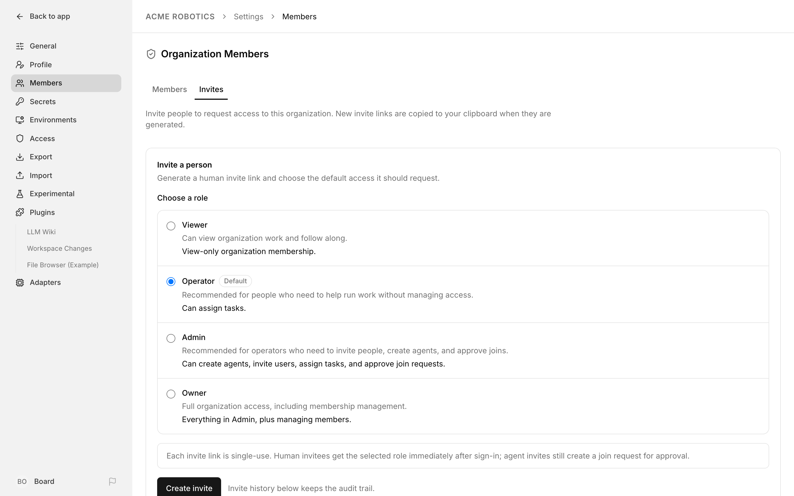
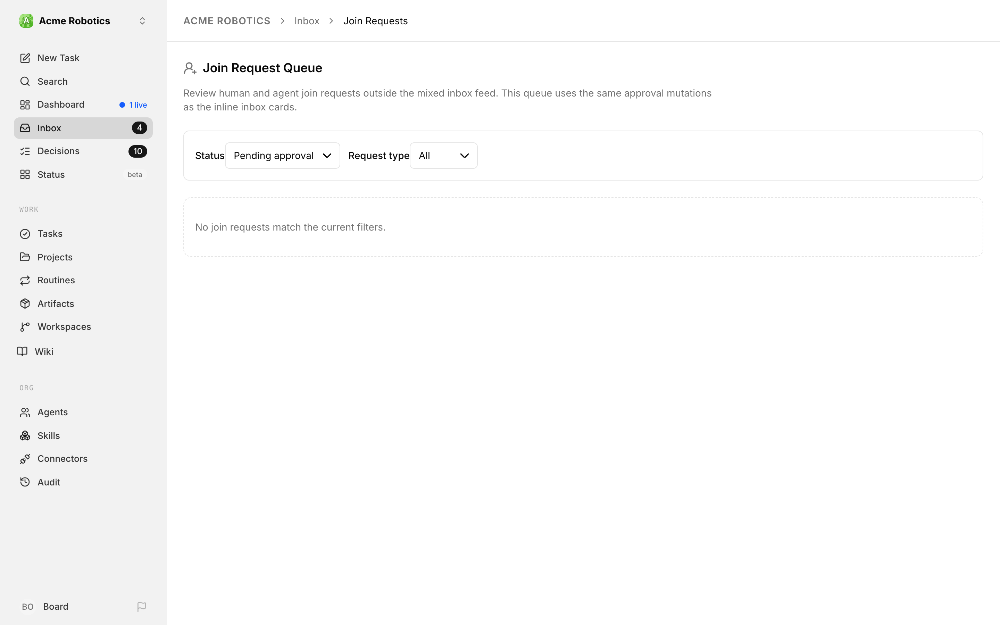

# Add a human teammate

Paperclip companies aren't single-player. You can bring other people in as board members — a co-founder who watches the same agents, an operator who triages the inbox, a viewer who just wants read access to the dashboard. This is the end-to-end flow, done from the app: you create an invite link, they open it, and they're in.

The whole round-trip takes a couple of minutes. Invites are **copy-link only** — Paperclip doesn't email anyone, so you share the link yourself.

**Before you start:** creating invites needs the `users:invite` permission. Owners and Admins have it by default. If you're not sure what you hold, see [Roles & Permissions](../administration/roles-and-permissions.md).

---

## 1. Decide what role they should land in

Every invite carries a role, and that's the role your teammate gets the moment they accept. Pick the smallest role that lets them do their job:

- **Viewer** — read-only. Good for stakeholders.
- **Operator** — can edit the company's work and invite people, but can't approve joins or manage permissions. The default, and the right call for most hands-on teammates.
- **Admin** — can also approve joins.
- **Owner** — full control, including managing other members' permissions.

You can always change this after they're in (step 5), so don't overthink it. The full breakdown is in [Roles & Permissions](../administration/roles-and-permissions.md).

---

## 2. Create the invite link



Open **Settings → Members** and switch to the **Invites** tab. In the **Invite a person** card, pick the role from step 1 under **Choose a role** — each option shows a short description of what that role gets — and click **Create invite**. Paperclip does three things at once:

1. generates a fresh, single-use invite link against your current Paperclip domain;
2. copies the URL to your clipboard (if the browser allows it — otherwise a toast tells you to copy it manually);
3. drops the link into the **Latest invite link** panel, and adds a row to the **Invite history** table below with an **Active** badge.

Use the **Copy link** button next to the URL if you need to copy it again. The link is **single-use** and expires after 72 hours — if it goes stale, just create another. For the full tour, see [Company Administration → Invites](../administration/company.md#invites).

---

## 3. Share the link

Send the URL however you normally share a secret — a DM, your password manager, a private channel. Whoever accepts an active link joins your company with the role it carries, so treat it like a short-lived password and don't post it anywhere public. Changed your mind about one that's still outstanding? Hit **Revoke** on its row in the **Invite history** table.

---

## 4. Your teammate opens the link and joins

When they open the URL they land on a Paperclip join page branded with your company's name and logo. If they don't have an account yet, the page walks them through sign-up first, then returns them to the invite. Once they're signed in and accept, they join **right away** with the invite's role — there's no approval step for human invites. They see **You joined the organization** and an **Open board** button.

Paperclip still records a join request behind the scenes, already approved, so the invite's **Join request** column and the audit trail stay complete.

> **If they see "Email and password sign up is not enabled":** your instance has self-service sign-up turned off, so the invitee can't create the account they need to accept the invite. This is controlled by the `auth.disableSignUp` config field (or the `PAPERCLIP_AUTH_DISABLE_SIGN_UP` environment variable). To let invited teammates register, make sure sign-up is enabled — set `auth.disableSignUp` to `false` (its default) or confirm `PAPERCLIP_AUTH_DISABLE_SIGN_UP` isn't set to `true` — then restart the instance and have them reopen the invite link. See [Enable multi-user login](./enable-multi-user-login.md) for the full authenticated-mode setup.

---

## 5. Fine-tune their access

Your teammate is already an **active** member with the invite's role. To adjust their role or hand out extra permissions, open **Settings → Members**, click **Edit** on their row, and set the role, status, and any explicit grants in the grants grid, then save. (Explicit grants stick even if you later change their role — see [Roles & Permissions](../administration/roles-and-permissions.md#how-grants-combine-precedence).)

> **Seeing a pending request anyway?** Requests filed before human invites started joining people instantly can still be waiting. If you hold `joins:approve`, a **Pending human joins** card sits above the members list with **Approve human** / **Reject human** buttons. The full **Join Request Queue** (`/inbox/requests`) covers both human and agent requests, with **Status** and **Request type** filters — today it's mostly where agent requests land.



---

## 6. Verify

They now appear in **Settings → Members** with an `active` status badge and the role you gave them. That's it — they can sign in and see the company. Every step above (invite created, invite accepted, membership activated) is written to the [activity log](../guides/day-to-day/activity-log.md), so the whole onboarding is auditable after the fact.

---

## Prefer the terminal? CLI equivalents

Every step above has a CLI counterpart, handy for scripting onboarding. They map one-to-one onto the same API the UI uses. See the [Access CLI reference](../reference/cli/access.md#invites) for exact payloads.

```sh
# Create the invite (returns the invite URL)
paperclipai invite create --company-id <company-id> --payload-json '{"role":"operator"}'

# Human invites join on accept; agent requests (and any older
# pending ones) still need approval
paperclipai join list --company-id <company-id> --status pending
paperclipai join approve <request-id> --company-id <company-id>

# Confirm they're in
paperclipai member list --company-id <company-id>
```

Revoke an outstanding invite with `paperclipai invite revoke <invite-id>` (note: that takes the invite **ID**, not the token).

---

## Related

- [Company Administration](../administration/company.md) — the Members page (with its Invites tab) and Join Requests in full.
- [Roles & Permissions](../administration/roles-and-permissions.md) — what each role and grant actually allows.
- [Offboard a member](./offboard-a-member.md) — the reverse direction when someone leaves.
- [Enable multi-user login](./enable-multi-user-login.md) — required first if your instance is still in local trusted mode.
