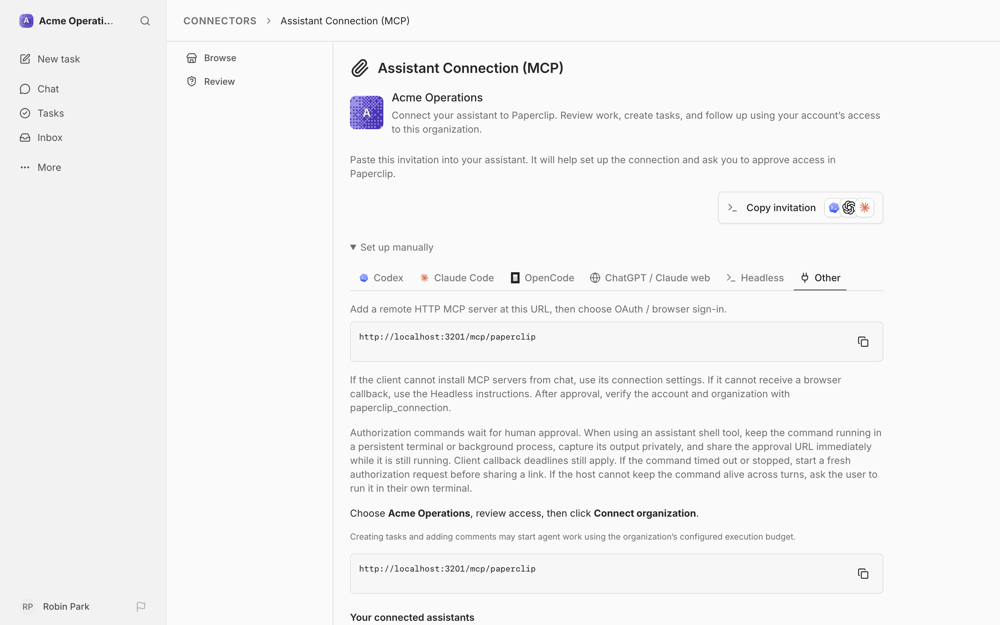
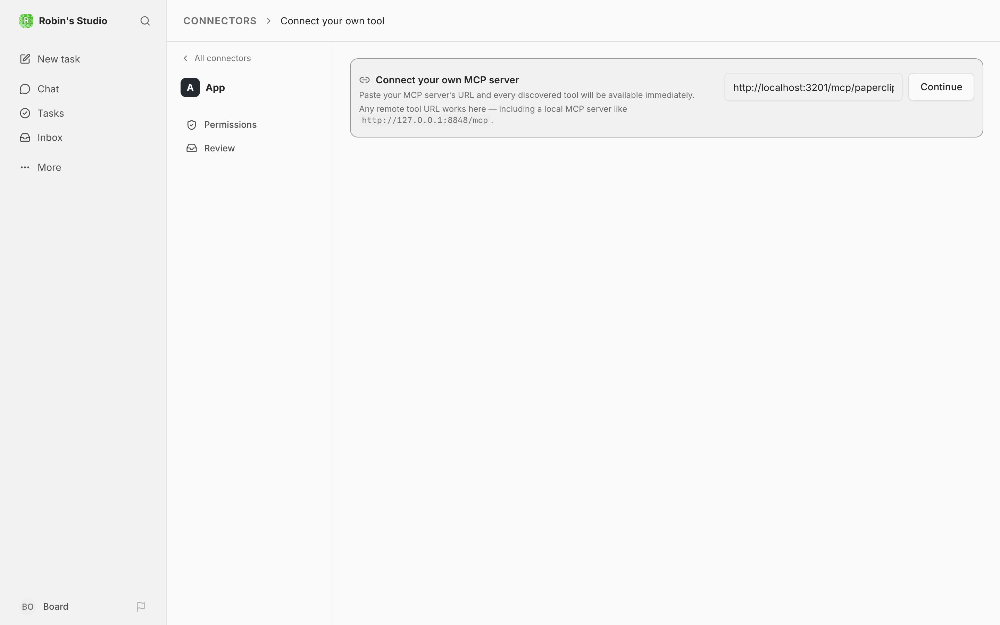
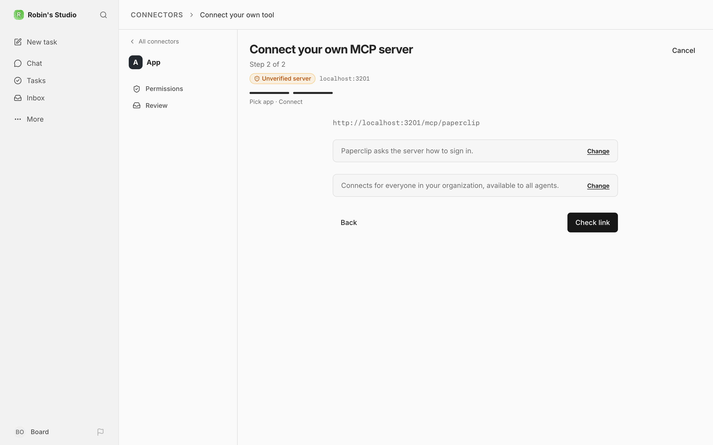
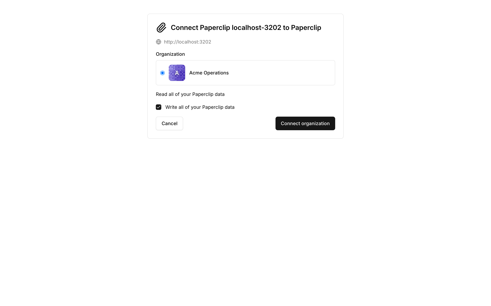
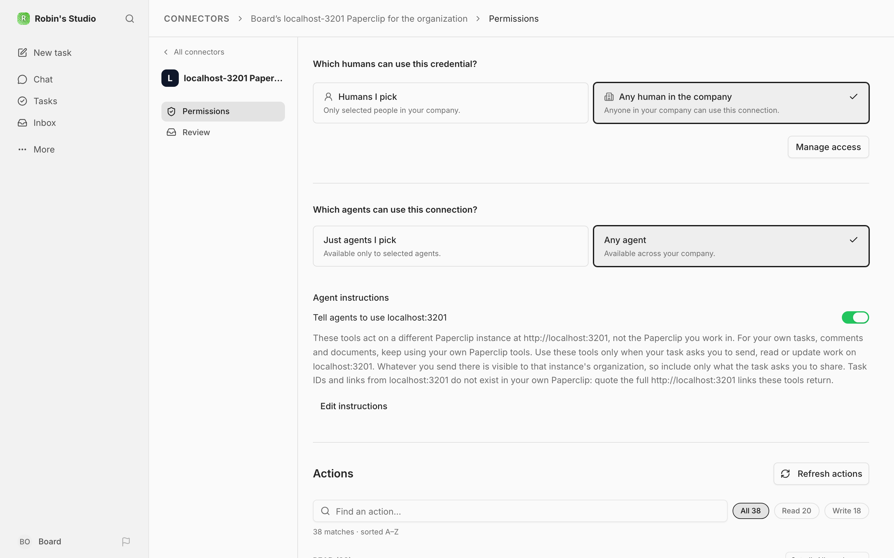
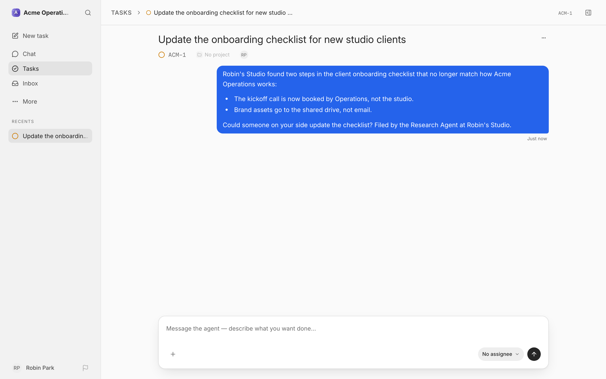

# Connect two Paperclip instances

Your agents can send work to another Paperclip instance — a colleague's, another team's — and follow it up there. You connect their instance to yours once, approve it with your account on their side, and from then on your agents can create tasks, comment and read results on their instance.

It takes about five minutes. There is no code, no API key to copy, and nothing to install.

In this walkthrough, **Robin's Studio** is your instance and **Acme Operations** is the colleague's instance you send work to.

---

## How it works

Every Paperclip instance serves an [assistant connection](../connectors/custom-mcp-servers.md) at `https://<their-host>/mcp/paperclip`. Your instance connects to that address like any other MCP server. You sign in on their instance as yourself, so everything your agents do there is done with your account and your access in their company — no more.

Paperclip recognizes that the address belongs to another Paperclip instance and sets the connection up so your agents can't confuse the two:

- The connection is named after that instance, and its tools carry that name, so an agent sees something like `acme-paperclip … paperclip_create_task`, never a bare `create_task` that looks like its own.
- Agents get standing instructions that these tools act on a different instance, and that their own work stays in their own Paperclip.

---

## Before you start

- **An account in their company.** You need an account on their instance that is a member of the company you'll send work to, with permission to create tasks. Ask its owner to [add you as a teammate](./add-a-human-teammate.md).
- **A reachable address.** Your instance must be able to reach theirs over HTTPS — for example, two Paperclip Cloud workspaces, or a self-hosted instance with a public address. Two instances on separate laptops can't reach each other.
- **A recent Paperclip.** Both instances need a release newer than `v2026.1106.0`.

---

## 1. Copy their instance's address

On **their** instance, open **Connectors**, select **Assistant Connection (MCP)**, then open **Set up manually** and choose **Other**. Copy the address shown there.

If you already know their host, the address is always `https://<their-host>/mcp/paperclip`.



---

## 2. Paste it into your instance

On **your** instance, open **Connectors** and select **Connect your own MCP server**. Paste the address and select **Continue**.



---

## 3. Choose who can use it, then check the link

Paperclip shows the address, an **Unverified server** label with the host, and two choices:

- **Sign-in.** Leave *"Paperclip asks the server how to sign in."* as it is. Paperclip uses browser sign-in on their instance.
- **Who it's for.** By default the connection is for everyone in your organization and every agent can use it. Select **Change** to make it **Just me** instead, or to limit it later to the agents you pick.

Select **Check link**.



> **Your own address is refused.** If you paste your own instance's address, Paperclip stops with *"That address is this Paperclip. Your agents already have its tools, so there is nothing to connect."*

---

## 4. Approve the connection on their instance

A sign-in window opens on **their** instance. Sign in with your account there if you aren't already. The page names the instance asking for access and its address.

1. Under **Organization**, choose the company you'll send work to.
2. Leave **Write all of your Paperclip data** checked, so your agents can create tasks and comment. Without it, they can only read.
3. Select **Connect organization**.



If your browser blocks the window, select **Open sign-in in a new tab** on your instance instead.

The window closes and you land on the new connection in your instance.

---

## 5. Check the connection

The connection's **Permissions** page shows who can use it and what it can do:

- **Agent instructions** are already filled in and switched on. They tell agents that these tools act on the other instance, to keep their own work in their own Paperclip, to share only what the task asks for, and to quote the other instance's full links. Select **Edit instructions** to add your own rules, such as *"Only file bugs here."*
- **Actions** lists everything the connection can do on their instance — read tasks and agents, create and update tasks, comment, and more. All of them start on. Switch off any you don't want agents to use, or set them to **Ask first**.



---

## 6. Send work to their instance

Ask one of your agents to do it, in plain words, and name the other instance:

```prompt
File a task on Acme Operations' Paperclip asking them to update the client onboarding checklist. Leave it unassigned.
```

When you create the task, choose who gets it:

| Assign it to | What happens on their instance |
|---|---|
| **No one** | The task waits unassigned for their team to pick up. Nothing starts. |
| **A person** | The task goes to that member. Agents can look people up with `paperclip_list_people`. Nothing starts automatically. |
| **One of their agents** | That agent starts working on it, using **their** company's budget. Only do this when they've agreed to it. |

The task appears on their instance like any other. It is created by your account there, and your agent gets back a link to it on their instance.



Your agents can come back to it later — read its comments and status, reply, or close it — using the same connection.

---

## Good to know

- **Removing access.** On their instance, open **Assistant Connection (MCP)**; your connection is listed under **Your connected assistants**, where you can revoke it. On your instance, remove the connection from **Connectors**.
- **Staying signed in.** The connection renews its access by itself. If it ever needs a fresh sign-in, it shows **Reconnect** on your instance.
- **Renaming is safe.** You can rename the connection. Its tool names don't change, so agents, saved rules and pending approvals keep working.
- **Use Connect your own MCP server.** If you paste a Paperclip address into another connector, such as Executor, Paperclip asks you to use **Connect your own MCP server** instead, so the naming and instructions above are set up.
- **Several instances.** Repeat these steps for each one. Each connection carries its own instance's name and instructions.

---

## Related

- [Connect a custom MCP server](../connectors/custom-mcp-servers.md) — the general flow this page uses.
- [Connection instructions](../connectors/connection-instructions.md) — how standing instructions reach agents.
- [Add a human teammate](./add-a-human-teammate.md) — how the other instance's owner adds you to their company.
