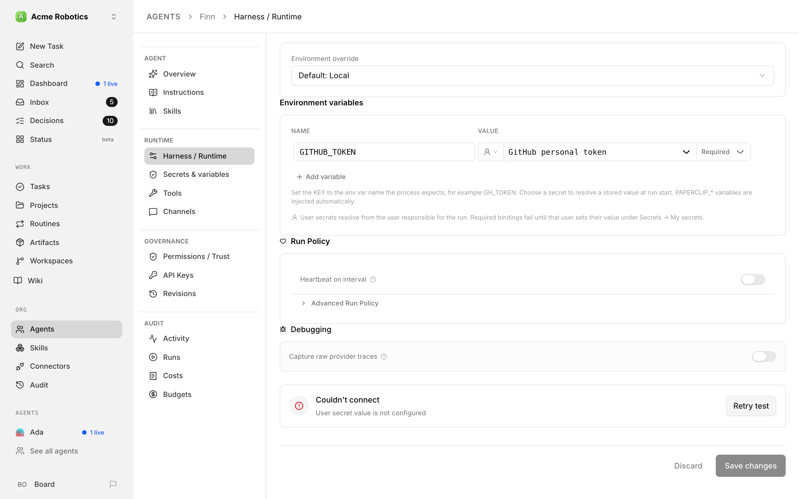

# Update or rotate a provider API key

You already have an agent running, and the API key it uses needs to change — maybe the provider rotated it, maybe it expired, maybe you moved from a subscription login (like Claude.ai) to a console-issued key and the old credential stopped working. This guide walks you through swapping the key in place, without rebuilding the agent.

If you're setting up an agent for the first time, follow [Hire Your First Agent](../guides/getting-started/your-first-agent.md) instead — that guide covers creating the key and wiring it from scratch.

---

## Two ways to store an API key

Paperclip lets you bind a provider key into an agent's `adapterConfig.env` in one of two shapes. Knowing which one you used decides where you change the value.

| Storage shape | What it looks like | Where you rotate it |
|---|---|---|
| **Text value** | The key is pasted directly into a row of the agent's **Environment variables** card. | On the agent itself — paste the new value into the row and save. |
| **Organization secret** | The agent's env-var row points at a secret in Paperclip's secret store, usually on the `latest` version. | In **Company Settings → Secrets** — rotate the secret once, and every agent bound to its `latest` version picks up the new value. |

> **Tip:** If you have more than one agent on the same provider, store the key as an organization secret. Rotation becomes a single edit instead of one trip per agent.

---

## Path A — Rotate on the agent (text value)

Use this when the key was pasted directly into the agent's environment variables.

1. Open **Agents → {agent}** and choose **Secrets & variables** in the agent's sidebar.
2. In the **Environment variables** card, find the row for the provider's key (for example `ANTHROPIC_API_KEY`). A text value row shows a text icon in its **Value source** switch at the left of the value field.
3. Replace the value with the new key.
4. Click **Save changes** in the bar at the bottom of the page.
5. Choose **Harness / Runtime** in the sidebar and click **Run test** in the **Test your agent** card. The test runs the adapter's checks on your runtime, and for many adapters also sends the model a short prompt; **Connection successful** means the checks passed.

Your agent's next run picks up the new value. No restart needed.

> **Tip:** When a value looks like a credential, the row offers **Store as secret**. Click it, name the secret, and click **Store & bind** to move the key into the secret store and bind the row to it in one step, so your next rotation can use Path B.
>
> If a secret with that name already exists, the popover tells you so and offers choices instead of a dead end. **Use existing secret** binds the row to that secret as it is. **Save as new version** saves your new key as the secret's next version and binds the row to it, which rotates the secret in the same step. It only appears when the existing secret is active and stored in Paperclip, not referenced from an external store. Or type a different name and click **Store & bind**.



> **Warning:** Text values are stored on the agent record. If you're running with `PAPERCLIP_SECRETS_STRICT_MODE=true`, the server rejects a non-empty text value for any env key whose name matches a sensitive-keyword pattern (`api_key`, `access_token`, `auth`, `authorization`, `bearer`, `secret`, `passwd`, `password`, `credential`, `jwt`, `private_key`, `cookie`, `connectionstring`). Either turn strict mode off temporarily, or use Path B.

---

## Path B — Rotate the secret (organization secret)

Use this when the key's row on the agent's **Secrets & variables** page shows a key icon in its **Value source** switch and a secret name in the value field. In the agent's config, the entry looks like:

```json
{
  "env": {
    "ANTHROPIC_API_KEY": {
      "type": "secret_ref",
      "secretId": "8f884973-c29b-44e4-8ea3-6413437f8081",
      "version": "latest"
    }
  }
}
```

1. Open **Company Settings → Secrets**.
2. Find the secret the agent is referencing — it's usually named after the provider (`anthropic-key`, `openai-key`, etc.). Type part of the name into **Search all secrets** if the list is long. A key Paperclip saved for you when you connected a model account sits under **Managed by Paperclip** at the bottom of the list, in the **Model sign-ins** group, where it's shown as **Model provider key**.
3. Click the secret to open its detail panel. The **Agents that can use it** section shows which agents receive it.
4. Click **Replace value**, paste the new key into **New value**, and click **Save new value**. Paperclip stores it as a new version and bumps `latestVersion`; the old value is kept as an earlier version.
5. Open the agent, choose **Harness / Runtime**, and click **Run test** in the **Test your agent** card to confirm the new value works.

Every agent that references this secret with `version: "latest"` now resolves to the new value on its next run. Agents pinned to a numeric version (`"version": 3`, shown as a `v3` tag on the row) stay on that historical value until you re-point them — click the version tag on the row and choose **latest**.

> **Note:** Every rotation creates a new version automatically — there is no "edit value in place" option. The old version is still resolvable by any binding that pinned it; new bindings and `latest` consumers move forward.

---

## Per-provider notes

Most providers follow the same shape — generate a new key in the provider's console, copy it once (most consoles show the key only on creation), then drop it into Path A or Path B above. The differences are the env-var name and the key format.

<!-- tabs: Anthropic (Claude), OpenAI, Google (Gemini), xAI (Grok), Cursor, OpenCode -->

<!-- tab: Anthropic (Claude) -->

**Env var:** `ANTHROPIC_API_KEY`
**Key prefix:** `sk-ant-`
**Console:** [console.anthropic.com](https://console.anthropic.com) → **API Keys** → **Create Key**

> **Info:** Moving from a Claude.ai subscription login to a console API key? That's the most common reason this doc gets opened. Older builds of `claude_local` accepted Claude Code's subscription auth; newer ones require an explicit `ANTHROPIC_API_KEY` from [console.anthropic.com](https://console.anthropic.com). Generate a console key, store it via Path A or Path B, and the adapter will start using it instead of the subscription session.

The `claude_local` adapter can also authenticate through Bedrock settings or Claude Code's own login state. If you switch to one of those, clear the `ANTHROPIC_API_KEY` entry rather than leaving an old value in place. See [Claude Code](../reference/adapters/claude-code.md).

<!-- tab: OpenAI -->

**Env var:** `OPENAI_API_KEY`
**Key prefix:** `sk-`
**Console:** [platform.openai.com](https://platform.openai.com) → profile menu → **API keys** → **Create new secret key**

Used by `codex_local` and by `opencode_local` when the configured model is an OpenAI one. Codex's own CLI login state also satisfies the adapter — if you've run `codex login`, you can leave `OPENAI_API_KEY` unset.

<!-- tab: Google (Gemini) -->

**Env vars:** `GEMINI_API_KEY` or `GOOGLE_API_KEY` (either is accepted)
**Console:** [aistudio.google.com](https://aistudio.google.com) → **Get API key**

Used by `gemini_local`. The adapter also accepts Google account login or Gemini CLI auth, so on a developer machine you may not need the key at all. See [Gemini CLI](../reference/adapters/gemini-cli.md).

> **Note:** On the default ACP engine, the test checks that the Gemini ACP command resolves and whether `GEMINI_API_KEY` or `GOOGLE_API_KEY` is set, but it sends no prompt, so a passing test doesn't prove the new key is accepted. With the adapter's engine set to `cli`, the test also asks the model to respond with hello, and reports an over-quota account or key, or an auth error if the probe is rejected. On the CLI engine, if the adapter's command is not `gemini`, the hello probe is skipped.

<!-- tab: xAI (Grok) -->

**Env var:** `XAI_API_KEY`
**Console:** [console.x.ai](https://console.x.ai) → **API Keys**

Used by `grok_local`. Treat it the same as the other provider keys — generate, store as an organization secret, bind into the agent's environment variables. See [Grok Local](../reference/adapters/grok-local.md).

<!-- tab: Cursor -->

**Local (`cursor`):** No API key field. The local adapter uses Cursor Agent CLI's own login session — re-authenticate by running `cursor login` from a terminal on the host. No Paperclip change is needed.

**Cloud (`cursor_cloud`):** Env var `CURSOR_API_KEY`. Rotate via Path A or Path B; generate the key from your Cursor account settings. See [Cursor Cloud](../reference/adapters/cursor-cloud.md).

<!-- tab: OpenCode -->

`opencode_local` is a multi-provider runtime. The key you rotate is the one that matches the `provider/model` configured on the adapter:

- `anthropic/...` → `ANTHROPIC_API_KEY`
- `openai/...` → `OPENAI_API_KEY`
- `google/...` → `GEMINI_API_KEY` or `GOOGLE_API_KEY`
- `xai/...` → `XAI_API_KEY`

If the agent uses two providers (for example a model and an embedding provider), rotate both. See [OpenCode](../reference/adapters/opencode.md).

<!-- /tabs -->

---

## Verify the new key works

1. Open the agent, choose **Harness / Runtime**, and click **Run test** in the **Test your agent** card. The test runs the adapter's checks on your runtime, and for many adapters also sends the model a short prompt; **Connection successful** means it passed, while **Couldn't connect** or **Connection needs attention** lists the checks to review.
2. Trigger a heartbeat — either toggle heartbeats on and wait for the next tick, or assign a small task to the agent. Watch the run log for a successful first turn.
3. If you rotated a shared secret, repeat the check on a second agent that references it so you know the rotation flowed through.

---

## Troubleshooting

**"I added a new secret but the agent still 401s"** — Creating a secret in **Company Settings → Secrets** does *not* auto-rewire existing agents. The agent is still using whatever was wired into its `ANTHROPIC_API_KEY` (or equivalent) env-var row when you last saved it. Open the agent → **Secrets & variables** → **Environment variables**. If the row already points at a secret, click the secret name in the value field and pick the new one. If it holds a text value, clear the value first, then open the row's **Value source** switch and choose **Organization secret** and pick the new secret from **Select secret…** (with a value still in the field, that choice opens **Store value as secret** instead). Click **Save changes**. Then run the test from **Harness / Runtime**. If the row was set to **Text value** with the old key, that text value is what the agent keeps using, whatever new secret you create elsewhere — switching the row to **Organization secret** is the fix.

**A 401 from the provider after a rotation** — The provider (not Paperclip) is rejecting the credential, which means the request reached them with *some* key. Two common causes: (1) the key value itself is wrong — whitespace pasted around it, copied from the wrong account/workspace, or the new console account hasn't been funded yet; (2) the agent picked up an old text value rather than the rotated secret. Re-copy the key from the provider console, paste it as a text value temporarily to isolate which side is wrong, then move it back to an organization secret once the test passes.

**"API key invalid"** — Compare the env-var *name* against the provider's expected name (`ANTHROPIC_API_KEY`, not `ANTHROPIC_KEY`). Check the key prefix matches what the provider issues (`sk-ant-`, `sk-`, etc.). Whitespace pasted in front of or after the key is a common culprit.

**Strict mode rejects the text value** — You're running with `PAPERCLIP_SECRETS_STRICT_MODE=true`, and the server rejects the save with `Strict secret mode requires secret references for sensitive key: <KEY>`. Use Path B (organization secret) instead. See [Secrets](../reference/deploy/secrets.md).

**The old subscription login keeps being used** — Claude Code, Codex CLI, and Gemini CLI each cache their own login state outside Paperclip. If you intend the API key to take precedence, log out of the CLI (`claude logout`, `codex logout`, etc.) on the host so the adapter falls back to the env var.

**Multiple agents still failing** — If you rotated a secret and only some agents picked up the new value, check the failing ones' env binding. Agents pinned to a specific version (`"version": 3`, a `v3` tag on the row) don't follow `latest`; re-point them to **latest** or update the binding.

---

## Related

- [Agent Adapters](../guides/org/agent-adapters.md) — full configuration reference for each adapter.
- [Secrets](../reference/deploy/secrets.md) — how the secret store works and how strict mode behaves.
- [Hire Your First Agent](../guides/getting-started/your-first-agent.md) — first-time setup, including generating an API key.
